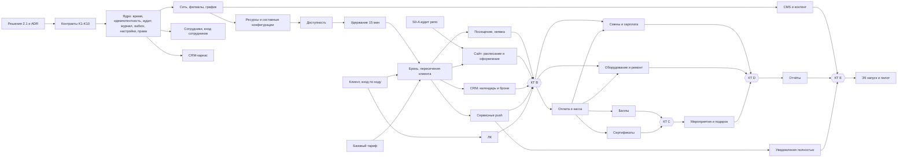

# План разработки yu-club

Версия 2 от 01.11.2026 (внесены решения владельца от 01.11). Автор – техлид проекта. Источник: `tz/01…20`, разборы `docs/razbor/*.md`.
Ссылки «18 §5.2» – файл ТЗ и пункт. «R-xx» – риск из реестра 20 §6. «N-xx» – новый блокер, которого в реестре 20 нет.
Сводный список вопросов – `docs/voprosy-zakazchiku.md` (Q-xx).

Статус плана: **02.11.2026, 13:40 – этапы 0, 1 и 2 готовы (Э2 – без прогона на стенде: сервер Beget недоступен); работа на паузе по решению владельца, отчёт – на странице плана.** Хостинг – наш Beget (N-01, частично), доступ к репо заказчика не получен (N-03).

### Решения владельца от 01.11.2026

| ID | Решение | Что остаётся открытым |
|---|---|---|
| N-01 / Q-90 | Решено 01.11: пока размещаем на нашем VPS Beget (45.12.72.227, адрес стенда yu-club.45.12.72.227.nip.io), потом переносим на сервер клиента. Сервер Beget в РФ | тексты согласия и политики ПДн, оператор ПДн – от юриста заказчика |
| N-03 / Q-89 | Владелец говорит, доступ выдан; на 01.11 аккаунт tema-mail репозиторий не видит (404, приглашения нет) – проверить, на какой логин отправлено | вопрос о «дополнениях» 19 §6 |
| остальные | открыты; работаем по умолчаниям плана, решения пишем в реестр со статусом «принято по умолчанию» | ответы заказчика |

---

## 1. Что строим и границы

Одна система для сети компьютерных клубов «Ю-Клуб» (мультигород, несколько филиалов в городе):
- **публичный сайт** – филиалы, зоны ПК/VR/PS, комнаты, каталог игр, новости/акции/розыгрыши, страница дня рождения, онлайн-запись (12, 19);
- **личный кабинет клиента** – вход по коду, записи, посещения, баллы, сертификаты, настройки уведомлений (03);
- **CRM/админка** – Владелец, Директор, Администратор: расписание и брони, клиенты, касса, лояльность, сертификаты, смены и зарплата, оборудование и ремонт, мероприятия, уведомления, контент, отчёты, настройки (13, 04–15);
- **фоновые процессы** – истечение удержаний, напоминания, сгорание сертификатов, бэкапы.

**Не делаем** (по ТЗ):
- эквайринг, онлайн-оплату, банковские интеграции, ККТ/ОФД, бухгалтерию – деньги вносятся вручную (06 §9, 20 §4.11, 13 §2.6); система «не заменяет фискализацию» (06 §2.7);
- SMS/email/мессенджеры как каналы уведомлений – только push (09 §2, §15); SMS допускается только как канал кода входа, если его выберут (03 §5.1);
- интеграцию с ПО управления ПК в клубе, внешние календари (01 §18), кадровый документооборот, налоги, СКУД (05 §2);
- QR/штрихкоды, склад запчастей, ТО по календарю (10 §16), онлайн-заказ праздников с оплатой (11 §12);
- мобильное приложение – в ТЗ его нет, клиент работает через веб (вывод по 09, 12, 19);
- приём заявок на розыгрыши и выбор победителя (12 §8.4).

**Делаем, хотя в ТЗ не до конца:** вход клиента и ЛК в MVP (03 §18, в 18 их нет), сервисные уведомления в MVP (01 §18 п.13), бэкапы с этапа 0 (17 §21, в 18 – только этап 5).

---

## 2. Блокеры до старта

Правило 20 §6: открытый вопрос блокирует только свою ветку, но спорную логику по догадке не делаем. Ниже – что не даёт начать конкретный этап. Если заказчик молчит 5 рабочих дней, работаем по умолчанию и пишем решение в реестр 20 §11 со статусом «принято по умолчанию».

### 2.1. Блокируют этап 0

| ID | Решение | Что блокирует | Моё предложение по умолчанию | Статус |
|---|---|---|---|---|
| N-01 | Хостинг и 152-ФЗ: где живут ПДн, кто оператор, согласие, уведомление РКН. **Вывод плана, не пункт ТЗ:** закон в ТЗ не назван ни разу (grep «152» – пусто); в ТЗ есть только открытые вопросы 17 §21 п.1 (площадка) и п.15 (юридические требования к ПДн) | выбор площадки, состав форм, тест-стенд с реальными данными | VPS в РФ (Beget/Selectel), БД и бэкапы в РФ; согласие на обработку – отдельная галочка, по умолчанию пустая; тексты политики и согласия даёт юрист заказчика до Э5 | **решено 01.11** (хостинг Beget); тексты ПДн – открыто |
| N-02 | Кто утверждает стек и архитектуру (20 §13: «готовит команда разработки») | ADR и каркас | утверждаю я как техлид по разделу 3.5; заказчику – на чтение | открыт, работаем по умолчанию |
| N-03 | Доступ к репозиторию `AndreikinRoman/yu-club` и фиксированный commit (R-22) | аудит фронта, шаги сайта в Э1 | дают доступ на чтение; базой считаем `main` на дату доступа | **в работе**: доступ не подтверждён (404) |
| N-04 | Единый план этапов вместо локальных нумераций 01–17 и 18 (Q-01) | планирование, приёмка этапов | принять этот документ главным; профильные «Этап N» в 01–17 читать через таблицу 4.2 | открыт, работаем по умолчанию |
| N-05 | Вход сотрудников и 2FA (04 §3.1, 17 §21 п.11) | S0-09 | почта + пароль (argon2id), TOTP по желанию для Владельца и Директоров, не обязателен | открыт, работаем по умолчанию |
| R-21 | Пилотный филиал и состав первой очереди | тестовые данные, объём MVP | один филиал, в первой очереди этапы 0–2; этапы 3–4 включаются вторым релизом | открыт, работаем по умолчанию |
| R-14 | Права по финансам, блокировкам, ставкам, штрафам, объединению клиентов (20 §6, «до выдачи рабочих доступов») | S0-10 (набор действий в матрице прав); часть по ставкам и штрафам – Э3 | финансы: Администратор – оплаты сеансов и расходы своего филиала, корректировки и возвраты – Директор и Владелец; блокировка ресурса – Администратор по праву; ставки – Владелец, штрафы – Директор с причиной; объединение клиентов – Владелец | открыт, работаем по умолчанию |
| N-06 | Делегирование прав (04 §9) в 04 отнесено к этапам 3–5, а матрица 04 §5 полна оговорок «если разрешено» (Директор: филиалы, Администраторы, ресурсы, смены; Администратор: блокировки). По правилу «неуказанное = запрещено» без делегирования эти права нечем выдать | S0-10 | до Э3 – фиксированный набор: Директор в своей зоне может всё по матрице 04 §5, кроме: назначать директоров, менять свою зону, финкорректировок, экспорта ПДн; назначать Администраторов – да. Делегирование с датами – Э3.4 | открыт, работаем по умолчанию |

### 2.2. Блокируют этап 1

| ID | Решение | Что блокирует | Предложение по умолчанию | Статус |
|---|---|---|---|---|
| R-01 | Модель VR1/VR2/комната целиком/PS4 | S1-02 и всё бронирование VR | атомарные единицы VR1, VR2, PS4; бронь VR-места занимает свою единицу; аренда комнаты занимает все три; PS4 отдельно не продаётся; конфликт проверяет БД (раздел 3.3) | открыт, работаем по умолчанию |
| R-02 | 15/30 мин – шаг сетки, минимум или оба | S1-05, S1-14 | оба: длительность кратна шагу и не меньше одного шага; максимум не ограничен до решения (01 §17) | открыт, работаем по умолчанию |
| R-18 | Канал входа клиента | S1-12, ЛК | телефон + одноразовый код по SMS через адаптер провайдера; соцвход (Яндекс/VK/MAX) – после запуска | открыт, работаем по умолчанию |
| Q-07 | Статусы брони целиком (документа «Посещения, неявки и штрафы» нет) | S1-07, S1-10 | Подтверждена → Пришёл → Завершена; Неявка; Отменена клиентом; Отменена клубом; Перенесена (старая версия) | открыт, работаем по умолчанию |
| R-08, R-16 | Момент неявки и автозакрытие сеанса | автоматика S1-10 | только ручная отметка; запись без отметки висит в списке «требует решения» | открыт, работаем по умолчанию |
| R-12 | Отмена/перенос клиентом | клиентская отмена в ЛК | в MVP отмена клиентом без возврата денег (денег при брони нет – 18 §2), перенос – только админом | открыт, работаем по умолчанию |
| R-17 | Напоминание при записи после 21:00 накануне | S1-15 | не отправлять «накануне», отправить только «за 15 мин» (как 09 §6.1) | открыт, работаем по умолчанию |
| Q-30 | Push – web push или приложение | S1-15, S1-16 | web push (VAPID) из браузера; без разрешения – только запись в ЛК | открыт, работаем по умолчанию |
| Q-06 | Кто рисует дизайн CRM (в макете CRM нет, 19 §5) | экраны CRM | мы, на дизайн-системе макета, без отдельного дизайнера | открыт, работаем по умолчанию |

### 2.3. Блокируют этап 2 и дальше (не мешают старту)

R-03 (остаток сертификата меньше цены), R-04 (что такое «один сеанс»), R-05, R-06, R-07, R-13, момент оплаты (Q-20), касса одна или по способам (Q-22) – этап 2. R-09, R-10, R-11, R-14 (часть по ставкам и штрафам), R-15 – этап 3. R-19, R-20 – этап 5. Предложения по умолчанию – в `voprosy-zakazchiku.md`.

---

## 3. Архитектура

### 3.1. Принципы (из ТЗ, обязательны для всех модулей)

1. Источник истины – сервер. Экран не считает остатки, статусы, доступность и роли (20 §3, D-21).
2. Первичные факты не дублируются: бронь, посещение, финоперация, операция баллов, операция сертификата – отдельные записи (16 §1).
3. Ничего значимого не удаляется: архив вместо удаления, сторно вместо правки (02 §12, 06 §4.4, 16 §2.7).
4. Каждая операция привязана к филиалу и проверяет право на сервере (04 §2.9, 17 §7.2, запрет IDOR).
5. Повтор команды не создаёт дубль (16 §2.2, §15.2).
6. Основная операция не откатывается из-за сбоя вторичной (уведомления, отчёты) – 16 §2.6, §15.3.
7. Время – по часовому поясу филиала, хранение в UTC (01 §4, 09 §13).

### 3.2. Модули (контексты) – модульный монолит

| Контекст | ТЗ | Владеет данными | Наружу отдаёт |
|---|---|---|---|
| **core** – ядро | 04, 15, 16, 17 | журнал операций, аудит, настройки, права, идемпотентность, outbox, время филиала | библиотечные функции, не API |
| network – сеть | 02, 15 §5 | города, филиалы, график, исключения | справочник филиалов |
| resources – ресурсы | 02, 15 §8 | помещения, комнаты, ресурсы, составные конфигурации, единицы занятости | множество конфликтов ресурса |
| staff – сотрудники | 04, 05 | сотрудники, назначения, вход сотрудников | субъект прав |
| booking – брони | 01, 16 §3–6, §9 | удержания, брони и версии, занятость, блокировки, посещения, неявки | события брони, API доступности |
| clients – клиенты | 03 | карточка, контакты, вход клиента, согласия, слияния | клиент, сессия ЛК |
| pricing – тарифы | 15 §9 | тарифы, акции | цена на момент брони |
| notifications | 09 | подписки push, плановые и отправленные уведомления, категории | – |
| finance – касса | 06 | кассы, финоперации, категории | поступления и расходы |
| loyalty – баллы | 07 | счёт, партии, резервы, товары за баллы | баланс, право записи |
| certificates | 08 | сертификаты, погашения, сгорание | остаток |
| shifts – смены и зарплата | 05 | смены, ставки, штрафы, расчёты | – |
| equipment – оборудование | 10 | единицы, перемещения, ремонты, исполнители, гарантии | статус для доступности |
| events – мероприятия | 11 | мероприятия, состав, подарки имениннику | – |
| content – CMS | 12 | игры, публикации, медиа, блоки главной | публичный контент |
| reports – отчёты | 14 | только чтение и задачи экспорта | – |

Модули общаются вызовами функций внутри процесса и событиями через outbox. Чужие таблицы напрямую не пишут.

### 3.3. Общее ядро

**Журнал операций со сторно (ledger).** Один механизм для денег, баллов, остатков сертификатов, штрафов сотрудников (вывод разбора 05–08). Запись: счёт (касса филиала / бонусный счёт клиента / сертификат / расчёт сотрудника), единица (копейки / баллы с точностью 0,01), сумма со знаком, тип, основание, ссылки (бронь, сеанс, мероприятие, ремонт), филиал, автор, `reversal_of`, ключ идемпотентности. Таблица только на вставку; баланс = сумма записей (или проверяемый снимок); сторно – новая запись со ссылкой, двойное сторно запрещено ограничением. Партии баллов (07 §3.2) – отдельная таблица поверх журнала.

**Аудит.** Одно определение – 04 §11.2 (время, пользователь или системный процесс, роль и зона на момент действия, действие, объект, филиал, до/после, результат, причина, источник). Права БД: роль приложения без UPDATE/DELETE. Секреты маскируются до записи (04 §11.2). Хронология объекта (16 §16) – выборка из аудита в пределах прав.

**Настройки с наследованием и датами действия (15 §3).** Значение: ключ, уровень (система/сеть/город/филиал), объект уровня, значение, `valid_from`, `valid_to`, автор, причина. Чтение `resolve(key, branchId, at)`: филиал → город → сеть → система, с учётом даты. Изменение не трогает созданные операции: операции хранят **снимок** нужных значений (цена, срок, состав конфигурации) – 15 §3.4, 02 §8.4. Просмотр истории настроек на дату – этап 3 (15 §21), снимки – с этапа 1.

**Права роль × зона × действие (04, 17 §7).** Роль (Владелец/Директор/Администратор) + назначения (сеть / город / группа городов / филиал / несколько филиалов, с датами) + явные права на действие. Функции: `can(actor, action, branchId)` – на каждую команду; `scopeFilter(actor, action)` – условие для каждого списка и поиска (поиск не раскрывает факт существования чужих объектов, 13 §7.1). Неуказанное право – запрещено. Делегирование с датами – этап 3; до него – фиксированный набор по N-06.

**Время филиала.** Хранение `timestamptz` в UTC, у филиала IANA-зона. Функции: локальная дата → интервал UTC, «21:00 накануне по филиалу», границы суток для отчётов. Интервалы полуоткрытые `[начало, конец)` (01 §3). Смена зоны филиала не сдвигает прошлые события (02 §6.4). Ночные смены через полночь не поддерживаем (01 §4.1).

**Идемпотентность и outbox.** Каждая критичная команда (удержание, подтверждение, отмена, оплата, погашение, баллы, отправка) принимает ключ; повтор с тем же ключом отдаёт прежний результат, с другим телом – конфликт. События пишутся в outbox в той же транзакции, обработчики (напоминания, начисления, внутренние события CRM) – идемпотентны по ключу события, с повтором.

**Защита от двойной брони – на уровне БД.** Таблица занятости: (единица ресурса, интервал `tstzrange`, источник: удержание/бронь/мероприятие, активность). Ограничение `EXCLUDE USING gist (unit_id WITH =, period WITH &&) WHERE (active)`. Аренда комнаты пишет строки на все единицы комнаты, место VR – на свою; поэтому TC-01…TC-03 гарантирует база, а не код. Второе ограничение – пересечения броней одного клиента по всей сети (01 §9, 15 §7.4): `EXCLUDE (client_id WITH =, period WITH &&)` по активным броням и удержаниям клиента. Блокировки ресурсов – отдельная таблица (могут ложиться поверх существующих броней и формировать список затронутых, 01 §13).

### 3.4. Модель данных верхнего уровня

```
Сеть → Город(tz по умолчанию) → Филиал(tz, статус, график, исключения)
  Филиал → Помещение → Комната → Ресурс(тип, шаг) → Единица занятости
  Составная конфигурация(основной ресурс, входящие единицы, период) → снимок в брони
  Единица оборудования ↔ Ресурс (N:M), перемещения, ремонтные события, гарантии
Клиент(один на сеть) → контакты, согласия, сессии, слияния
  Удержание(15 мин, общий таймер) → Бронь(версии) → Занятость
  Бронь → Посещение | Неявка ; Бронь → Сеанс оплаты(R-04) → ровно один Платёж
Журнал операций: касса филиала | бонусный счёт(+партии, резервы) | сертификат | расчёт сотрудника
Сотрудник → роль, назначения(с датами), права, смены, ставки(с датами), штрафы, расчёты
Мероприятие → строки состава, поступления/расходы (ссылки в журнал), подарок имениннику
Уведомление(категория, плановое время, статус) ← подписка push клиента
Контент: игра(направление, доступность по филиалам), публикация(охват сеть/город/филиал), медиа
Аудит, настройки, системные статусы и причины (15 §16), outbox, ключи идемпотентности
```

Деньги – целые копейки. Баллы – `numeric(12,2)` (2,5 балла за 15 мин, 07 §3.3; правило округления – R-06/Q-41).

### 3.5. Рекомендация стека (не факт ТЗ, решение техлида; записать ADR в S0-00)

| Слой | Выбор | Причина |
|---|---|---|
| БД | **PostgreSQL 16** | `EXCLUDE` по интервалам закрывает гонку за слот и составные ресурсы в самой базе (17 §10); транзакции для журнала; `timestamptz` и зоны; одна база вместо БД + Redis |
| Бэкенд | **TypeScript на Node 26 (встроенный Temporal), Fastify, SQL через Kysely, миграции чистым SQL** | один язык с фронтом, общие схемы контрактов (Zod → OpenAPI); Kysely не прячет SQL – нужен для `EXCLUDE`, блокировок, сложных отчётов; один разработчик с ИИ держит один язык |
| Фоновые задачи | **pg-boss** (очередь в той же Postgres) | истечение удержаний, напоминания по времени, outbox, повторы; без отдельного брокера |
| Публичный сайт и ЛК | **Astro** (SSR для страниц с данными) + острова **Preact** (`@astrojs/preact`, `preact/compat` для переноса TSX макета) | правило владельца; SSR даёт индексируемые страницы филиалов и игр (12 §13) без SPA; расписание, удержание с таймером и ЛК – острова |
| CRM | **Astro + Preact**, отдельное приложение за входом целиком | стандарт админок владельца (admin-builder); отдельный деплой и отдельная поверхность атаки; экраны CRM – крупные острова |
| Уведомления | **Web Push (VAPID)** через service worker сайта | канал – только push (09 §2), приложения нет; без стороннего провайдера и его хранения ПДн |
| SMS кода входа | адаптер с двумя реализациями: тестовая (в лог стенда) и боевой провайдер РФ по выбору заказчика | канал не утверждён (R-18) – меняется без правки модулей |
| Хостинг | VPS в РФ, Docker Compose, Caddy (http→https кодом 301, не 308); решено 01.11: стенд на нашем VPS Beget (45.12.72.227, yu-club.45.12.72.227.nip.io), затем перенос на сервер клиента | 152-ФЗ (N-01); сервер Beget в РФ |
| Тесты | Vitest + настоящая Postgres в Docker; Playwright для e2e; k6 для нагрузки на гонку | гонки и `EXCLUDE` моками не проверить |

Отклонённые варианты: Supabase/Firebase (ПДн за рубежом, сложно с `EXCLUDE`-логикой и аудитом только на вставку), Next.js (против правила владельца «фронт – Astro»), отдельный Redis для блокировок (лишняя часть: база уже гарантирует).

### 3.6. Развилка по репозиторию заказчика

Факт на 01.11: репозиторий приватный; владелец говорит, доступ выдан, но аккаунт tema-mail его не видит (404, приглашения нет) – проверить логин (N-03). По 19 §2 в нём `src/App.tsx`, `src/components/Schedule.tsx`, `GameCarousel.tsx`, `src/types.ts`, `styles.css`, `docs/*.md`, `AGENTS.md` – похоже на TSX-прототип на React (вывод, не проверено). 19 §3.2 запрещает переносить его модель данных, хранение состояния, маршрутизацию и библиотеки; переиспользуем дизайн, вёрстку, компоненты, состояния и сценарии.

Шаг **S0-A (аудит репозитория заказчика)** – когда дадут доступ: только чтение, отчёт `docs/audit-repo-zakazchika.md` – фреймворк и сборка, список страниц и компонентов, что зависит от React-специфики (контекст, хуки сторонних библиотек), доля демо-данных, дизайн-токены, `AGENTS.md` и `docs/requirements.md` (могут содержать требования, которых нет в ТЗ), лицензии шрифтов и картинок, проверка «дополнений» 19 §6 против файлов (R-22).

| Итог аудита | Что делаем | Влияние на план |
|---|---|---|
| **A. React/Vite-прототип без бэкенда** (ожидаемо) | новое приложение Astro; компоненты переносим в острова Preact через `preact/compat`, `styles.css` и токены – как есть; демо-данные выбрасываем | шаги S1-18…S1-21 по разделу 6; +3–6 дней к Э1 на перенос |
| **A2. То же, но заказчик требует оставить его React-приложение** | его SPA + наш API; маршрутизатор и клиент API добавляем к нему | −2–4 дня сейчас; SEO страниц филиалов и игр хуже (SPA); расхождение с правилом владельца – записать причину в ADR |
| **B. Есть свой фреймворк с SSR (Next.js и т.п.) или бэкенд** | бэкенд остаётся нашим API; фронт – решение владельца: перенос в Astro или работа в их фреймворке | вопрос владельцу одним сообщением; до ответа делаем API и CRM, сайт ждёт |
| **C. В `docs/` или `AGENTS.md` есть требования вне ТЗ** | вносим в профильные разделы через реестр 20 §11 до реализации (20 §7.3) | возможное расширение объёма – отдельной оценкой |
| **D. Доступа нет к началу Э1** | API и CRM идут дальше; сайт – по разделу 12 и 19 без макета, только каркас и острова расписания без дизайна | дизайн-перенос уходит в Э4, риск переделки |

---

## 4. Единый план этапов

### 4.1. Этапы

| Этап | Название | Состав | Контрольная точка |
|---|---|---|---|
| **Э0** | Фундамент | решения раздела 2.1, аудит репо, ADR; каркас, CI, стенд; ядро (время, идемпотентность, аудит, журнал, outbox, настройки, права); вход сотрудников; города и филиалы, график; справочники, статусы и причины; CRM-каркас с контекстом филиала; **бэкап и проверка восстановления**; тестовые данные | КТ A по 18 §4.4 + восстановление из бэкапа проверено |
| **Э1** | Операционный MVP | помещения, комнаты, ресурсы, составные конфигурации; исключения календаря; блокировки; доступность; удержание 15 мин; бронь, запрет пересечений; отмена и перенос админом; посещение и неявка вручную; **клиент, вход по коду, ЛК (записи, посещения, настройки)**; бронь админом и без профиля; **базовый тариф и снимок цены**; **сервисные push: подтверждение, отмена, напоминания 21:00 и −15 мин**; сайт: выбор города/филиала, зоны и комнаты из данных, расписание и оформление; CRM: календарь филиала, карточка брони, справочники ресурсов, блокировки; нагрузочный тест гонки; 6 тестов VR+PS4 | КТ B по 18 §5.5 + запись с сайта видна в ЛК и CRM + напоминание приходит по времени филиала |
| **Э2** | Коммерческий контур | оплата сеанса одним способом (нал/безнал/перевод); касса филиала: начальный остаток, поступления, расходы в 2 уровня, изъятия, сторно; бонусный счёт: начисление после посещения, штраф −5, предел −50, блок записи, списание на время, товары за баллы, возвраты в исходную партию; сертификаты: продажа, частичное погашение, 6 мес, сгорание, ЛК; возвраты и корректировки; права на финансы; финсводка филиала | КТ C по 18 §6.5 + 10 сценариев 18 §6.3 |
| **Э3** | Управление клубом | 3 параллельные ветки: **смены и зарплата** (05); **оборудование и ремонт** (10, базовая карточка из 02); **мероприятия, платный праздник, подарок имениннику** (11, 20 §4.10); делегирование прав с датами (04 §9) | КТ D по 18 §7.4 + TC-13, TC-14, TC-15, TC-19 |
| **Э4** | Коммуникации, контент, отчёты | уведомления полностью: реклама с согласием, ручные и массовые с предпросмотром, центр уведомлений в ЛК, повторы; CMS: игры, комнаты, публикации, медиатека, черновик/публикация, гео-охват; SEO-поля и карта сайта; отчёты 14 §5–14 с детализацией и экспортом; рабочие столы Директора и Владельца; глобальный поиск | КТ E по 18 §8.4 + TC-20 |
| **Э5** | Подготовка к запуску и пилот | полное и сквозное тестирование TC-01…TC-20; нагрузка; безопасность (скиллы `безопасность`, `защита-сайта`), юр-проверка 152-ФЗ; мониторинг и оповещения; регламенты; наполнение данных; учётки; инструкции и обучение; план отката; пилот на одном филиале | КТ F по 18 §9.4, подпись владельца |
| **Э6** | Стабилизация | по 18 §10 | – |

Внутренние показы заказчику – после каждого этапа на тест-стенде. Боевой запуск – только после Э5 (18 §9). Вариант раньше: пилот после Э2 на одном филиале параллельно со старой записью (18 §17 п.10) – если владелец захочет получить пользу раньше; тогда части Э5 (мониторинг, регламент сбоя, юр-проверка) переезжают перед этим пилотом.

### 4.2. Соответствие локальных нумераций (как читать «Этап N» в профильных разделах)

| Блок | Где в профильном ТЗ | Где в 18 | Наш этап |
|---|---|---|---|
| Роли, зоны, аудит базовые | 04: Э0 | Э0 | Э0 |
| Смены, пересечения, самопланирование | 04: Э1; 05: Э1 | Э3 | Э3 |
| Базовая карточка оборудования | 02: Э0 | Э3 | Э3 |
| Ремонт, перемещения | 02: Э4; 10: Э2–3 | Э3 | Э3 |
| Вход клиента, ЛК | 03: Э1 | нет | **Э1** |
| Баллы и сертификаты в ЛК | 03: Э1 | Э2 | Э2 |
| Баллы: счёт и начисление | 07: Э1 | Э2 | Э2 |
| Сертификаты: продажа | 08: Э1 | Э2 | Э2 (продажа вместе с погашением) |
| Напоминания | 01: MVP; 09: Э2 | Э4 | **Э1** |
| Категории и настройки уведомлений | 09: Э1 | Э4 | Э1 (две настройки), остальное Э4 |
| Статусы и причины | 15: Э2 | Э0 | Э0 |
| Базовые тарифы | 15: Э1 | Э2 | **Э1** (простой тариф) / Э2 (дни недели, акции) |
| Касса, оплата сеанса | 06: Э2–3; 13: Э2; 16: Э1 | Э2 | Э2 |
| Мероприятия | 11: Э1–2; 16: Э2 | Э3 | Э3 |
| Подарок имениннику | 11: Э2 | **Э2** | **Э3** (вместе с мероприятиями) |
| Отчёты базовые | 14: Э1 | Э4 | Э4; в Э1–Э2 – списки дня и сводка кассы |
| Сайт: данные и выбор филиала | 12: Э1 | Э1 | Э1 |
| CMS | 12: Э2 | Э4 | Э4 |
| SEO | 12: Э3 | нет (в 18 слова SEO нет; публикация контента – Э4, 18 §8.2 п.9–10) | ЧПУ и маршруты – **Э1**; мета, карта сайта – Э4 |
| Бэкапы и восстановление | 17: Э2 | Э5 | **Э0** |
| Нагрузочный тест брони | 17: Э1 | Э5 | **Э1** + повтор в Э5 |

### 4.3. Где отступили от 18 и почему

| № | Что | В 18 | У нас | Почему |
|---|---|---|---|---|
| 1 | Регистрация, вход клиента, ЛК | отсутствуют | Э1 | 03 §18 ставит их в MVP; 18 §5.5 требует «полный цикл от сайта до CRM», а запись без клиента не проверить на пересечения (01 §9) |
| 2 | Сервисные уведомления и напоминания | Э4 | Э1 | 01 §18 п.13, 16 §17 Э1 п.8, TC-11 требует уведомление при отмене клубом; без них MVP не проходит свои же критерии |
| 3 | Базовый тариф и снимок цены | Э2 | Э1 | 16 §3.1 «тариф настроен» – предпроверка брони; 15 §21 Э1; 01 §10.1 показывает стоимость в сводке |
| 4 | Бэкапы и тест восстановления | Э5 | Э0 | 17 §21 требует бэкап до утверждения открытых вопросов; на стенде уже будут данные заказчика |
| 5 | Нагрузочный тест гонки за слот | Э5 | Э1 и Э5 | главный риск проекта (01 §8, R-01); ловить в Э1, а не за неделю до запуска |
| 6 | Подарок имениннику | Э2 | Э3 | основание подарка – мероприятие (11 §9.2), а мероприятия в 18 – Э3 (разбор 09–12, п.9.2) |
| 7 | Статусы и причины | Э0 | Э0 (совпало) | против 15 §21 (Э2) – брони Э1 без причин отмены невозможны |
| 8 | Маршруты и ЧПУ сайта | SEO не упомянуто; управление контентом – Э4 (18 §8.2 п.9–10) | ЧПУ в Э1, мета и карта сайта – Э4 | адреса фиксируются при первой вёрстке; смена позже – переезд с 301 (разбор 09–12, 12 п.9.4) |
| 9 | Сертификаты: продажа и погашение | Э2 | Э2 вместе | 08 §16 продаёт в Э1 без погашения – нельзя продавать то, что нельзя погасить |
| 10 | Счёт баллов для штрафа −5 | Э2 | Э2 | 16 §17 ставит штраф в Э1; оставили по 18: до боевого запуска Э2 всё равно будет готов, а штраф без начислений путает клиента; неявку в Э1 фиксируем, штраф применяется с Э2 только к новым неявкам |
| 11 | Справочник оборудования | Э3 | Э3 | 02 §16 просит базовую карточку в Э0, но брони Э1 зависят от единиц занятости ресурса, а не от карточки оборудования; блокировки ресурса на ремонт – в Э1 как в 18 |
| 12 | Делегирование прав | – | Э3 | N-06: до него – фиксированный набор прав Директора |

---

## 5. Граф зависимостей и параллельные потоки

### 5.1. Граф



### 5.2. Потоки и кто их может вести одновременно

Исполнители: я (техлид, интеграция и ревью) + агенты-исполнители в отдельных git worktree, каждый на свой поток. Одновременно разумно держать **не больше 3 потоков кода**: ревью и интеграция – узкое место одного человека.

| Поток | Состав | Старт после | Можно параллельно с |
|---|---|---|---|
| П1 Ядро и платформа | S0-01…S0-08, S0-12, S0-17, S0-19 | ADR | – (первым) |
| П2 Сеть и доступ | S0-09…S0-11, S0-13 | S0-04, S0-06 | П1 (после S0-06) |
| П3 CRM-оболочка | S0-14, S0-15, затем экраны CRM каждого этапа | S0-10 (права) | П2, П4 |
| П4 Бронирование | S1-01…S1-10, S1-13, S1-14 | КТ A | П5, П6 |
| П5 Клиент и ЛК | S1-11, S1-12, S1-17 | КТ A | П4 (сходятся в S1-07: `client_id` в брони) |
| П6 Сайт | S0-A, S1-18…S1-21 | аудит репо + контракт K5 (на моках) | П4, П5 |
| П7 Уведомления | S1-15, S1-16, затем Э4 | контракт K4 | П4 после S1-07 |
| П8 Деньги | Э2: касса, оплата → баллы ‖ сертификаты | КТ B | П9a/b/c (Э3 частично) |
| П9a Смены и зарплата | Э3 | КТ B + S0-10 | П9b, П9c, П8 |
| П9b Оборудование и ремонт | Э3 | КТ B (блокировки S1-04 и список затронутых броней); расход ремонта в кассу – после Э2.1 | П9a, П9c |
| П9c Мероприятия | Э3 | КТ C (касса, журнал) | П9a, П9b |
| П10 CMS и отчёты | Э4 | CMS – после КТ A; отчёты – после КТ D | П7 (Э4) |
| ПТ Тесты и эксплуатация | гонки, сквозные TC, бэкап, мониторинг | весь проект | всеми |

**Точки схода и что проверяем в каждой**

| Сход | Потоки | Проверка схода |
|---|---|---|
| С1 – S1-07 подтверждение брони | П4 + П5 | бронь клиента с входом и без профиля; пересечение клиента ловит БД |
| С2 – S1-18…S1-20 сайт на живом API | П6 + П4 | контракт-тест K5 зелёный и для API, и для клиента сайта |
| С3 – S1-15 напоминания на событиях брони | П7 + П4 | TC-18 перенос и отмена |
| С4 – КТ B | все Э1 | e2e Playwright сайт → ЛК → CRM + 6 тестов VR+PS4 + нагрузка |
| С5 – оплата сеанса | П8 + П4 | один сеанс – один платёж; TC-07 |
| С6 – мероприятие занимает комнату | П9c + П4 | занятость мероприятия в той же таблице; TC-13 |
| С7 – ремонт → блокировка → затронутые брони | П9b + П4 + П7 | TC-12 |
| С8 – отчёты = первичка | П10 + все | TC-20, контрольные соотношения 16 §14 |

### 5.3. Контракты, которые фиксируем до старта потоков (в `docs/kontrakty/`, шаг S0-00)

| ID | Контракт | Нужен потокам |
|---|---|---|
| K1 | `can(actor, action, branchId)` и `scopeFilter(actor, action)`; список действий – по матрице 04 §5 и 17 §7.3 | все |
| K2 | Событие аудита: поля по 04 §11.2, список типов по 04 §11.3 | все |
| K3 | Запись журнала операций: счёт, единица, сумма, тип, основание, ссылки, `reversal_of`, ключ | П8, П9a, П9c |
| K4 | События outbox: `HoldCreated/Expired`, `BookingConfirmed/Cancelled/Rescheduled`, `VisitConfirmed`, `NoShowMarked`, `ResourceBlocked` – поля, ключ события, версия | П4, П7, П8 |
| K5 | Публичный API записи (OpenAPI из Zod): филиалы, доступность, удержание, добавить слот, подтвердить, отменить; коды ошибок с причиной (01 §8.2) | П4, П6, П5 |
| K6 | Модель занятости: единицы ресурса, составная конфигурация → множество единиц, снимок в брони (R-01) | П4, П9b, П9c |
| K7 | `resolveSetting(key, branchId, at)` и список ключей этапов 0–1 | все |
| K8 | Время филиала: функции перевода, сутки, «21:00 накануне» | П4, П7, П10 |
| K9 | Клиент и сессия ЛК; бронь без профиля (телефон + имя) | П4, П5, П6 |
| K10 | «Сеанс оплаты» (R-04): по умолчанию одна бронь = один сеанс; составной визит – несколько броней, у каждой свой платёж. Финальная версия для Э2 – 02.11.2026 (6.4) | П8 |
| K15 | Баллы: партии со сроком, резерв с удержанием, начисление, штраф с обрезкой −50, блокировка записи, возврат в исходную партию (Э2, 6.4) | П8b, П5 |
| K16 | Сертификаты: продажа, номер и код, срок 6 мес, погашение, сгорание, остаток (Э2, 6.4) | П8c, П5 |
| K17 | Касса филиала: два места денег, операции, сторно, закрытие месяца, смена за флагом, сводка (Э2, 6.4) | П8a, П9a, П9b, П9c |

---

## 6. Детальная разбивка этапов 0 и 1

Правила шага: ≤3 файлов кода (включая тесты, миграции, конфигурацию запуска), каждый файл ≤800 строк, рабочий результат, проверка, отдельный коммит с описанием на русском. Файлы, созданные официальным генератором без правки (`npm create astro`), в счёт не идут – сам генератор и его версию пишем в коммит. Пути – по стеку 3.5; если аудит репо (3.6) или ADR изменит структуру, меняются пути, но не границы шагов.

Структура репозитория (предложение):
```
apps/api/      Fastify, src/core/*, src/modules/<контекст>/*
apps/site/     Astro: публичный сайт + ЛК, острова Preact
apps/crm/      Astro: CRM за входом
packages/contracts/  схемы Zod, генерация OpenAPI и типов
db/migrations/ SQL-миграции вверх/вниз
tests/         интеграционные, e2e, нагрузка
deploy/        compose, Caddy, бэкап
```

### 6.1. Этап 0 – фундамент

Документы (не код, без лимита файлов):

| ID | Что делаем | Результат | Проверка | Зависит |
|---|---|---|---|---|
| S0-D | Решения 2.1 у заказчика | реестр решений `docs/reshenia.md` по шаблону 20 §11 | каждое решение с датой и автором | – |
| S0-A | Аудит репо заказчика | `docs/audit-repo-zakazchika.md` + выбор ветки 3.6 | сверка с 19 §2 по списку файлов; R-22 – что из 19 §6 есть в коде | доступ (N-03) |
| S0-00 | ADR стека, модель данных, контракты K1–K10 | `docs/adr/0001-stek.md`, `docs/model-dannyh.md`, `docs/kontrakty/*.md` | прогон `architecture-reviewer`, затем `verify-plan` по шагам Э0 | S0-D (N-01, N-02) |

Код:

| ID | Что делаем | Файлы / зона | Проверка | Зависит |
|---|---|---|---|---|
| S0-01 | Каркас API: сервер, `/health`, конфиг из окружения | `apps/api/package.json`, `apps/api/src/server.ts`, `tests/api/health.test.ts` | `pnpm test` зелёный; `curl /health` → 200 и версия | S0-00 |
| S0-02 | БД и миграции: Postgres в Compose, раннер, первая миграция (`btree_gist`, схемы, роль приложения без UPDATE/DELETE на журнальные таблицы) | `deploy/compose.dev.yml`, `db/migrate.ts`, `db/migrations/0001_init.sql` | миграция вверх и вниз на чистой базе; повтор вверх – без изменений | S0-01 |
| S0-03 | CI: типы, линт, тесты с Postgres-сервисом | `.github/workflows/ci.yml` | зелёный прогон на ветке; падающий тест роняет CI (проверить нарочно) | S0-02 |
| S0-04 | Время филиала (K8) | `apps/api/src/core/time.ts`, `tests/core/time.test.ts` | тесты: Москва, Новосибирск, Калининград, зона с переходом на летнее время; полуоткрытые интервалы; «21:00 накануне»; прогон с `TZ=America/New_York` на машине | S0-01 |
| S0-05 | Идемпотентность команд | `db/migrations/0002_idempotency.sql`, `apps/api/src/core/idempotency.ts`, `tests/core/idempotency.test.ts` | повтор с ключом → тот же ответ; другой запрос с тем же ключом → 409; 20 параллельных одинаковых → одна запись | S0-02 |
| S0-06 | Аудит (K2), только вставка | `db/migrations/0003_audit.sql`, `apps/api/src/core/audit.ts`, `tests/core/audit.test.ts` | UPDATE/DELETE от роли приложения падают; пароль/код в «до/после» замаскирован | S0-02 |
| S0-07 | Журнал операций со сторно (K3) | `db/migrations/0004_ledger.sql`, `apps/api/src/core/ledger.ts`, `tests/core/ledger.test.ts` | баланс = сумма записей; сторно создаёт запись, не удаляет; второе сторно той же записи – ошибка; повтор с ключом – без дубля | S0-05 |
| S0-08 | Outbox и фоновые задачи (pg-boss) | `db/migrations/0005_outbox.sql`, `apps/api/src/core/outbox.ts`, `tests/core/outbox.test.ts` | событие пишется только при фиксации транзакции; обработчик с ошибкой повторяется; повтор не дублирует результат | S0-05 |
| S0-09 | Сотрудники и вход сотрудников (N-05): пароль argon2id, сессии, выход, тайм-аут, блокировка завершает сессии, защита от перебора | `db/migrations/0006_staff.sql`, `apps/api/src/modules/staff/auth.ts`, `tests/staff/auth.test.ts` | вход/выход; 10 неверных паролей → задержка; заблокированный теряет сессию; в аудите вход и отказ без пароля | S0-06 |
| S0-10 | Права роль × зона × действие (K1), фиксированный набор по N-06 и R-14 | `db/migrations/0007_access.sql`, `apps/api/src/core/permissions.ts`, `tests/core/permissions.test.ts` | таблица тестов по матрице 04 §5: Директор не назначает директоров, никто не меняет себе роль, город не открывает филиалы автоматически, неуказанное – запрещено | S0-09 |
| S0-11 | Сеть: города, филиалы, статусы, часовой пояс, базовый график 10:00–22:00 | `db/migrations/0008_network.sql`, `apps/api/src/modules/network/routes.ts`, `tests/network/network.test.ts` | Владелец создаёт город и филиал; Администратор чужого филиала получает отказ и по прямому ID (IDOR); архив вместо удаления; смена зоны не сдвигает прошлые события; аудит изменения | S0-10, S0-04 |
| S0-12 | Настройки с наследованием и датами (K7): окно 7/30, шаг, удержание 15 мин, время напоминаний | `db/migrations/0009_settings.sql`, `apps/api/src/core/settings.ts`, `tests/core/settings.test.ts` | приоритет филиал → город → сеть → система; значение на дату; возврат к наследованию хранит старое в истории; цикл и пересечение дат ловятся до сохранения | S0-11 |
| S0-13 | Справочники: типы ресурсов, типы помещений, системные статусы и причины (коды неизменны), причины отмены | `db/migrations/0010_dictionaries.sql`, `apps/api/src/modules/dictionaries/routes.ts`, `tests/dictionaries/dictionaries.test.ts` | системный код нельзя удалить и переименовать; пользовательская причина – архив; права только Владельцу | S0-10 |
| S0-14 | CRM-каркас: вход, меню по правам, переключатель контекста сеть/город/филиал | `apps/crm/src/layouts/Crm.astro`, `apps/crm/src/islands/ContextSwitcher.tsx`, `apps/crm/src/pages/login.astro` (остальное – генератор Astro) | Playwright: Администратор видит только свои филиалы; прямая ссылка на чужой – отказ с сервера; несохранённая форма при смене контекста – предупреждение | S0-09, S0-10 |
| S0-15 | CRM: общие список и карточка (поиск, фильтры, порции, архив, история), экраны городов, филиалов, справочников | `apps/crm/src/islands/EntityList.tsx`, `apps/crm/src/islands/EntityCard.tsx`, `apps/crm/src/pages/network/[...path].astro` | Владелец создаёт филиал из CRM и видит запись аудита; список грузится порциями; пустое и ошибочное состояния | S0-14, S0-11, S0-13 |
| S0-16 | Сопоставление макета с данными (12 Э0) | `docs/karta-sayta.md`: страницы с ЧПУ (`/`, `/{city}/{branch}/`, `/{city}/{branch}/vr/`, `/games/pc/`, `/birthday/`, `/account/`…), откуда каждое поле | показать владельцу до вёрстки (правило «ЧПУ и карта сайта сразу»), агент `site-map` | S0-A |
| S0-17 | Бэкап и проверка восстановления (перенос из 18 Э5) | `deploy/backup.sh`, `deploy/restore-check.sh`, `deploy/backup.timer` | бэкап → восстановление в чистую базу → совпадают число записей и суммы журнала; неуспешный бэкап шлёт оповещение | S0-02 |
| S0-18 | Тестовые данные Э0: 2 города, 3 филиала (разные зоны), справочники, сотрудники трёх ролей (ресурсы – в S1-28) | `db/seed/dev.ts`, `tests/seed.test.ts` | повторный запуск не плодит дубли; демо-данные помечены и не попадают на прод (19 §10.1) | S0-11, S0-13 |
| S0-19 | Тест-стенд: Compose, Caddy (301), выкладка из CI по тегу | `deploy/compose.yml`, `deploy/Caddyfile`, `.github/workflows/deploy-test.yml` | открыть адрес стенда: CRM-вход отвечает, `/health` – версия коммита; http → https кодом 301 | S0-03, S0-14, S0-17 |

**КТ A:** критерии 18 §4.4 + восстановление из бэкапа проверено + скилл `deploy-check` на стенд.

### 6.2. Этап 1 – операционный MVP

Номер миграции = порядок применения: 0101 ресурсы → 0102 занятость → 0103 календарь → 0104 блокировки → 0105 клиенты → 0106 вход клиента → 0107 тарифы → 0108 удержания → 0109 брони → 0110 посещения → 0111 уведомления. Таблицы ниже сгруппированы по потокам, а не по порядку.

**Ресурсы и расписание (П4)**

| ID | Что делаем | Файлы / зона | Проверка | Зависит |
|---|---|---|---|---|
| S1-01 | Помещения, комнаты, ресурсы (тип, шаг, «самостоятельная бронь», статус), закрытие комнаты закрывает её ресурсы | `db/migrations/0101_resources.sql`, `apps/api/src/modules/resources/routes.ts`, `tests/resources/resources.test.ts` | число ПК/VR – данные, не код (01 §5.1); архив вместо удаления; права Директора своей зоны | КТ A |
| S1-02 | Единицы занятости и составные конфигурации (K6, R-01), снимок состава | `db/migrations/0102_occupancy.sql`, `apps/api/src/modules/resources/composite.ts`, `tests/resources/composite.test.ts` | комната целиком → {VR1, VR2, PS4}; VR-место → {VRi}; PS4 самостоятельно не бронируется; смена состава не меняет снимок старых броней | S1-01 |
| S1-03 | График и исключения календаря (сокращённый день, закрытие, спецграфик; приоритет ресурс → комната → филиал → регулярный) | `db/migrations/0103_calendar.sql`, `apps/api/src/modules/network/calendar.ts`, `tests/network/calendar.test.ts` | открытые интервалы на дату по приоритету; смена графика не трогает брони, отдаёт список затронутых (TC-17 частично) | S1-01 |
| S1-04 | Блокировки ресурсов (ремонт, ТО, закрытие) и список затронутых броней | `db/migrations/0104_blocks.sql`, `apps/api/src/modules/booking/blocks.ts`, `tests/booking/blocks.test.ts` | блокировка поверх будущей брони не удаляет её, а возвращает в список; блокировка без права Администратора – отказ | S1-02 |
| S1-05 | Доступность: сетка по шагу ресурса, 6 состояний слота, окно 7/30 из настроек | `apps/api/src/modules/booking/availability.ts`, `tests/booking/availability.test.ts` | состояния «свободен / мой / удерживается другим / занят / заблокирован / вне графика»; шаг VR 15, ПК/PS 30; граница суток по зоне филиала; расписание филиала за период ≤3 с, проверка доступности ≤2 с (17 §4.1) | S1-03, S1-04 |
| S1-06 | Удержание 15 мин: создать, добавить слот с перезапуском общего таймера, истечение задачей | `db/migrations/0108_holds.sql`, `apps/api/src/modules/booking/hold.ts`, `tests/booking/hold.test.ts` | TC-05, TC-06; неудачное добавление не трогает уже удержанные; истёкшее удержание не занимает слот (чистка в той же транзакции); событие в outbox | S1-05, S0-08, S1-11 |
| S1-07 | Подтверждение брони: 8 повторных проверок (01 §8.2), идемпотентность, запрет пересечений клиента по сети, версии брони | `db/migrations/0109_bookings.sql`, `apps/api/src/modules/booking/confirm.ts`, `tests/booking/confirm.test.ts` | TC-01…TC-04; 50 параллельных подтверждений одного слота → ровно одна бронь; повторное нажатие – та же бронь; отказ с конкретной причиной; запись аудита и события; снимок цены и отказ без тарифа | S1-06, S1-11 (С1), S1-14 |
| S1-08 | Публичный API записи (K5) и схемы контрактов | `packages/contracts/src/booking.ts`, `apps/api/src/modules/booking/routes.public.ts`, `tests/contracts/booking.contract.test.ts` | OpenAPI генерируется; контракт-тест на живом сервере; ошибки не раскрывают чужие данные | S1-07 |
| S1-09 | Отмена и перенос (админом; клиентом – отмена по R-12) | `apps/api/src/modules/booking/change.ts`, `tests/booking/change.test.ts` | перенос: старая не меняется, пока новая не подтверждена; отмена комнаты освобождает только свои единицы, чужую бронь VR не трогает (18 §5.3 п.5–6); комментарий Администратора обязателен | S1-07 |
| S1-10 | Посещение, завершение сеанса, неявка вручную, исправление с причиной | `db/migrations/0110_visits.sql`, `apps/api/src/modules/booking/visit.ts`, `tests/booking/visit.test.ts` | повторная отметка прихода не создаёт второе посещение; неявка не создаёт посещение; ошибочная неявка – обратная запись; событие `VisitConfirmed` для Э2 | S1-07 |
| S1-13 | Бронь администратором: с клиентом, без профиля (телефон + имя), проверки не обходятся | `apps/api/src/modules/booking/routes.crm.ts`, `tests/booking/crm-booking.test.ts` | обычным созданием запрет пересечений не обходится, исключение – только отдельный сценарий (01 §9 п.6, вне MVP); Администратор чужого филиала – отказ; бронь без профиля проверяется на пересечения по телефону (Q-09 по умолчанию) | S1-07, S1-11 |
| S1-14 | Базовый тариф (филиал × тип ресурса × длительность) и снимок цены в брони | `db/migrations/0107_tariffs.sql`, `apps/api/src/modules/pricing/tariff.ts`, `tests/pricing/tariff.test.ts` | нет тарифа → ошибка конфигурации, не 0 ₽; два тарифа одного приоритета – ошибка до сохранения; смена тарифа не меняет цену созданной брони | S0-12, S1-01 |
| S1-28 | Тестовые данные Э1: VR-комната (VR1, VR2, PS4), 5 ПК, 3 комнаты PS5, базовые тарифы, исключения графика | `db/seed/resources.ts`, `tests/seed-resources.test.ts` | повторный запуск не плодит дубли; на засеянных данных проходят S1-26 и S1-27 | S0-18, S1-02, S1-03, S1-14 |

**Клиент и ЛК (П5)**

| ID | Что делаем | Файлы / зона | Проверка | Зависит |
|---|---|---|---|---|
| S1-11 | Карточка клиента: нормализация телефона, статусы, поиск в CRM по телефону/ФИО/ID с маской | `db/migrations/0105_clients.sql`, `apps/api/src/modules/clients/routes.ts`, `tests/clients/clients.test.ts` | одна карточка на телефон; поиск ≤2 с; Администратор видит минимум сетевой истории (04 §8.3) | КТ A |
| S1-12 | Вход клиента по коду (R-18), адаптер SMS (тестовый + боевой), согласие на ПДн | `db/migrations/0106_client_auth.sql`, `apps/api/src/modules/clients/otp.ts`, `tests/clients/otp.test.ts` | ответ не раскрывает, есть ли аккаунт; перевыпуск аннулирует старый код; лимит попыток; повторная регистрация = вход; код не попадает в аудит и логи | S1-11 |
| S1-17 | ЛК: профиль, мои записи (будущие/прошлые/отменённые), история посещений, переключатели «Напоминания» и «Реклама», выход | `apps/site/src/pages/account/index.astro`, `apps/site/src/islands/Account.tsx`, `tests/e2e/account.spec.ts` | клиент видит только свои записи; блоки баллов и сертификатов – пустое состояние «появится позже»; служебные комментарии не видны (03 §8.3) | S1-12, S1-08 |

**Уведомления (П7)**

| ID | Что делаем | Файлы / зона | Проверка | Зависит |
|---|---|---|---|---|
| S1-15 | Подписка web push и планировщик: подтверждение, отмена клубом, напоминания 21:00 накануне и −15 мин по зоне филиала, отмена старых при переносе | `db/migrations/0111_notifications.sql`, `apps/api/src/modules/notifications/reminders.ts`, `tests/notifications/reminders.test.ts` | TC-18; бронь после 21:00 накануне – «накануне» не шлём (R-17); выключенные напоминания не глушат отмену (09 §3.1); проверка 7 условий перед отправкой (09 §6.4) | S1-09, S0-08 |
| S1-16 | Отправка push и журнал статусов («отправлено провайдеру», «нет канала», «пропущено», «ошибка») | `apps/api/src/modules/notifications/sender.ts`, `apps/site/public/sw.js`, `tests/notifications/sender.test.ts` | реальная доставка на тестовый браузер со стенда; без подписки – статус «нет доступного канала», бронь не страдает (16 §15.5); «доставлено» не показываем без подтверждения | S1-15 |

**Сайт (П6) – ветка A из 3.6; при ветке A2/B шаги переписываются после S0-A**

| ID | Что делаем | Файлы / зона | Проверка | Зависит |
|---|---|---|---|---|
| S1-18 | Каркас сайта Astro: стили и токены макета, шапка/подвал, выбор города и филиала, маршруты по карте S0-16 | `apps/site/src/layouts/Site.astro`, `apps/site/src/islands/BranchPicker.tsx`, `apps/site/src/pages/[city]/[branch]/index.astro` | Playwright 390 и 1440 px; адреса и часы из API, не из статики (12 приёмка 23); закрытый филиал – без слотов (12 §4.3) | S0-16, S1-08 |
| S1-19 | Остров расписания: сетка, фильтр зоны и игры, выбор слотов, таймер удержания (перенос `Schedule.tsx` через `preact/compat`) | `apps/site/src/islands/Schedule.tsx`, `apps/site/src/islands/HoldTimer.tsx`, `tests/e2e/schedule.spec.ts` | таймер идёт от серверного `expires_at`, закрытие вкладки не продлевает (01 §7.4); состояния не только цветом; без горизонтальной прокрутки страницы на 390 px | S1-18, S1-06 |
| S1-20 | Оформление: вход по коду в потоке записи, сводка с ценой, подтверждение, экран успеха, переход в ЛК; 12 состояний ошибок (01 §15.1) | `apps/site/src/islands/Checkout.tsx`, `apps/site/src/pages/booking/success.astro`, `tests/e2e/checkout.spec.ts` | успех – только после ответа сервера (D-07); ошибка не сбрасывает ввод; бронь появляется в ЛК и CRM (С2) | S1-19, S1-12 |
| S1-21 | Страницы зон ПК/VR/PS и комнат из данных, пустые состояния, 404 | `apps/site/src/pages/[city]/[branch]/[zone].astro`, `apps/site/src/components/ZoneCard.astro`, `apps/site/src/pages/404.astro` | вместимость не из числа устройств (12 §7.1); кнопка комнаты ведёт в выбор ресурса; игры – из файла импорта до CMS Э4, без демо-игр макета | S1-18 |

**CRM (П3)**

| ID | Что делаем | Файлы / зона | Проверка | Зависит |
|---|---|---|---|---|
| S1-22 | Календарь филиала по ресурсам (день/неделя) и рабочий стол Администратора: записи дня, неотмеченные, блокировки | `apps/crm/src/islands/BranchCalendar.tsx`, `apps/crm/src/pages/schedule/index.astro`, `tests/e2e/crm-calendar.spec.ts` | данные сайта и CRM совпадают (18 §5.5); загрузка ≤3 с; время в зоне филиала, а не браузера | S1-07, S0-15 |
| S1-23 | Карточка брони и действия: создать (в т.ч. без профиля), отменить с причиной, перенести, отметить приход/неявку, хронология | `apps/crm/src/islands/BookingCard.tsx`, `apps/crm/src/islands/BookingForm.tsx`, `tests/e2e/crm-booking.spec.ts` | подтверждение «было/стало» при отмене и переносе (13 §10); двойной клик – одна операция | S1-22, S1-09, S1-10, S1-13 |
| S1-24 | Справочники ресурсов, комнат, составных конфигураций; график и исключения; блокировки со списком затронутых | `apps/crm/src/pages/resources/[...path].astro`, `apps/crm/src/islands/CalendarExceptions.tsx`, `apps/crm/src/islands/BlockForm.tsx` | перед сокращением часов – список затронутых броней, автоотмены нет (15 §6.5); Playwright по сценарию TC-17 | S0-15, S1-03, S1-04 |
| S1-25 | Карточка клиента в CRM: поиск, контакты, записи, посещения | `apps/crm/src/islands/ClientCard.tsx`, `apps/crm/src/pages/clients/[...path].astro`, `tests/e2e/crm-client.spec.ts` | телефон маскирован в списке; экспорта нет у Администратора | S1-11, S0-15 |

**Проверки этапа (ПТ)**

| ID | Что делаем | Файлы / зона | Проверка | Зависит |
|---|---|---|---|---|
| S1-26 | Нагрузочный тест гонки: 200 клиентов на 3 слота VR-комнаты одновременно, аренда комнаты против мест | `tests/load/booking-race.ts` (`npm run load:race`) | ноль двойных броней (запрос к базе после прогона); p95 удержания ≤2 с | S1-08, S1-28 |
| S1-27 | Сквозной e2e и набор VR+PS4: сайт → вход → удержание → бронь → ЛК → CRM → приход → завершение; 6 сценариев 18 §5.3 | `tests/e2e/full-cycle.spec.ts`, `tests/e2e/vr-ps4.spec.ts` | все зелёные на стенде; отчёт Playwright в артефактах CI | S1-20, S1-23, S1-28 |

**КТ B:** 18 §5.5 + S1-26 и S1-27 зелёные + напоминание реально пришло на тестовый телефон в 21:00 по времени филиала + `deploy-check` GO + `change-reviewer` на итоговый diff этапа.

### 6.3. Этапы 2–6 – эпики

| Эпик | Состав | Ключевые проверки |
|---|---|---|
| Э2.1 Касса филиала | начальный остаток (без удвоения), поступления, расходы 2 уровня с обязательным комментарием, изъятия, сторно, вложения, отрицательная касса по настройке, сводка кассы | остаток конец = начало + доходы − расходы ± корректировки; правка – только сторно |
| Э2.2 Оплата сеанса | один способ на сеанс (нал/безнал/перевод), статус оплаты брони, возврат отдельной операцией с решением сотрудника | TC-07; повтор не создаёт второй платёж; поиск исходной операции при потере ответа (16 §15.3) |
| Э2.3 Баллы | счёт, партии, начисление по `VisitConfirmed` (÷6 мин), штраф −5 с обрезкой до −50, блок записи на −50 (в S1-07 добавляется проверка), списание на время только целиком, резерв на время удержания, товары за баллы, возврат в исходную партию, ручная корректировка по праву | TC-09, TC-10; баланс воспроизводится из операций; одно начисление и один штраф на бронь |
| Э2.4 Сертификаты | продажа за деньги (поступление в филиале продажи), номер системы, 6 мес (31-е → последний день), частичное погашение, сгорание задачей, сторно погашения, ЛК «Мои сертификаты» | TC-08; погашение сверх остатка и истёкшего – отказ; два параллельных погашения не уводят в минус |
| Э2.5 Права на деньги и финсводка | действия 17 §7.3, финсводка филиала, ЛК: баллы и сертификаты | 18 §6.5 |
| Э3.1 Смены и зарплата | назначения, самопланирование, правка владельцем с уведомлением, пересечения между филиалами, пустые смены, факт, ставки с датой действия, начисления, штрафы, расчётный период, выплата | TC-15, TC-19 |
| Э3.2 Оборудование и ремонт | единый список статусов (Q-50), карточка, перемещения с проверкой будущих броней, учётки PS/VR без паролей, ремонтные события, исполнители, гарантии, документы, расход ремонта в кассу, блокировка по подтверждению | TC-12; поломка одного VR блокирует только его |
| Э3.3 Мероприятия | карточка без обязательной брони, состав, пакеты, чек-лист, поступления и расходы через журнал, план/факт, платный праздник VR+PS4 (≥120 мин, до 10 гостей), подарок имениннику (60 дней, Пн–Пт, праздники) | TC-13, TC-14; занятость мероприятия в общей таблице |
| Э3.4 Делегирование прав | права с датами, временная замена, отзыв | 04 §9 |
| Э4.1 Уведомления полностью | реклама с подтверждённым согласием, ручные и массовые с предпросмотром аудитории, центр уведомлений в ЛК, повторы без дублей, шаблоны | 18 §8.4 |
| Э4.2 CMS | игры с доступностью по филиалам, комнаты, новости/акции/розыгрыши, медиатека, черновик/предпросмотр/публикация, охват сеть/город/филиал, базовые версии и аудит | черновик не виден по ссылке; контент не меняет доступность |
| Э4.3 SEO | title/description, H1, alt, `sitemap.xml`, `robots.txt`, canonical, разметка филиалов, 301 при смене адреса (скиллы `site-seo`, `site-tech`) | проверка `site-tech` в режиме «тест» |
| Э4.4 Отчёты | 11 отчётов 14 §4–14, детализация = итог, экспорт XLSX/CSV в фоне с правом и аудитом, дашборды Директора и Владельца, глобальный поиск | TC-20; контрольные соотношения 16 §14 |
| Э5 | TC-01…TC-20 целиком, нагрузка, `безопасность`, `защита-сайта`, `юр-проверка-сайта`, мониторинг и оповещения, тест восстановления **из копии вне сервера** (S3-99 – раньше, база + медиатека + вложения), окончательный порядок миграций 03xx/04xx (правило 6.5.1), регламенты 17 §18, наполнение, учётки, инструкции, обучение, план отката, пилот | 18 §9.4 |

### 6.4. Детальная разбивка этапа 2 – коммерческий контур

Контракты: K10 (сеанс оплаты, финальный), K15 (баллы), K16 (сертификаты), K17 (касса). Правила шага – как в 6.1–6.2: ≤3 файлов кода, файл ≤800 строк, проверка, отдельный коммит. Пометки: «по умолчанию, ждёт заказчика (Q-xx)» – умолчание, выключается или меняется настройкой; «решение» – вывод архитектора, не пункт ТЗ.

**Что меняется против эпиков 6.3 (решения, основания – в контрактах):**
1. Оплата – только после прихода, при закрытии сеанса администратором (13 §12.1 п.8–9); предоплаты в Э2 нет (Q-20). «Сеанс закрыт» = проведённый платёж (K10 §1).
2. Начисление баллов – не по `visit.confirmed`, а когда у брони есть и посещение, и платёж не баллами (07 §4.4, Q-40); одно начисление на бронь держит база (K15 §4).
3. R-03: строгое «один сеанс – один способ» по умолчанию, исключение «сертификат + доплата деньгами» – флаг `payment.certificate_topup_enabled`, модель платежа с 1–2 строками готова к обоим решениям без миграции (K10 §2).
4. Касса одна, места денег два: наличные и безнал – отдельные счета K3, способ – в операции; сверка смены – только наличных, за флагом (K17 §2, §7; разбор 05–08, модуль 06, дыра 1).
5. Резерв баллов не хранит своего срока – живёт, пока живо удержание; переходит на бронь при подтверждении, списывается при оплате, снимается при отмене и неявке (K15 §3; 07 §6.3; Q-46).
6. Блокировка записи на −50 – отдельный код `LOYALTY_LIMIT_REACHED` с текстом 07 §9.2; обход в CRM – только Владелец и Директор с причиной (R-13).

Вне 6.4: тарифы по дням недели и акции (таблица 4.2 относила их к Э2) – только после утверждения измерений (15 §9.1 «остальные измерения добавляются после утверждения»); шаги добавятся отдельной оценкой. Подарок имениннику – Э3 (4.3 п.6). Экспорт и отчёты 14 – Э4.

#### 6.4.1. Миграции и порядок слияния

| № | Файл | Таблицы | FK наружу | Отложенные FK, добавляемые здесь | Шаг |
|---|---|---|---|---|---|
| 0201 | `0201_ledger_limit.sql` | – (замена функции `journal.ledger_apply_balance`: нижний предел проверяется только при `NEW.amount < 0`) | – | – | S2-07 |
| 0202 | `0202_finance.sql` | `finance_categories`, `journal.finance_operations`, `finance_opening_balances`, `finance_periods`; `ledger_accounts.kind` + `cash_branch_noncash`; посев категорий 06 §7.3 | `→ branches`, `→ finance_categories` (автор – без FK, model-dannyh §0) | – | S2-10 |
| 0203 | `0203_loyalty.sql` | `loyalty_batches`, `journal.loyalty_batch_moves`, `loyalty_accruals`, `loyalty_penalties`, `loyalty_reserves`, `loyalty_issues` | `→ clients`, `→ ledger_entries`, `→ bookings`, `→ holds`, `→ visits`, `→ no_shows`, `→ branches` | – | S2-30 |
| 0204 | `0204_certificates.sql` | `certificates`, `certificate_redemptions`, `journal.certificate_holder_history` | `→ branches`, `→ staff`, `→ clients`, `→ ledger_accounts`, `→ ledger_entries`, `→ finance_operations`, `→ bookings` | – | S2-50 |
| 0205 | `0205_payments.sql` | `payment_sessions`, `payments`, `payment_lines`, `payment_refunds` | `→ bookings`, `→ branches`, `→ clients`, `→ finance_operations`, `→ certificates` | `certificate_redemptions.payment_id → payments`, `loyalty_accruals.payment_id → payments` (поэтому S2-20 ждёт слитых 0203 и 0204) | S2-20 |
| 0206 | `0206_cash_shifts.sql` | `cash_shifts` | `→ branches`, `→ staff`, `→ finance_operations` | `finance_operations.shift_id → cash_shifts` | S2-16 |
| 0207 | `0207_loyalty_goods.sql` | `loyalty_goods`, `loyalty_goods_branches`, `loyalty_goods_orders` | `→ branches`, `→ clients`, `→ ledger_entries` | – | S2-39 |

**Правило слияния (факт кода):** раннер отказывает, если есть неприменённая миграция младше последней применённой (`db/migrate.ts:112–114`, «порядок нарушен»). Значит, миграции сливаются в `main` строго по номеру. Поток, чья младшая миграция задерживается, не держит остальных: до первого применения на стенде номер можно поменять местами (файл ещё нигде не применён) – решение принимает техлид при слиянии и правит эту таблицу. Каждая миграция – вверх, вниз, вверх на чистой базе (model-dannyh §1).

Порядок номеров = порядок слияния по зависимостям (правка по ревью 02.11): 0201 – подготовка; 0202 – первый шаг кассы; 0203 и 0204 – первые шаги баллов и сертификатов; 0205 – оплата (после 0202–0204); 0206 – смена, которую поток П8a делает **после** S2-22 (S2-16 и S2-17 переставлены в конец потока); 0207 – товары, поздний шаг баллов.

#### 6.4.2. Шаги

**Подготовка (техлид, последовательно, до развилки потоков)**

| ID | Что делаем | Файлы / зона | Проверка | Зависит |
|---|---|---|---|---|
| S2-00 | Документы: правки K1, K3, K4, K5, K7, K9, K11 по K10 §10; `model-dannyh.md` – разделы 0201–0207; реестр решений Э2 со статусом «принято по умолчанию» | `docs/*` (не код) | `architecture-reviewer` по K10, K15–K17; затем `verify-plan` по 6.4 | КТ B |
| S2-01 | Реестр прав и настроек Э2: действия K10 §8, K15 §10, K16 §9, K17 §8; ключи K15 §13, K17 §12 (решение: расширяем общую таблицу `MATRIX`, а не `actions.ts` модулей – одно место до развилки, без конфликтов слияния) | `apps/api/src/core/permissions.ts`, `apps/api/src/core/settings.ts`, `tests/core/permissions-e2.test.ts` | табличный тест роль × действие; Директор не получает `finance.correct`, `finance.opening_balance`, `certificate.correct`; Администратор – только `finance.payment.record`, `finance.payment.view`, `finance.expense.create`, `finance.view.day`, `finance.shift.operate`, `loyalty.view`, `loyalty.goods.issue`, `certificate.view`, `certificate.link`; умолчания ключей совпадают с контрактами | S2-00 |
| S2-02 | Каркас `finance`: коды ошибок K10 §7 и K17 §11, действия аудита | `apps/api/src/modules/finance/errors.ts`, `apps/api/src/modules/finance/audit.ts`, `apps/api/src/core/registry.ts` | старт сервера и `tests/core` зелёные; дубль кода с другим модулем роняет загрузку | S2-01 |
| S2-03 | Каркас `loyalty`: ошибки K15 §12, аудит | `modules/loyalty/errors.ts`, `modules/loyalty/audit.ts`, `core/registry.ts` | то же | S2-02 |
| S2-04 | Каркас `certificates`: ошибки K16 §12, аудит | `modules/certificates/errors.ts`, `modules/certificates/audit.ts`, `core/registry.ts` | то же | S2-03 |
| S2-05 | Провайдеры `booking` для Э2: `payableBooking` (статус, цена версии, минуты, тип ресурса, клиент), `activeVisit`, `adjacentChain` (брони клиента подряд), `holdBookings` | `apps/api/src/modules/booking/providers.ts`, `tests/booking/providers-e2.test.ts` | бронь `confirmed`/`no_show` – не к оплате; перенос – цена новой версии; цепочка 14:00–15:00 + 15:00–16:00 одна, с разрывом – две | КТ B |
| S2-06 | Реестр способов оплаты, типы событий `payment.recorded/refunded` (K10 §5–6), `AggregateType` + `payment`, `certificate` – чтобы баллы и сертификаты писали обработчики, не дожидаясь S2-20 | `apps/api/src/modules/finance/methods.ts`, `apps/api/src/core/outbox.ts`, `tests/finance/methods.test.ts` | регистрация дубля способа – ошибка при старте; типы событий проверяются компилятором в обработчике-заглушке теста; события Э1 не изменились (тесты `tests/core/outbox*` зелёные) | S2-02 |
| S2-07 | Миграция 0201: предел счёта K3 – только для списаний. Сейчас триггер (`0004_ledger.sql:112`) отклоняет любую запись, после которой баланс ниже `min_balance`, даже положительную: при балансе −60 (ниже предела после корректировки Владельца) не пройдут начисление, возврат, сторно штрафа | `db/migrations/0201_ledger_limit.sql`, `tests/core/ledger-limit.test.ts` | при −60: +5, возврат и сторно штрафа проходят; −1 без `limit_override` – `BALANCE_BELOW_LIMIT`; старые тесты `tests/core/ledger.test.ts` зелёные; вверх/вниз/вверх | КТ B |
| S2-08 | Идемпотентность с маскировкой секрета: `runIdempotent` получает `redact(body)` для сохраняемого ответа и `hashBody(body)` для `request_hash` (K16 §3: код сертификата не хранится в `idempotency_keys`) | `apps/api/src/core/idempotency.ts`, `tests/core/idempotency-redact.test.ts` | повтор продажи – тот же сертификат, ответ без кода и с `pinShownOnce: true`; в `response_body` и `request_hash` кода нет (поиск по таблице в тесте); маршруты без опций работают как раньше | КТ B |

**Поток «Касса» (П8a, K17)**

| ID | Что делаем | Файлы / зона | Проверка | Зависит |
|---|---|---|---|---|
| S2-10 | Миграция 0202 и вид счёта `cash_branch_noncash`, тип ссылки `payment` | `db/migrations/0202_finance.sql`, `apps/api/src/core/ledger.ts`, `tests/finance/schema.test.ts` | вверх/вниз/вверх; два места денег на филиал, третье – `UNIQUE`; `UPDATE`/`DELETE finance_operations` от `yu_app` → `42501`; категории 06 §7.3 засеяны | S2-02 |
| S2-11 | Ядро кассы: места денег, `postMoneyOperation`, начальный остаток, доход, расход, изъятие, перевод между местами, правило отрицательной кассы, предпросмотр | `apps/api/src/modules/finance/cashbox.ts`, `tests/finance/cashbox.test.ts` | 06 §17 п.3, 4, 9, 12, 16; property-based формула 06 §3.2 по каждому месту; `OPENING_BALANCE_EXISTS`; `CASH_INSUFFICIENT` при `false`, проход при `true`; `SESSION_INCOME_VIA_PAYMENT` | S2-10, S2-01 |
| S2-12 | Категории: два уровня, порядок, архив, подкатегория обязательна при наличии | `modules/finance/categories.ts`, `tests/finance/categories.test.ts` | третий уровень – отказ; использованная – только архив (06 §17 п.11); `SUBCATEGORY_REQUIRED`, `CATEGORY_ARCHIVED` | S2-10 |
| S2-13 | Сторно, исправление (сторно + новая), закрытие месяца | `modules/finance/corrections.ts`, `tests/finance/corrections.test.ts` | исходная операция цела (18 §6.3 п.10, 06 §17 п.15); второе сторно → `ALREADY_REVERSED` (ловит `UNIQUE`); операция в закрытом месяце → `PERIOD_CLOSED`; сторно и исправление прихода с источником `session` → `USE_PAYMENT_REFUND`, `certificate_sale` → `USE_CERTIFICATE_CANCEL`; сторно прихода, уводящее место в минус при запрете, → `CASH_INSUFFICIENT` | S2-11 |
| S2-14 | API CRM кассы №37–47 | `modules/finance/routes.crm.ts`, `apps/api/src/server.ts`, `tests/finance/routes.crm.test.ts` | IDOR по каждому маршруту → `404`; Администратор видит только сутки без остатков; `Idempotency-Key`: повтор – та же операция | S2-11, S2-12, S2-13 |
| S2-15 | Сводка кассы филиала и сети №48, деньги отдельно от баллов и погашений | `modules/finance/summary.ts`, `modules/finance/routes.crm.ts`, `tests/finance/summary.test.ts` | каждое число = сумма своих операций (TC-20 для кассы, 16 §14); сутки по зоне филиала при чужом `TZ` машины; переводы между местами и изъятия не входят в результат | S2-14, S2-20 |
| S2-16 | Миграция 0206 и кассовая смена за флагом | `db/migrations/0206_cash_shifts.sql`, `modules/finance/shift.ts`, `tests/finance/shift.test.ts` | флаг `false` – смены нет, операции идут; `true` – без смены `CASH_SHIFT_REQUIRED`; вторая открытая – отказ; расхождение не проводится само | S2-11, S2-22 (номер 0206 – после слитой 0205) |
| S2-17 | API смены №49–50 | `modules/finance/routes.crm.ts`, `tests/finance/shift.routes.test.ts` | Администратор не получает `expected`/`diff`; `resolve` – только Директор/Владелец, корректировка со ссылкой на смену | S2-16, S2-14 |

**Поток «Оплата» (П8a после кассы, K10)**

| ID | Что делаем | Файлы / зона | Проверка | Зависит |
|---|---|---|---|---|
| S2-20 | Миграция 0205, сеанс оплаты, `recordPayment` для `cash/card/transfer/none`, правило одного способа и флаг R-03, `getPaymentStatus`, `listUnpaid`, событие `payment.recorded` | `db/migrations/0205_payments.sql`, `apps/api/src/modules/finance/payment.ts`, `tests/finance/payment.test.ts` | TC-07: все пары способов → `PAYMENT_METHODS_COMBINED` (сертификат – обработчик-заглушка через S2-06); 50 параллельных оплат одной брони → один платёж (индекс); повтор с ключом – тот же `paymentId`; `BOOKING_NOT_PAYABLE`; `drain`: после обработчика сверка «списано сертификатом + денежная строка = к оплате», иначе откат; `receiptIssued` сохраняется в операции кассы (Q-23) | S2-05, S2-06, S2-11, слиты 0203 (S2-30) и 0204 (S2-50) |
| S2-21 | Возврат: деньги частично и целиком, баллы и сертификат – целиком через обработчики; повторная оплата после полного возврата | `modules/finance/refund.ts`, `tests/finance/refund.test.ts` | возврат не удаляет платёж (06 §17 п.14); `REFUND_EXCEEDS_PAID`; `attempt=2` после полного возврата, `ALREADY_PAID` после частичного | S2-20 |
| S2-22 | API оплаты №19–23 | `modules/finance/routes.payments.ts`, `apps/api/src/server.ts`, `tests/finance/payment.routes.test.ts` | `allowedMethods` считает сервер; IDOR; Администратор проводит оплату, не делает возврат | S2-21 |

**Поток «Баллы» (П8b, K15)**

| ID | Что делаем | Файлы / зона | Проверка | Зависит |
|---|---|---|---|---|
| S2-30 | Миграция 0203, счёт, партии, FEFO, долг, `returnSpend`, `getBalance` | `db/migrations/0203_loyalty.sql`, `apps/api/src/modules/loyalty/account.ts`, `tests/loyalty/account.test.ts` | property-based: `Σ remaining = max(0, баланс)`, `баланс = Σ K3`; возврат с истёкшей партией – часть «не возвращено», исходный срок сохранён (18 §6.3 п.9) | S2-03, S2-01 |
| S2-31 | Начисление: обработчики `payment.recorded`, `visit.confirmed`, `visit.reverted`; `loyalty_issues` | `modules/loyalty/accrual.ts`, `apps/api/src/worker.ts`, `tests/loyalty/accrual.test.ts` | TC-09: двойная доставка обоих событий в любом порядке → одно начисление; оплата баллами – нет; 20 мин → 3,0; сторно ниже −50 → issue, не обход; полный возврат платежа → сторно начисления, повторная оплата баллами → начисления нет (Q-40), деньгами → новое начисление; состояние (посещение, живой платёж, способ) читается из базы под блокировкой счёта, а не из payload (доставка не по порядку) | S2-30, S2-05, S2-06 |
| S2-32 | Штраф: `no_show.marked/reverted`, обрезка у −50, `penalty_scope`, `penalties_from` | `modules/loyalty/penalty.ts`, `apps/api/src/worker.ts`, `tests/loyalty/penalty.test.ts` | TC-10: −48 → −50, следующий – событие без изменения; при −52 (ниже предела по праву Владельца) штраф 0, а не +2 (`applied = min(0, …)`); неявка до `penalties_from` – без штрафа; цепочка подряд – один штраф; отмена клубом – штрафа нет (TC-11) | S2-30, S2-05, S2-07 |
| S2-33 | Ворота записи в `clients`: `registerBookingGate`, необязательный параметр обхода в `assertCanBook` (сигнатура K9 совместима) | `apps/api/src/modules/clients/index.ts`, `tests/clients/gate.test.ts` | без ворот поведение Э1 не изменилось (тесты Э1 зелёные); ворота с отказом роняют `assertCanBook` | КТ B |
| S2-34 | Ворота −50 модуля `loyalty` | `modules/loyalty/gate.ts`, `apps/api/src/server.ts`, `tests/loyalty/gate.test.ts` | при −50 `confirmHold` → `LOYALTY_LIMIT_REACHED`; при −49,5 проходит (07 §9.4, без ручной разблокировки) | S2-33, S2-30 |
| S2-35 | Проверка −50 в удержании и обход в CRM | `apps/api/src/modules/booking/hold.ts`, `apps/api/src/modules/booking/change.ts`, `tests/booking/loyalty-limit.test.ts` | TC-10 «новая запись блокируется»: `createHold` известного клиента и `attachHold` → отказ; бронь в CRM: Администратор – отказ, Директор с причиной – бронь и запись аудита (R-13) | S2-34 |
| S2-36 | Резерв на время удержания: создание, перенос на бронь, снятие; обработчики `hold.*`, `booking.*`, `no_show.marked` | `modules/loyalty/reserve.ts`, `apps/api/src/worker.ts`, `tests/loyalty/reserve.test.ts` | TC-05/06 с резервом: продление удержания продлевает резерв, истечение снимает; изменение удержания (добавление, удаление позиции, отказ клиента) → резерв не считается занятым по `holdSignature` и статусу удержания без события (K15 §3, ленивое снятие); оплата брони не баллами → `released(paid_other)`; два параллельных резерва на один баланс → один `POINTS_INSUFFICIENT` | S2-30 |
| S2-37 | Способ оплаты `points` (списание FEFO, гашение резерва, возврат в партии) | `modules/loyalty/payment-method.ts`, `apps/api/src/server.ts`, `tests/loyalty/payment-method.test.ts` | минуты × 100; `POINTS_INSUFFICIENT` с двумя числами (07 §6.2); `POINTS_NOT_ALLOWED` для комнаты целиком (Q-42); баланс не уходит ниже 0 | S2-36, S2-06 |
| S2-38 | Ручная корректировка и задача истечения партий | `modules/loyalty/adjust.ts`, `apps/api/src/worker.ts`, `tests/loyalty/adjust.test.ts` | без причины → `COMMENT_REQUIRED`; ниже −50 без права – `LIMIT_OVERRIDE_NOT_ALLOWED`; `batch_ttl_days=null` – задача ничего не делает; при сроке – `loyalty.expire` и FEFO | S2-30 |
| S2-39 | Миграция 0207 и товары за баллы: каталог, выдача, возврат | `db/migrations/0207_loyalty_goods.sql`, `modules/loyalty/goods.ts`, `tests/loyalty/goods.test.ts` | только целиком (Q-47); остаток товара под блокировкой; невыданный – возврат в партии с причиной (07 §7.2) | S2-30 |
| S2-40 | API CRM баллов №24–28 | `modules/loyalty/routes.crm.ts`, `apps/api/src/server.ts`, `tests/loyalty/routes.crm.test.ts` | IDOR; Администратор не корректирует; клиент чужой зоны – `404` | S2-38, S2-39 |
| S2-41 | API ЛК баллов: `/me/loyalty`, история, резерв на удержание, каталог | `modules/loyalty/routes.public.ts`, `apps/api/src/server.ts`, `tests/loyalty/routes.public.test.ts` | только своя карточка; в истории нет внутренних комментариев (03 §8.3); резерв чужого удержания → `RESERVE_HOLD_INVALID` | S2-36, S2-37 |

**Поток «Сертификаты» (П8c, K16)**

| ID | Что делаем | Файлы / зона | Проверка | Зависит |
|---|---|---|---|---|
| S2-50 | Миграция 0204, номер и код, `expiryOf`, продажа одной проводкой с поступлением в кассу | `db/migrations/0204_certificates.sql`, `apps/api/src/modules/certificates/sale.ts`, `tests/certificates/sale.test.ts` | TC-08 (продажа): одна операция кассы в филиале продажи; 31.08 → 28/29.02; код не попал в лог, аудит и `idempotency_keys`; повтор продажи – ответ без кода; `UPDATE nominal_kop` → `42501` | S2-04, S2-11, S2-08 |
| S2-51 | Способ оплаты `certificate`: погашение, режим `drain` для флага R-03, возврат погашения | `modules/certificates/payment-method.ts`, `apps/api/src/server.ts`, `tests/certificates/payment-method.test.ts` | TC-08 (погашение без дохода); сверх остатка и истёкший – отказ (18 §6.3); два параллельных погашения – остаток ≥ 0 (срок и остаток перечитываются после `lockAccounts`, `BALANCE_BELOW_LIMIT` → `CERTIFICATE_INSUFFICIENT`); неверный код увеличивает `pin_failed_count` в отдельной короткой транзакции и не откатывается вместе с отказом; возврат после срока – `not_restored` | S2-50, S2-06 |
| S2-52 | Жизненный цикл: задача сгорания, отмена продажи, корректировка, «требует проверки», получатель | `modules/certificates/lifecycle.ts`, `apps/api/src/worker.ts`, `tests/certificates/lifecycle.test.ts` | TC-08 (сгорание отдельной записью, касса не меняется); отмена использованного → `CERTIFICATE_USED`; корректировка выше номинала – отказ | S2-50 |
| S2-53 | API CRM сертификатов №29–36 | `modules/certificates/routes.crm.ts`, `apps/api/src/server.ts`, `tests/certificates/routes.crm.test.ts` | IDOR; Администратор не продаёт (08 §4.1) и не корректирует; 5 неверных кодов → `CERTIFICATE_PIN_LOCKED` | S2-51, S2-52 |
| S2-54 | API ЛК «Мои сертификаты» | `modules/certificates/routes.public.ts`, `apps/api/src/server.ts`, `tests/certificates/routes.public.test.ts` | видны только свои (получатель или покупатель без получателя); у истёкшего – сгоревшая сумма; кода в ответе нет | S2-52 |

**Поток «CRM-экраны» (П3)**

| ID | Что делаем | Файлы / зона | Проверка | Зависит |
|---|---|---|---|---|
| S2-60 | Раздел «Финансы»: журнал движения и сводка филиала/сети | `apps/crm/src/pages/finance/[...path].astro`, `apps/crm/src/islands/CashJournal.tsx`, `apps/crm/tests/finance.spec.ts` | Playwright 1440 и 390 px; колонки 06 §10; Директор видит только свою зону; пустое состояние | S2-14, S2-15 |
| S2-61 | Формы дохода и расхода с предпросмотром остатка, дерево категорий | `apps/crm/src/islands/OperationForm.tsx`, `apps/crm/src/islands/CategoryTree.tsx`, `apps/crm/tests/finance-forms.spec.ts` | состояния 06 §13.4; остаток после показан до сохранения (06 §8); двойной клик – одна операция | S2-60 |
| S2-62 | Кассовая смена | `apps/crm/src/islands/CashShift.tsx`, `apps/crm/src/pages/finance/[...path].astro`, `apps/crm/tests/cash-shift.spec.ts` | при выключенном флаге экрана нет; Администратор вводит пересчёт вслепую | S2-17, S2-60 |
| S2-63 | Оплата в карточке брони: способы от сервера, проверка сертификата, возврат | `apps/crm/src/islands/PaymentPanel.tsx`, `apps/crm/src/islands/BookingCard.tsx`, `apps/crm/tests/payment.spec.ts` | двойной клик → один платёж; `ALREADY_PAID` показывает проведённый платёж; при `topup=false` второй строки нет (TC-07 в интерфейсе) | S2-22 |
| S2-64 | «К оплате» и статус оплаты в календаре | `apps/crm/src/islands/UnpaidList.tsx`, `apps/crm/src/islands/BranchCalendar.tsx`, `apps/crm/tests/unpaid.spec.ts` | пришедший без оплаты – в списке; после оплаты исчезает; время – по зоне филиала | S2-22 |
| S2-65 | Бонусный счёт в карточке клиента: баланс, доступно, резерв, история, причина блокировки, корректировка, issues | `apps/crm/src/islands/LoyaltyBlock.tsx`, `apps/crm/src/pages/clients/[...path].astro`, `apps/crm/tests/loyalty.spec.ts` | Администратор не видит кнопку корректировки и не может её вызвать (сервер); пометка «по расписанию» (07 §4.3) | S2-40 |
| S2-66 | Товары за баллы: каталог и выдача | `apps/crm/src/islands/GoodsCatalog.tsx`, `apps/crm/src/pages/goods/[...path].astro`, `apps/crm/tests/goods.spec.ts` | цены в ₽ и баллах раздельно; нехватка – выдача недоступна | S2-40 |
| S2-67 | Сертификаты: список с «истекающими», карточка с 8 разделами 08 §11.2 | `apps/crm/src/pages/certificates/[...path].astro`, `apps/crm/src/islands/CertificateCard.tsx`, `apps/crm/tests/certificates.spec.ts` | крупно номер, статус, остаток, дата; Администратор – без отмены и корректировки | S2-53 |
| S2-68 | Продажа сертификата: номер и код один раз, печать, предупреждение R-03 | `apps/crm/src/islands/SellCertificateForm.tsx`, `apps/crm/src/pages/certificates/[...path].astro`, `apps/crm/tests/certificate-sale.spec.ts` | после закрытия окна код не получить; повтор нажатия – один сертификат | S2-67 |

**Поток «ЛК и сайт» (П5/П6)**

| ID | Что делаем | Файлы / зона | Проверка | Зависит |
|---|---|---|---|---|
| S2-70 | ЛК «Баллы»: баланс, доступно, резерв, ближайшее истечение, история, каталог, сообщение о −50 | `apps/site/src/islands/Loyalty.tsx`, `apps/site/src/pages/account/index.astro`, `apps/site/tests/account-loyalty.spec.ts` | 07 §12.1–12.2, §9.2–9.3: ЛК и история при −50 доступны; 390 px без горизонтальной прокрутки | S2-41 |
| S2-71 | ЛК «Мои сертификаты» | `apps/site/src/islands/MyCertificates.tsx`, `apps/site/src/pages/account/index.astro`, `apps/site/tests/account-certificates.spec.ts` | 08 §10; заглушка «появится позже» Э1 убрана | S2-54 |
| S2-72 | Оформление: «оплатить баллами» с резервом, баннер −50 в расписании | `apps/site/src/islands/Checkout.tsx`, `apps/site/src/islands/Schedule.tsx`, `apps/site/tests/checkout-points.spec.ts` | баллов мало – выбор недоступен, доплаты нет (07 §6.2); при −50 текст 07 §9.2 до выбора слота; таймер удержания = срок резерва | S2-41, S2-35 |

**Проверки этапа (ПТ)**

| ID | Что делаем | Файлы / зона | Проверка | Зависит |
|---|---|---|---|---|
| S2-80 | Ночная сверка 16 §14: `verifyBalance` всех счетов K3, `Σ партий = max(0, баланс)`, остаток сертификата = номинал − погашения − сгорание ± корректировки, касса = операции; модуль `reports` только читает (3.2) | `apps/api/src/modules/reports/reconcile.ts`, `apps/api/src/worker.ts`, `tests/reports/reconcile.test.ts` | подменённый тестом кэш баланса → расхождение в логе уровня `error` (17 §13); чистые данные – ноль расхождений | S2-20, S2-30, S2-50 |
| S2-81 | Тестовые данные Э2: начальные остатки, категории, сертификаты, баллы, оплаченные и неоплаченные брони | `db/seed/commerce.ts`, `tests/seed-commerce.test.ts` | повтор не плодит дубли; демо помечено и не попадает на прод (19 §10.1) | S2-20, S2-39, S2-52 |
| S2-82 | Сквозные сценарии 18 §6.3 (10 штук) на API и в CRM | `tests/finance/commerce-e2e.test.ts`, `apps/crm/tests/commerce.spec.ts` | все 10 зелёные на стенде; отчёт Playwright в CI | S2-63, S2-65, S2-68, S2-72 |
| S2-83 | Нагрузка гонок денег: 100 параллельных оплат одной брони, двойное погашение сертификата, списание баллов против штрафа | `tests/load/money-race.ts` (`npm run load:money`) | ноль второго живого платежа, ноль отрицательных остатков сертификатов, `Σ партий = max(0, баланс)` после прогона (запрос к базе) | S2-22, S2-37, S2-51 |

Итого: 52 шага кода + S2-00 (S2-07 и S2-08 добавлены по ревью архитектуры 02.11). Файлы `server.ts` (9 шагов) и `worker.ts` (6 шагов) правят 15 шагов разных потоков строками регистрации – конфликт слияния тривиальный, сливает техлид.

**Потоки и параллельность.** Одновременно – не больше 3 потоков кода (5.2).

| Поток | Шаги | Старт после | Можно параллельно с |
|---|---|---|---|
| Подготовка | S2-00…S2-08 | КТ B | – (первая, ~1 день) |
| П8a Касса → Оплата → Смена | S2-10…S2-15, затем S2-20…S2-22 (S2-20 ждёт слитых S2-30 и S2-50: FK 0205 → 0203, 0204), затем S2-16, S2-17 | S2-02, S2-07 | П8b; П8c после S2-11 |
| П8b Баллы | S2-30…S2-41 | S2-03, S2-05, S2-06 | П8a, П8c |
| П8c Сертификаты | S2-50…S2-54 | S2-04, S2-11 | П8a, П8b |
| П3 CRM-экраны | S2-60…S2-68 | API своего раздела (S2-14, S2-22, S2-40, S2-53) | заменяет закончивший поток API |
| П5/П6 ЛК и сайт | S2-70…S2-72 | S2-41, S2-54, S2-35 | П3 |
| ПТ | S2-80…S2-83 | API всех трёх потоков | П3, П5/П6 |

**Точки схода**

| Сход | Потоки | Проверка схода |
|---|---|---|
| С9 – номера миграций | П8a + П8b + П8c | 0201 → 0202 → 0203 → 0204 → 0205 → 0206 → 0207 слиты по порядку; `migrate up` на копии стенда без «порядок нарушен» |
| С10 – оплата всеми способами | S2-20 + S2-37 + S2-51 | TC-07 на настоящих обработчиках: каждая пара – отказ, при флаге R-03 – только «сертификат + деньги» |
| С11 – начисление по живым событиям | S2-22 + S2-31 | TC-09 через outbox: приход → оплата → одно начисление; оплата баллами → нет |
| С12 – блокировка −50 | S2-32 + S2-35 + K5 | TC-10 целиком: штраф до −50, сайт и CRM не создают удержание и бронь, Директор обходит с причиной |
| С13 – резерв и удержание | S2-36 + S2-72 | таймер на сайте и резерв истекают одновременно (TC-05/06), отмена брони снимает резерв |
| С14 – касса без двойного дохода | S2-15 + S2-20 + S2-50 + S2-51 | TC-08 в сводке: продажа – одно поступление, погашение и баллы – только в `nonMoney` |
| С15 – КТ C | все Э2 | ниже |

**TC, которые закрывают шаги:** TC-07 – S2-20, S2-37, S2-51, S2-63, сход С10; TC-08 – S2-50, S2-51, S2-52, S2-15, сход С14; TC-09 – S2-31, сход С11; TC-10 – S2-32, S2-34, S2-35, сход С12; TC-11 (часть «штраф не начисляется») – S2-32; TC-20 (касса) – S2-15, целиком – Э4.4. 18 §6.3: п.1 – S2-20; п.2 – S2-20/С10; п.3–5 – S2-51; п.6 – S2-14/С14; п.7 – S2-31; п.8 – S2-32; п.9 – S2-30, S2-37; п.10 – S2-13, S2-21. Все 10 – S2-82.

**КТ C:** 18 §6.5 + TC-07…TC-10 зелёные + S2-82, S2-83 зелёные + ночная сверка S2-80 без расхождений на стенде + `deploy-check` GO + `change-reviewer` на итоговый diff этапа.

**Оценка.** Вилка 7.2 (16 / 22 / 30) не пересчитывалась; шагов в Э2 почти вдвое больше, чем в Э1 (50 против 28), поэтому реалистичная оценка – ближе к 30 дням. Пересчёт – после S2-00 и ревью архитектуры.

#### 6.4.3. Вопросы, без которых Э2 нельзя выпустить в бой

Разработку они не держат: везде стоит умолчание, переключаемое настройкой или данными. Но включать деньги, баллы и сертификаты на живом филиале без ответа нельзя – иначе меняются деньги клиентов задним числом.

| № | Вопрос | Почему держит выпуск | Что сейчас в системе | Как меняется |
|---|---|---|---|---|
| 1 | Q-24 / R-03: остаток сертификата меньше цены – сгорает или доплата деньгами | 20 §6: «Критический, до включения погашения»; жалобы клиентов | строгий запрет | флаг `payment.certificate_topup_enabled` |
| 2 | Q-86 + 08 §2 п.10: текст оферты с условием сгорания сертификата | продавать сертификат без условия в оферте нельзя (08, приёмка 24) | – | текст от юриста заказчика |
| 3 | Q-23: где пробиваются чеки 54-ФЗ за сеансы и сертификаты | юридический риск клуба (вывод плана, 06 §2 п.7) | поле «чек пробит» | решение заказчика, система не фискализирует |
| 4 | Q-20: оплата только после прихода, без предоплаты | от этого зависит, когда закрывается сеанс и начисляются баллы | оплата при `arrived`/`completed` | предоплата – новая работа, не флаг |
| 5 | Q-22 и Q-28: два места денег, сверка смены, отрицательная касса, закрытие месяца | без этого не настроить кассу филиала и регламент Администратора | два места; смена выключена; минус запрещён; месяц закрывает Владелец | флаги `finance.cash_shift_enabled`, `finance.negative_balance_allowed` |
| 6 | Q-29 / R-14: кто что делает с деньгами – ручной доход Администратором, продажа сертификата Администратором (08 §4.1 «только при праве»), возвраты | 20 §6: R-14 «Критический, до выдачи рабочих доступов» | Администратор: оплаты, расходы; продажа и возвраты – Директор и Владелец | правка `MATRIX` (S2-01), до Э3 – без делегирования |
| 7 | Q-44 / R-07: штраф −5 за бронь или за визит | 20 §6: «Критический, до автоматических штрафов» | за визит (брони подряд = один штраф) | настройка `loyalty.penalty_scope` |
| 8 | Q-45 / R-13: запись клиента с балансом −50 | тупик −50 (план, риск 7) | обход только Директором и Владельцем с причиной | правка `MATRIX` |
| 9 | Q-40 / R-06: баллы по расписанию или по факту; за оплату баллами и сертификатом | 20 §6: «Высокий, до запуска начислений»; экономика с первого дня | по расписанию; за баллы – нет; за сертификат – да | флаги `loyalty.accrue_for_*`; «по факту» – новая работа (учёт фактического времени) |
| 10 | Q-41: округление начисления вниз до 0,5 балла | начисленное не пересчитывается задним числом | вниз до 0,5 | константа в `pointsForMinutes` (K3), хранение в сотых – без миграции |
| 11 | Q-16 / R-04: что такое «один сеанс» в составном визите | 20 §6: «до оплаты составного визита» | сеанс = бронь | смена – правка K10 и миграция (не флаг) |
| 12 | Q-26: сертификат на предъявителя по номеру и коду; перевод как способ продажи; возврат денег за неиспользованный | без этого нет регламента продажи и погашения на кассе | на предъявителя, номер + код; продажа нал/безнал/перевод; возврат – отменой продажи до использования | настройка `certificate.sale_methods`; именной – новая работа |
| 13 | Начальные остатки кассы каждого места денег на дату старта и утверждение справочника категорий 06 §7.3 | без начального остатка любой расход упрётся в запрет минуса (разбор 05–08, модуль 06, дыра 6) | категории – предложение 06 §7.3 | данные заказчика, ввод Владельцем |
| 14 | Q-102: снимать ли баллы при полном возврате денег | иначе клиент получает баллы за непроданный сеанс или теряет их без объяснения | полный возврат сторнирует начисление, частичный – нет | правка обработчика `payment.refunded` (K15 §4) |
| 15 | Q-104: кто возвращает деньги, если посещение отменено после оплаты | 16 §5: исправление посещения платёж не трогает – нужен регламент | вручную, Директор или Владелец с причиной | регламент, кода нет |
| 16 | Q-105: 4 или 6 цифр кода сертификата, сколько попыток | от этого зависит стойкость к подбору на кассе | 4 цифры, 5 попыток, блок 15 минут | константы K16 §3; уже выданные коды не меняются |

Выпускаются по умолчанию без вреда (ответ желателен, но не держит): Q-43 / R-05 (срок баллов – бессрочно, FEFO), Q-42 (комната целиком баллами не оплачивается), Q-46 (неявка на бонусную бронь снимает резерв без списания), Q-47 (товары – только целиком), Q-48 (корректирует Директор и Владелец), Q-25 (выручка сертификата – в филиале продажи), Q-27 (срок до конца дня по зоне филиала продажи), Q-21 (все три денежных способа с первого дня), Q-103 (штраф при балансе ниже −50 по праву Владельца – 0).

### 6.5. Детальная разбивка этапа 3 – управление клубом

Контракты: K18 (смены и зарплата), K19 (оборудование и ремонт), K20 (мероприятия, праздник, подарок; там же – новый раздел K17 §14 «Связи операций кассы» и правки K6, K5). Правила шага – как в 6.4: ≤3 файлов кода, файл ≤800 строк, проверка, отдельный коммит. Пометки: «по умолчанию, ждёт заказчика (Q-xx)» – умолчание, меняется настройкой, `MATRIX` или данными; «решение» – вывод архитектора, не пункт ТЗ. Этап 4 параллельно расписывает другой архитектор (6.6, K21–K24) – точки соприкосновения собраны в сходе С23.

**Что меняется против эпиков 6.3 (решения, основания – в контрактах):**
1. Статус оборудования не управляет доступностью: ресурс закрывает только блокировка K6, которую подтверждает сотрудник (10 §6.2); статус и регистрация поломки её только предлагают. Автоблокировка критической – флаг, по умолчанию выключен (Q-111). Единый список из 8 статусов закрывает расхождение 02 §9.3 / 10 §4.3 (K19 §2, Q-50).
2. Оборудование привязано к единице занятости K6 (`VR1`), а не к ресурсу: поломка VR1 сама закрывает «VR-место 1» и «комнату целиком», VR2 остаётся (10 §12.1, приёмка 16) – отдельной таблицы зависимостей нет (K19 §1).
3. Мероприятие – не сеанс K10: платежи частями и разными денежными способами, каждая операция – одним способом; баллы и сертификаты не принимаются (K20 §1, Q-74, Q-113). Конфликт с «один сеанс – один способ» снят: правило остаётся для брони.
4. Подарок имениннику – право `birthday_gifts`, бронь – обычная K5 на служебный ресурс «Подарок: 2 VR» (`VR1+VR2`, без PS4, `self_bookable=false`) через грант бронирования; запись в выходной через обычное расписание невозможна (K20 §8).
5. Новая связь «операция кассы – объект» (`finance_operation_links`, K17 §14): одна операция – не больше одного живого объекта; расход ремонта, мероприятия и выплаты зарплаты не учитывается дважды, уже внесённый расход привязывается без новой операции.
6. Зарплата – счёт K3 `staff_payroll` на сотрудника, филиал – в записи; закрытый период – только сторно и корректировки датой открытого (K18 §6–§7). Расход кассы при выплате – кнопкой с подтверждением (Q-64 / R-15).
7. Вложения (квитанции, фото, документы мероприятий) – закрытое хранилище ядра в Э3 (`attachments`, выдача только через API с правом на объект), не публичная медиатека CMS Э4 (K19 §9). Адаптер диска `core/files.ts` (безопасный путь, атомарная запись, адрес по `sha256`, проверка сигнатуры) – общий, создаёт его S3-06; Э4 его не пишет заново, а расширяет (S4-06: квота, корни `MEDIA_DIR`/`EXPORT_DIR`), медиа CMS – `content/media.ts` поверх адаптера (S4-30). Каталог вложений входит в бэкап (S3-94) и в копию вне сервера (S3-99).
8. Делегирование прав (04 §9, Э3.4) – `staff_grants` с датами и закрытым списком делегируемых действий; дополнение K1 вносит S3-00.

Вне 6.5: экспорт отчётов, отчёты 14 и дашборды (Э4, читают представления `rpt_*` из 0311), уведомления сотрудникам и заказчикам мероприятий (Э4 по событиям K4 Э3), прочие удержания и частичные выплаты (05 §9.3, §14), склад запчастей, QR, ТО по календарю (10 §16), онлайн-оплата праздника (11 §12).

#### 6.5.1. Миграции и порядок слияния

| № | Файл | Таблицы | FK наружу | Шаг |
|---|---|---|---|---|
| 0301 | `0301_finance_links.sql` | `finance_operation_links` | `→ finance_operations` | S3-05 |
| 0302 | `0302_attachments.sql` | `attachments` | – (владелец полиморфный, решение как `occupancy.source_id`) | S3-06 |
| 0303 | `0303_staff_shifts.sql` | столбцы `staff` (`employment_*`, `planning_status`, `manager_comment`), `journal.staff_rates`, `payroll_periods`, `staff_shifts`, `journal.staff_shift_changes`, `staff_shift_change_acks` | `→ staff`, `→ branches` | S3-10 |
| 0304 | `0304_equipment.sql` | `equipment_categories` (посев 10 §3.2), `equipment_items`, `equipment_placements`, `equipment_accounts`; последовательности инв. номеров и номеров ремонта | `→ branches`, `→ rooms`, `→ occupancy_units` | S3-30 |
| 0305 | `0305_events.sql` | `event_types` (посев), `event_packages`, `events`, `event_lines`, `event_checklist`, `event_resources`, `event_bookings` | `→ branches`, `→ clients`, `→ staff`, `→ resources`, `→ bookings` | S3-50 |
| 0306 | `0306_payroll.sql` | `payroll_statements`, `payroll_penalties`, `journal.payroll_accruals` | `→ payroll_periods`, `→ staff`, `→ staff_shifts`, `→ ledger_entries`, `→ staff_rates` | S3-15 |
| 0307 | `0307_repairs.sql` | `repair_executors`, `repairs`, `journal.repair_status_history`, `repair_blocks`, `equipment_warranties` | `→ equipment_items`, `→ resource_blocks`, `→ attachments`, `→ staff` | S3-34 |
| 0308 | `0308_holidays.sql` | `holiday_dates` (модуль network) | `→ cities` | S3-56 |
| 0309 | `0309_gifts.sql` | `birthday_gifts`, `gift_uses` | `→ clients`, `→ events`, `→ branches`, `→ holds`, `→ bookings` | S3-57 |
| 0310 | `0310_staff_grants.sql` | `staff_grants` (делегирование) | `→ staff`, `→ cities`, `→ branches` | S3-88 |
| 0311 | `0311_rpt_e3.sql` | представления `rpt_events`, `rpt_event_money`, `rpt_repair_money`, `rpt_shifts`, `rpt_shift_gaps`, `rpt_payroll`, `rpt_equipment`, `rpt_repairs` (владельцы – модули Э3 и finance, K20 §11); расширение CHECK `reconcile_discrepancies.check_name` – `DROP CONSTRAINT` + `ADD CONSTRAINT` с полным списком значений на момент 0311 (то же делает 0408 Э4 со своим полным списком; кто применяется позже, тот и содержит все значения) | – | S3-95 |

Отложенных FK нет: каждая миграция смотрит только назад. Порядок номеров внутри Э3 = порядок зависимостей: 0301–0302 – подготовка; 0303, 0304, 0305 – первые шаги трёх потоков; 0306, 0307 – поздние шаги смен и оборудования; 0308–0309 – подарок; 0310 – делегирование; 0311 – последней.

**Единственное правило номеров 03xx/04xx (решение техлида 04.11, действует и для 6.6.1):** миграции Э3 и Э4 пишутся параллельно, каждая ветка в CI гоняет `migrate up` на чистой базе (там порядок всегда номерной); стенд до первого выпуска не обновляется поверх, а пересоздаётся `--reset-stage` (раннер `db/migrate.ts:112–114` поэтому не встречает «младшую неприменённую»); перед первым выпуском в бой (Э5) техлид один раз выстраивает все 03xx/04xx в окончательном порядке и правит таблицы 6.5.1 и 6.6.1. Других ограничений на порядок слияния 03xx и 04xx нет.

#### 6.5.2. Шаги

**Подготовка (техлид, последовательно, до развилки потоков)**

| ID | Что делаем | Файлы / зона | Проверка | Зависит |
|---|---|---|---|---|
| S3-00 | Документы: K17 §14 и §4 (текст – K20 §11), K6 (источник `event_resources.id`, грант бронирования), K5 (`serviceGrant`), K1 (действия Э3 по K18 §12, K19 §12, K20 §13 + раздел «Делегирование»: делегируемые действия 04 §9 – `block.manage`, `network.hours.manage`, `finance.income.create`, `finance.expense.create`, `equipment.view.accounts`, `client.merge`, `shift.manage`, `payroll.view`, `network.branch.create` (04 §5 – делегируется отдельно от прочих прав сети); остальные не делегируются; выдача – только конкретному сотруднику, не роли (по умолчанию, Q-156)), K2 (коды аудита Э3), K3 (`payroll.bonus`, ссылки `shift`, `payroll_penalty`, `payroll_statement`), K4 (события Э3), K7 (ключи Э3), K11 (маршруты 301–379, П1–П5); `model-dannyh.md` – разделы 0301–0311; реестр решений Э3 в `reshenia.md` со статусом «принято по умолчанию» | `docs/*` (не код) | `architecture-reviewer` по K18–K20 и правкам K17/K6; затем `verify-plan` по 6.5; сверка с архитектором Э4 по С23 | КТ C |
| S3-01 | Реестр прав и настроек Э3: строки `MATRIX` (K18 §12, K19 §12, K20 §13), ключи K18 §16, K19 §16, K20 §17 (меняет только Владелец, D2-02) | `apps/api/src/core/permissions.ts`, `apps/api/src/core/settings.ts`, `tests/core/permissions-e3.test.ts` | табличный тест роль × действие; Администратор не получает `shift.manage`, `payroll.*`, `equipment.manage`, `repair.manage`, `repair.close`, `event.price.manage`, `event.money.view`; Директор не получает `payroll.rate.manage`, `payroll.payout.mark`, `repair.approve`, `equipment.write_off`, `gift.issue.manual`; умолчания ключей совпадают с контрактами | S3-00 |
| S3-01b | Типы ядра Э3 (добавлен S3-00, решение D3-07): объекты аудита Э3 (K2 «Э3»), коды `ATTACHMENT_TOO_LARGE` 413 / `ATTACHMENT_TYPE_NOT_ALLOWED` 415 и `HttpStatus` 413/415 | `apps/api/src/core/audit.ts`, `apps/api/src/core/errors.ts`, `tests/core/core-e3.test.ts` | `writeAudit` принимает объекты Э3 и отвергает неизвестный; коды в `errorStatus` реестра | S3-00 |
| S3-02 | Каркас `shifts`: коды ошибок K18 §15, действия аудита | `modules/shifts/errors.ts`, `modules/shifts/audit.ts`, `apps/api/src/core/registry.ts` | старт сервера и `tests/core` зелёные; дубль кода с другим модулем роняет загрузку | S3-01 |
| S3-03 | Каркас `equipment`: ошибки K19 §15, аудит | `modules/equipment/errors.ts`, `modules/equipment/audit.ts`, `core/registry.ts` | то же | S3-02 |
| S3-04 | Каркас `events`: ошибки K20 §16, аудит | `modules/events/errors.ts`, `modules/events/audit.ts`, `core/registry.ts` | то же | S3-03 |
| S3-05 | Миграция 0301, связи операций кассы: `linkOperation`, `createLinkedOperation`, `linksOf`, `unlink`, `refundIncome` (K17 §14) | `db/migrations/0301_finance_links.sql`, `apps/api/src/modules/finance/links.ts`, `tests/finance/links.test.ts` | вверх/вниз/вверх; одна операция ко второму объекту → `OPERATION_ALREADY_LINKED` (индекс, 20 параллельных привязок → одна); роль не по виду операции → `OPERATION_LINK_INVALID`; сторнированная не привязывается; `refundIncome` > поступления → `EVENT_REFUND_EXCEEDS_INCOME`; для `source='session'` → `USE_PAYMENT_REFUND`; касса = операции (формула K17 §9) | КТ C, S3-01 |
| S3-06 | Миграция 0302 и **общий адаптер диска** `core/files.ts` (создаёт этот шаг; Э4 расширяет в S4-06): безопасный путь (без `..`, только внутри корня), атомарная запись (временный файл → `fsync` → `rename`), адрес по `sha256`, тип по сигнатуре; поверх него – вложения: каталог `ATTACHMENTS_DIR` вне веб-корня, лимит и MIME (Q-96), версия вместо замены, реестр владельцев `registerAttachmentOwner(type, { canRead, canWrite })` | `db/migrations/0302_attachments.sql`, `apps/api/src/core/files.ts`, `tests/core/files.test.ts` | 10 МБ + 1 байт → `ATTACHMENT_TOO_LARGE`; `.exe` с подменой MIME → `ATTACHMENT_TYPE_NOT_ALLOWED` (проверка сигнатуры); путь из имени файла не принимается (`../`); обрыв посреди записи не оставляет файла под итоговым именем; `UPDATE content`/`DELETE` от `yu_app` → `42501`; `invalidate` хранит причину; бэкап и отдача каталога – S3-94 | S3-01 |
| S3-07 | API вложений №350: загрузка телом запроса (без новой зависимости, парсер `application/octet-stream` и типов изображений), выдача с проверкой права владельца | `apps/api/src/modules/attachments/routes.crm.ts`, `apps/api/src/server.ts`, `tests/attachments/routes.test.ts` | IDOR: файл ремонта чужого филиала → `404`; без зарегистрированного владельца тип отклоняется; `Content-Disposition: attachment`, `X-Content-Type-Options: nosniff`; повтор с ключом – та же запись | S3-06 |
| S3-08 | Типы событий Э3 (K18 §11, K19 §11, K20 §12) и агрегатов `shift`, `staff_rate`, `repair`, `event`, `gift` | `apps/api/src/core/outbox.ts`, `packages/contracts/src/events-e3.ts` (новый: K4 ссылается на `packages/contracts/src/events.ts`, которого в коде нет – типы Э2 живут в `modules/finance/methods.ts`; S3-00 правит K4), `tests/core/outbox-e3.test.ts` | схемы payload – Zod, тип проверяется компилятором в обработчике-заглушке; события Э1–Э2 не изменились (`tests/core/outbox*` зелёные) | S3-01 |
| S3-09 | Провайдеры `booking` для Э3: `bookingsOnUnits(unitIds, from)` (будущие брони, удержания **и мероприятия**), `previewBlock` (затронутые без записи), `occupyForEvent` / `releaseEvent` / `moveEventOccupancy` (K6 `source='event'`, источник – `event_resources.id`), `createBlockFor(ctx, …)` для вызова из `equipment`. Сейчас `affected()` в `booking/blocks.ts:58–71` выбирает только `source_type IN ('booking','hold_item')` – добавить ветку `source_type='event'` → `event_resources` → событие и отдельный список `eventIds` (K19 §4, §8) | `apps/api/src/modules/booking/providers.ts`, `apps/api/src/modules/booking/blocks.ts`, `tests/booking/providers-e3.test.ts` | `previewBlock` и `createBlock` на одних данных дают один список; блокировка комнаты с мероприятием → мероприятие в `eventIds`, не в `bookingIds`; мероприятие на комнату против брони VR-места → `SLOT_TAKEN` (база); `releaseEvent` гасит только строки своего `event_resources`; 6 тестов VR+PS4 Э1 зелёные | КТ C |

**Поток «Смены и зарплата» (П9a, K18)**

| ID | Что делаем | Файлы / зона | Проверка | Зависит |
|---|---|---|---|---|
| S3-10 | Миграция 0303, ставки: `setRate`, `rateAt`, история, исправление записью `corrects`, событие `staff.rate_set` | `db/migrations/0303_staff_shifts.sql`, `modules/shifts/rates.ts`, `tests/shifts/rates.test.ts` | вверх/вниз/вверх; `rateAt` до первой ставки = `null`, не 0 (05 §4.4); две ставки одной даты – действует поздняя; `UPDATE`/`DELETE journal.staff_rates` → `42501`; стоимость часа и ставка за выход – разные поля (приёмка 12) | S3-02, S3-08 |
| S3-11 | Планирование: `createShift`, `updateShift`, `cancelShift`, `setPlanningStatus`, 8 проверок K18 §4, история чужой правки и `shift.changed` | `modules/shifts/plan.ts`, `tests/shifts/plan.test.ts` | TC-15: два филиала одного города, 10–16 + 16–21 – обе, 15–21 – `SHIFT_OVERLAP`; 50 параллельных пересекающихся смен одного сотрудника в двух филиалах → одна (база); смена 2 ч проходит; вне графика без права – `OUTSIDE_SCHEDULE`; своя смена за 23 ч – `SHIFT_EDIT_DEADLINE`; `on_leave` – `STAFF_ON_LEAVE`, его будущие смены в `futureShiftsNeedingDecision`; прошедшую смену сотрудник не отменяет | S3-10 |
| S3-12 | Покрытие и пустые интервалы: `coverage` по графику и исключениям филиала (network `openIntervals`) | `modules/shifts/coverage.ts`, `tests/shifts/coverage.test.ts` | частичное покрытие показывает дыры (приёмка 10); активный сотрудник без смены не закрывает интервал (05 §6.2); сутки – по зоне филиала при чужом `TZ` машины; ≤ 31 дня за ≤ 1 с на 20 филиалов (17 §4.1) | S3-11 |
| S3-13 | Факт выхода: `checkIn`, `checkOut`, `setAttendance` (время / ручные минуты с комментарием / невыход / «не оплачивается»), `fact_version`, событие `shift.attendance_changed`; задача `shifts.review` → `needs_review` | `modules/shifts/attendance.ts`, `apps/api/src/worker.ts`, `tests/shifts/attendance.test.ts` | плановая без отметки – не факт (приёмка 11); отметка раньше окна – `CHECKIN_WINDOW`; за другого – `FORBIDDEN`; ручные минуты без комментария – `COMMENT_REQUIRED`; после `review_grace` – `needs_review` ровно один раз (повтор задачи); смена в закрытом периоде – `PAYROLL_PERIOD_CLOSED` | S3-11 |
| S3-14 | API смен №301–310 | `modules/shifts/routes.crm.ts`, `apps/api/src/server.ts`, `tests/shifts/routes.crm.test.ts` | IDOR по каждому маршруту → `404`; без `payroll.view` суммы `null`; TC-16: Директор зоны {А} не видит смены филиала Б, по прямому id – `404`; `Idempotency-Key` – повтор возвращает ту же смену | S3-12, S3-13 |
| S3-15 | Миграция 0306 и начисление: обработчики `shift.attendance_changed`, `staff.rate_set`; почасовая часть + ставка за выход, порог Q-61, сторно прежней версии. 0306 пересоздаёт CHECK `ledger_entry_type_known` (0004) с полным списком + `payroll.bonus`, а `EntryType`/`RefType` в `core/ledger.ts` дополняются (`payroll.bonus`; ссылки `payroll_penalty`, `payroll_bonus`, `payroll_statement`, `staff`) – сейчас их там нет. Порядок блокировок: `FOR SHARE` строки периода (`payroll_periods`) **до** `lockAccounts`; период закрыт → обработчик не падает, а проводит `payroll.correction` в текущем открытом периоде (K18 §7) | `db/migrations/0306_payroll.sql`, `modules/shifts/accrual.ts` (+ строки типов в `core/ledger.ts`), `tests/shifts/accrual.test.ts` | 2 ч → 120 мин × ставка + ставка за выход; 1 ч 59 мин → без ставки за выход; `no_show` – только сторно; двойная доставка и обратный порядок версий → одно живое начисление; новая ставка задним числом – пересчитан только открытый период, событие по смене закрытого – корректировка в открытом; запись `payroll.bonus` до 0306 → `23514`, после – проходит; `Σ accrual = формула` (property-based) | S3-13, S3-10 |
| S3-16 | Подписка обработчиков начисления в worker | `apps/api/src/worker.ts`, `tests/shifts/accrual-worker.test.ts` | через живой outbox: отметка ухода → запись K3 в течение 2 с; сбой обработчика не откатывает отметку (16 §2.6) | S3-15 |
| S3-17 | Штрафы и премии: `createPenalty`, `cancelPenalty` (сторно), `amendPenalty` (сторно + новый), премия за флагом; штрафы – за флагом `payroll.penalties_enabled = false` до ответа Q-121, замена по умолчанию – депремирование (снятие премии, ТК ст. 135, 191; Q-153) | `modules/shifts/penalties.ts`, `tests/shifts/penalties.test.ts` | без причины – `COMMENT_REQUIRED`; сумма ≤ 0 – `INVALID_AMOUNT`; штраф при `penalties_enabled = false` – `FEATURE_DISABLED`; штраф Директора без филиала – `BRANCH_REQUIRED` (без филиала – только Владелец); отмена сохраняет исходную запись и причину (приёмка 16–17); премия при `false` – `FEATURE_DISABLED`; Директор штрафует сотрудника чужой зоны – `404`; `FOR SHARE` периода раньше `lockAccounts` | S3-15 |
| S3-18 | Периоды и ведомости: `createPeriod`, `closePeriod` (под `payroll_periods FOR UPDATE`), `calculateStatements`, статусы, `markPaid` (K3 `payroll.payout`), `postCorrection` | `modules/shifts/payroll.ts`, `tests/shifts/payroll.test.ts` | пересекающийся период – `PAYROLL_PERIOD_OVERLAP`; закрытие при `needs_review`, при смене `worked` без `payroll_accruals` на текущую `fact_version` или при необработанном `staff.rate_set` – `PAYROLL_PERIOD_HAS_UNRESOLVED`; гонка «закрытие ↔ отметка ухода» 100 раз – либо отметка до закрытия и начисление в периоде, либо `PAYROLL_PERIOD_CLOSED`; после закрытия смена и штраф с датой периода – `PAYROLL_PERIOD_CLOSED`; корректировка закрытого – запись в открытом со ссылкой; `ready`/`paid` – только у ведомости закрытого периода; `toPayKop = 0` → `paid` без проводки; `toPayKop < 0` → `paid` без выплаты, минус переносится корректировкой в следующий период (по умолчанию, Q-154); снимок закрытой ведомости не меняется при новой ставке (приёмка 15); `paid` дважды – одна выплата | S3-17 |
| S3-19 | Расход при выплате: `createPayoutExpense` (по филиалам или из одного), `linkPayoutExpense`; `split='by_branch'` – один `lockAccounts` по местам денег всех филиалов разбивки, отсортированный (без взаимной блокировки) | `modules/shifts/payout-expense.ts`, `tests/shifts/payout-expense.test.ts` | TC-19: двойной клик → одна связь, сумма операций = `toPayKop`, копейки остатка – филиалу с большей долей; две параллельные выплаты с пересекающимися филиалами в разном порядке – обе проходят, без `deadlock`; второй вызов – `PAYOUT_EXPENSE_EXISTS`; сторно расхода в кассе → можно создать заново; привязка ручного расхода другой суммы – `PAYOUT_AMOUNT_MISMATCH`; без `paid` – отказ | S3-18, S3-05 |
| S3-20 | API зарплаты №311–317; ПДн зарплаты: записи аудита `payroll.*` и `staff.rate_set` видны только при `payroll.view` в зоне, сетевые ставки – только Владельцу, суммы в `timeline` без права – маской | `modules/shifts/routes.payroll.ts`, `apps/api/src/server.ts`, `tests/shifts/routes.payroll.test.ts` | IDOR; Директор не ставит ставку, не закрывает период, не отмечает выплату (`403`); Администратор – `403` на всё, кроме своих смен; Администратор в журнале аудита и `timeline` не видит сумм и ставок | S3-19 |
| S3-21 | Отчёт по зарплате 05 §10 (без экспорта): строки, разбивка по филиалам, итоги, детализация №318 | `modules/shifts/report.ts`, `modules/shifts/routes.payroll.ts`, `tests/shifts/report.test.ts` | детализация = итог по каждой строке (16 §14); смена в двух филиалах не считается дважды (05 §10.3); фильтры ограничены зоной (приёмка 21); прогноз отделён от факта (приёмка 18) | S3-20, S3-12 |

**Поток «Оборудование и ремонт» (П9b, K19)**

| ID | Что делаем | Файлы / зона | Проверка | Зависит |
|---|---|---|---|---|
| S3-30 | Миграция 0304, карточка: `createEquipment`, `updateEquipment`, `setEquipmentStatus` (8 статусов K19 §2, предложение блокировки), инвентарный номер, категории | `db/migrations/0304_equipment.sql`, `modules/equipment/items.ts`, `tests/equipment/items.test.ts` | вверх/вниз/вверх; номер `INV-000001…` без дублей при 50 параллельных созданиях; дубль серийного – предупреждение; `written_off` – конечный; правка стоимости Директором – `FORBIDDEN` (приёмка 1–2, 19) | S3-03 |
| S3-31 | Размещение и перемещение: `moveEquipment`, история, проверка будущих броней | `modules/equipment/placement.ts`, `tests/equipment/placement.test.ts` | история прежних мест доступна (приёмка 3–4); уход из `VR1` при будущей брони **или мероприятии** – `EQUIPMENT_MOVE_HAS_BOOKINGS` (`details.bookingIds`, `details.eventIds`), с подтверждением – брони и мероприятия целы, список в аудите (02 §10); списанное в единицу – `EQUIPMENT_NOT_PLACEABLE`; единица чужого филиала – отказ составного FK | S3-30, S3-09 |
| S3-32 | Учётки PS/VR: `bindAccount`, `rebindAccount` | `modules/equipment/accounts.ts`, `tests/equipment/accounts.test.ts` | перепривязка закрывает прежнюю с датой и причиной (10 §5.4); полей пароля нет (схема Zod `strictObject` отвергает лишнее) | S3-30 |
| S3-33 | API оборудования №331–337 | `modules/equipment/routes.crm.ts`, `apps/api/src/server.ts`, `tests/equipment/routes.crm.test.ts` | IDOR; Администратор не получает `accounts` ни в карточке, ни по №336 (Q-54); перемещение между филиалами без зоны второго – `404` | S3-31, S3-32 |
| S3-34 | Миграция 0307, ремонт: `registerRepair` (три даты, история повторов), `updateRepair`, `changeRepairStatus` по таблице переходов, согласование выше порога | `db/migrations/0307_repairs.sql`, `modules/equipment/repairs.ts`, `tests/equipment/repairs.test.ts` | дата поломки ≠ дате обнаружения, «неизвестна» без даты – можно (приёмка 7–8); переход не по таблице – `REPAIR_TRANSITION_INVALID`; план 15 000 ₽ без согласования – `REPAIR_APPROVAL_REQUIRED`, согласование Директором – `FORBIDDEN`; первоначальное описание не перезаписывается; статус оборудования следует за ремонтом | S3-30 |
| S3-35 | Исполнители: справочник, снимок реквизитов в ремонте | `modules/equipment/executors.ts`, `tests/equipment/executors.test.ts` | правка справочника не меняет `executor_snapshot` прошлых ремонтов (10 §8.3); внутренний ремонт без ИНН сохраняется (10 §8.2) | S3-34 |
| S3-36 | Ремонт → блокировка: `proposeBlock`, `confirmBlock`, привязка существующей блокировки, автоблокировка за флагом, простой по блокировкам; `BlockProposal.affectedEvents` – мероприятия на блокируемых единицах отдельным списком | `modules/equipment/repair-blocks.ts`, `tests/equipment/repair-blocks.test.ts` | TC-12 (K19 §17): бронь VR1 в списке, после подтверждения `confirmed`; праздник в комнате – в `affectedEvents`, не отменён; новые брони VR1 и комнаты – `RESOURCE_BLOCKED`, VR2 – проходит (приёмка 15–16); без подтверждения блокировки нет (флаг `false`); при `true` критическая блокирует сама; гонка «подтверждение блокировки ↔ удержание» 100 раз – либо `RESOURCE_BLOCKED`, либо бронь в списке | S3-34, S3-09 |
| S3-37 | Закрытие, гарантии, повтор: `closeRepair`, снятие выбранных блокировок, `stillBlocked`, `equipment_warranties` | `modules/equipment/repair-close.ts`, `tests/equipment/repair-close.test.ts` | без суммы и без «без затрат» – `REPAIR_CLOSE_INCOMPLETE`; второй открытый ремонт на комнате – блокировка не снята (`other_open_repair`, 02 §11); снятая блокировка остаётся в истории (приёмка 17); повторная поломка показывает прошлые ремонты и гарантии, гарантийной сама не становится (10 §10.2) | S3-36, S3-35 |
| S3-38 | Расход на ремонт: `createRepairExpense`, `linkRepairExpense`, статус оплаты из связей | `modules/equipment/repair-expense.ts`, `tests/equipment/repair-expense.test.ts` | приёмка 18: двойной клик – одна операция; привязка ручного – новой нет; та же операция к мероприятию – `OPERATION_ALREADY_LINKED`; сторно в кассе → статус `unpaid`; плательщик – другой филиал зоны (Q-120); без `finance.expense.create` в филиале-плательщике – `FORBIDDEN` | S3-34, S3-05 |
| S3-39 | API ремонта №341–349 | `modules/equipment/routes.repairs.ts`, `apps/api/src/server.ts`, `tests/equipment/routes.repairs.test.ts` | IDOR; Администратор регистрирует, прикладывает фото, подтверждает блокировку и принимает ремонт ≤ порога, но не меняет план и сумму (10 §14); `timeline` – из аудита | S3-37, S3-38 |

**Поток «Мероприятия и подарок» (П9c, K20)**

| ID | Что делаем | Файлы / зона | Проверка | Зависит |
|---|---|---|---|---|
| S3-50 | Миграция 0305, мероприятие: `createEvent`, `updateEvent`, `changeEventStatus` (таблица переходов, требования к подтверждению), номер | `db/migrations/0305_events.sql`, `modules/events/events.ts`, `tests/events/events.test.ts` | вверх/вниз/вверх; без брони и без профиля – создаётся (приёмка 1); подтверждение без даты или состава – `EVENT_NOT_READY`; конечные статусы не меняются; номер без дублей при параллельном создании | S3-04 |
| S3-51 | Состав и пакеты: строки, удаление статусом с причиной, скидка с причиной, `applyPackage`, согласованная стоимость | `modules/events/lines.ts`, `tests/events/lines.test.ts` | правка строк не меняет шаблон (приёмка 4); цена и скидка Администратором – `FORBIDDEN`; история цены – в аудите `before/after` (11 §7.4) | S3-50 |
| S3-52 | Ресурсы и платный праздник: `reserveResource`, `releaseResource`, `moveEvent`, правила 20 §4.10 (R-22); комната под заявку `new_request` держится не дольше `event.request_hold_hours` (48), за `event.request_hold_remind_hours` (24) до конца – напоминание ответственному, по истечении – освобождение с причиной (задача worker) | `modules/events/resources.ts`, `tests/events/resources.test.ts` | удержание под `new_request` по истечении срока снято один раз, мероприятие осталось; TC-13 (K20 §18): 120 мин, ≤ 10 гостей, только комната целиком, формат; бронь VR-места на время праздника – `SLOT_TAKEN`; перенос на занятое время – прежнее время цело (16 §9); 50 параллельных «праздник против брони VR» → одна сторона | S3-50, S3-09 |
| S3-53 | Чек-лист: посев 10 пунктов 11 §6, статусы, ответственный | `modules/events/checklist.ts`, `tests/events/checklist.test.ts` | пункт не удаляется, только «не нужно»; пункт «оплата» показывает остаток, не меняет его | S3-50 |
| S3-54 | Деньги мероприятия: поступление, возврат, расход (в себестоимость, строка), привязка, сводка 11 §11.3 | `modules/events/money.ts`, `tests/events/money.test.ts` | предоплата наличными + доплата картой – две операции (Q-74); возврат больше поступления – `EVENT_REFUND_EXCEEDS_INCOME`; возврат перечитывает сторно поступления **после** `lockPlaces` (сторнированное между проверкой и записью – `OPERATION_REVERSED`); сторно поступления с живыми возвратами – `INCOME_HAS_REFUNDS`; расход виден в журнале кассы одной строкой (приёмка 8); привязка кейтеринга из общих расходов – без новой операции; `result = received − refunded − factCost`, `deviation = factCost − planCost` (property-based) | S3-51, S3-05 |
| S3-55 | API мероприятий №361–370 | `modules/events/routes.crm.ts`, `apps/api/src/server.ts`, `tests/events/routes.crm.test.ts` | IDOR; без `event.money.view` – только `dueKop`; отмена возвращает `needsDecision` (брони, подарки, деньги), связанные брони не отменены (приёмка 12) | S3-52, S3-53, S3-54 |
| S3-56 | Миграция 0308 и праздничный календарь: сеть + город, `isHoliday`, `setHoliday`, `cancelHoliday` | `db/migrations/0308_holidays.sql`, `apps/api/src/modules/network/holidays.ts`, `tests/network/holidays.test.ts` | праздник города не действует в другом городе; дата – по зоне филиала; повтор даты – одна активная строка; график филиала не меняется | S3-04 |
| S3-57 | Миграция 0309, подарок: `issueGift` (основание, 60 дней, один в 365 дней), `cancelGift`, задача истечения (подписка в worker – S3-59) | `db/migrations/0309_gifts.sql`, `modules/events/gifts.ts`, `tests/events/gifts.test.ts` | 01.06 → `validUntil` 31.07; второй за год – `GIFT_ALREADY_ISSUED` (база, 20 параллельных); основание – не день рождения клиента – `GIFT_BASIS_INVALID`; ручная выдача Директором – `FORBIDDEN`; истечение – `expired` один раз | S3-50, S3-56 |
| S3-58 | Грант бронирования в `booking`: `serviceGrant` у удержания, CRM-брони и переноса; реестр `registerServiceGrant(resourceType, validator)` | `apps/api/src/modules/booking/hold.ts`, `apps/api/src/modules/booking/change.ts`, `tests/booking/service-grant.test.ts` | без гранта поведение Э1–Э2 не изменилось (тесты `tests/booking` зелёные); ресурс `self_bookable=false` без гранта – `RESOURCE_UNAVAILABLE`; ошибка валидатора проходит как есть; валидатор в той же транзакции до `occupy` | S3-09 |
| S3-59 | Запись по подарку: `holdGift`, `bookGiftByStaff`, 7 проверок 11 §9.3 + восьмая (клиент брони = `gift.clientId` в `bookGiftByStaff`, переносе и `attachHold`), `gift_uses`, обработчики `hold.expired`, `booking.*`, `visit.*`, `no_show.marked` | `modules/events/gift-booking.ts`, `apps/api/src/worker.ts`, `tests/events/gift-booking.test.ts` | TC-14 целиком (K20 §18); два параллельных `holdGift` – одна запись; бронь подарка на другого клиента, перенос с подменой клиента, `attachHold` чужого удержания – `GIFT_CLIENT_MISMATCH`; приход → `used`, исправление прихода → `reserved`; неявка → подарок снова `issued` (Q-114); перенос на субботу – `GIFT_WEEKDAY_ONLY`; оплата `none` (K10) | S3-57, S3-58 |
| S3-60 | API подарка: CRM №376–379, ЛК П1–П2 | `modules/events/routes.gifts.ts`, `apps/api/src/server.ts`, `tests/events/routes.gifts.test.ts` | клиент видит только свои подарки, чужой – `404`; слоты дня – только будни без праздников в пределах срока; подарок не появляется в `/me/certificates` | S3-59 |
| S3-61 | Публичные маршруты мероприятий: П3 «Мои мероприятия», П4 заявка с сайта, П5 сведения о празднике | `modules/events/routes.public.ts`, `apps/api/src/server.ts`, `tests/events/routes.public.test.ts` | заявка без согласия – `CONSENT_REQUIRED`; 6-я заявка с телефона за сутки – `RATE_LIMITED`; повтор с ключом – та же заявка; в «Мои мероприятия» нет себестоимости; при `price_confirmed=false` цены в П5 нет | S3-55 |
| S3-62 | Подарочный ресурс в бою (не только демо): `ensureGiftResource(branchId)` – ресурс `gift_vr` (`VR1+VR2`, без PS4, `self_bookable=false`, шаг 5) и тариф 0 ₽ в филиале с VR-комнатой; вызывается при создании VR-комнаты (экран ресурсов) и боевой идемпотентной процедурой `npm run gift:ensure` для уже существующих комнат | `modules/events/gift-resource.ts`, `db/seed/gift-resources.ts`, `tests/events/gift-resource.test.ts` | повтор – без дублей; филиал без VR-комнаты – ресурса нет; процедура на боевой базе без демо-флага (не `db/seed/dev.ts`); после неё TC-14 проходит в каждом филиале с VR-комнатой | S3-58, S3-59 |

**Поток «CRM-экраны» (П3)**

| ID | Что делаем | Файлы / зона | Проверка | Зависит |
|---|---|---|---|---|
| S3-70 | Карточка сотрудника: ставки с историей, «временно не работает», даты работы | `apps/crm/src/islands/StaffRates.tsx`, `apps/crm/src/pages/staff/[...path].astro`, `apps/crm/tests/staff-rates.spec.ts` | Playwright 1440 и 390 px; «Не настроена ставка» видна; Директор не видит кнопку ставки и не может вызвать (сервер) | S3-14 |
| S3-71 | «Расписание сотрудников»: филиал/сотрудник, день/неделя/месяц, пустые интервалы, конфликт подсвечен и не сохраняется | `apps/crm/src/pages/shifts/[...path].astro`, `apps/crm/src/islands/ShiftCalendar.tsx`, `apps/crm/tests/shifts.spec.ts` | 05 §12.2; частично пустой день – дыры видны; время – по зоне филиала; пустые состояния 05 §12.5 | S3-14 |
| S3-72 | «Моё расписание»: свои смены, создать/снять, приход/уход, баннер чужих изменений с «ознакомлен» | `apps/crm/src/islands/MySchedule.tsx`, `apps/crm/src/pages/shifts/[...path].astro`, `apps/crm/tests/my-schedule.spec.ts` | Администратор двух филиалов планирует в обоих (TC-15 в интерфейсе); двойной клик «Пришёл» – одна отметка | S3-14 |
| S3-73 | Карточка смены: план/факт, ручные минуты с комментарием, невыход, история | `apps/crm/src/islands/ShiftCard.tsx`, `apps/crm/tests/shift-card.spec.ts` | 05 §12.3; без комментария кнопка неактивна, сервер всё равно отвечает `COMMENT_REQUIRED` | S3-14 |
| S3-74 | «Зарплата»: период, ведомости, прогноз отдельно от факта, детализация, статусы, закрытие | `apps/crm/src/pages/payroll/[...path].astro`, `apps/crm/src/islands/PayrollTable.tsx`, `apps/crm/tests/payroll.spec.ts` | 05 §12.4; подпись «управленческий расчёт»; закрытый период – только корректировки | S3-21 |
| S3-75 | Штрафы, корректировки, отметка выплаты, «Создать расход» с подтверждением | `apps/crm/src/islands/PenaltyForm.tsx`, `apps/crm/src/islands/PayoutDialog.tsx`, `apps/crm/tests/payout.spec.ts` | TC-19 в интерфейсе: повтор нажатия – один расход; подпись «юридическая допустимость не проверена» у штрафа (Q-121) | S3-20 |
| S3-76 | «Оборудование»: список с фильтрами 10 §13.1, карточка с 7 вкладками | `apps/crm/src/pages/equipment/[...path].astro`, `apps/crm/src/islands/EquipmentCard.tsx`, `apps/crm/tests/equipment.spec.ts` | Администратор не видит вкладку учёток; списанное – только чтение | S3-33 |
| S3-77 | Перемещение с предупреждением о бронях, учётки PS/VR | `apps/crm/src/islands/MoveEquipment.tsx`, `apps/crm/src/islands/EquipmentAccounts.tsx`, `apps/crm/tests/equipment-move.spec.ts` | список затронутых броней до подтверждения; без галочки «беру решение» перемещения нет | S3-33 |
| S3-78 | Вложения: загрузка, список версий, «недействителен» | `apps/crm/src/islands/Attachments.tsx`, `apps/crm/tests/attachments.spec.ts` | файл больше лимита – сообщение до отправки и отказ сервера; замены нет, только новая версия | S3-07 |
| S3-79 | «Ремонт»: список с «просроченным планом», форма регистрации | `apps/crm/src/pages/repairs/[...path].astro`, `apps/crm/src/islands/RepairForm.tsx`, `apps/crm/tests/repairs.spec.ts` | 10 §13.3–13.4; после сохранения – карточка с предложением блокировки | S3-39 |
| S3-80 | Карточка ремонта: план, статусы, согласование, блокировка с затронутыми бронями и действиями «отменить клубом / перенести», закрытие, расход | `apps/crm/src/islands/RepairCard.tsx`, `apps/crm/src/islands/RepairBlockPanel.tsx`, `apps/crm/tests/repair-card.spec.ts` | TC-12 в интерфейсе: бронь в списке, не отменена молча; отмена из списка – клиенту push (тест-приёмник); `stillBlocked` показан после закрытия | S3-39, S3-78 |
| S3-81 | «Мероприятия»: список 11 §11.1, карточка с 9 вкладками и финсводкой сверху | `apps/crm/src/pages/events/[...path].astro`, `apps/crm/src/islands/EventCard.tsx`, `apps/crm/tests/events.spec.ts` | показатели 11 §11.3 раздельно; Администратор без сумм себестоимости | S3-55 |
| S3-82 | Состав, пакеты, чек-лист | `apps/crm/src/islands/EventLines.tsx`, `apps/crm/src/islands/EventChecklist.tsx`, `apps/crm/tests/event-lines.spec.ts` | изменение пакета в заказе не меняет шаблон; удалённая строка видна с причиной | S3-81 |
| S3-83 | Комната мероприятия и праздник; мероприятия в календаре филиала | `apps/crm/src/islands/EventResources.tsx`, `apps/crm/src/islands/BranchCalendar.tsx`, `apps/crm/tests/event-resources.spec.ts` | TC-13 в интерфейсе: правила праздника до сохранения, сервер – окончательно; мероприятие видно в календаре как занятость | S3-81 |
| S3-84 | Деньги мероприятия: поступления, возвраты, расходы, привязка | `apps/crm/src/islands/EventMoney.tsx`, `apps/crm/tests/event-money.spec.ts` | двойной клик – одна операция; привязка показывает только непривязанные расходы | S3-81 |
| S3-85 | Подарки: выдача из карточки мероприятия, запись подарка, блок в карточке клиента | `apps/crm/src/islands/GiftPanel.tsx`, `apps/crm/src/pages/clients/[...path].astro`, `apps/crm/tests/gifts.spec.ts` | условия подарка дословно; выходные и праздники не предлагаются; подарок не в блоке сертификатов | S3-60 |
| S3-86 | Справочники Э3: праздничный календарь, категории оборудования, типы и пакеты мероприятий, исполнители | `apps/crm/src/islands/HolidayCalendar.tsx`, `apps/crm/src/pages/dictionaries/[...path].astro`, `apps/crm/tests/dictionaries-e3.spec.ts` | архив вместо удаления; Директору – только чтение | S3-56, S3-39, S3-55 |
| S3-87 | Делегирование прав: выдать, срок, отозвать, список | `apps/crm/src/islands/StaffGrants.tsx`, `apps/crm/src/pages/staff/[...path].astro`, `apps/crm/tests/staff-grants.spec.ts` | неделегируемое действие в списке не предлагается и сервером отклоняется | S3-89 |

**Делегирование прав (Э3.4, техлид)**

| ID | Что делаем | Файлы / зона | Проверка | Зависит |
|---|---|---|---|---|
| S3-88 | Миграция 0310, права с датами: `staff_grants (staff, action, зона, valid_from, valid_to, granted_by, revoked_at)`; `loadAccess` добавляет действующие права; `can` = роль ∪ право в зоне; `scopeFilter(ctx, action)` = зона роли ∪ зона права **на это действие** (сейчас `core/permissions.ts:230–235` берёт только `ctx.branchIds` роли – списки и отчёты не увидели бы делегированный филиал); зона права ⊆ `staff_assignments` получателя на дату выдачи; закрытый список `DELEGABLE` (K1 «Делегирование», S3-00, включая `network.branch.create`); выдача – только сотруднику, не роли (Q-156) | `db/migrations/0310_staff_grants.sql`, `apps/api/src/core/permissions.ts`, `tests/core/permissions-grants.test.ts` | право вне `DELEGABLE` – отказ при выдаче; зона права вне назначений получателя – `GRANT_SCOPE_INVALID`; истёкшее и отозванное – не действует со следующего запроса; право в филиале А не открывает Б; `scopeFilter` по делегированному действию возвращает филиал права, по другому действию – нет; табличный тест S3-01 без прав – тот же результат | S3-01 |
| S3-89 | API делегирования: выдать, отозвать, список; только Владелец; аудит | `apps/api/src/modules/staff/grants.ts`, `apps/api/src/modules/staff/routes.crm.ts`, `tests/staff/grants.test.ts` | Директор выдать не может (`403`); выдача себе запрещена; аудит `staff.grant.created/revoked` (04 §9 «фиксироваться в аудите») | S3-88 |

**Поток «ЛК и сайт» (П5/П6)**

| ID | Что делаем | Файлы / зона | Проверка | Зависит |
|---|---|---|---|---|
| S3-90 | Страница `/birthday/`: праздник по 20 §4.10 (R-22), филиалы с комнатой, «цена уточняется», блок подарка, форма заявки с пустой галочкой согласия | `apps/site/src/pages/birthday.astro`, `apps/site/src/islands/PartyRequest.tsx`, `apps/site/tests/birthday.spec.ts` | 390 px без горизонтальной прокрутки; без галочки кнопка неактивна, сервер – `CONSENT_REQUIRED`; цифры (120 мин, 10 гостей) – из П5, не зашиты; `site-forms` – заявка доходит в CRM «Новое обращение» | S3-61 |
| S3-91 | ЛК «Мой подарок»: условия дословно (11 §12), срок, статус, «Записаться» | `apps/site/src/islands/MyGift.tsx`, `apps/site/src/pages/account/index.astro`, `apps/site/tests/account-gift.spec.ts` | истёкший – без кнопки; подарок не в «Мои сертификаты» | S3-60 |
| S3-92 | Запись по подарку: режим подарка в расписании и оформлении | `apps/site/src/islands/Schedule.tsx`, `apps/site/src/islands/Checkout.tsx`, `apps/site/tests/gift-booking.spec.ts` | только будни без праздников в пределах срока; цена 0; таймер удержания – как K5; занятый один шлем – окно не предлагается | S3-91 |
| S3-93 | ЛК «Мои мероприятия» | `apps/site/src/islands/MyEvents.tsx`, `apps/site/src/pages/account/index.astro`, `apps/site/tests/account-events.spec.ts` | только свои, от `confirmed`; без себестоимости | S3-61 |

**Проверки этапа (ПТ)**

| ID | Что делаем | Файлы / зона | Проверка | Зависит |
|---|---|---|---|---|
| S3-94 | Бэкап вложений: `ATTACHMENTS_DIR` – том контейнера `api` вне веб-корня; `backup.sh` снимает каталог в том же запуске, что и дамп; `restore-check.sh` – каждый живой `attachments.storage_key` есть на диске после восстановления; Caddy каталог не раздаёт | `deploy/backup.sh`, `deploy/restore-check.sh`, `deploy/compose.yml` | восстановление на копии стенда – вложения на месте, проверка `restore-check.sh` зелёная; `curl` к любому пути каталога через оба домена → 404; `docker compose config` валиден | S3-07 |
| S3-95 | Миграция 0311 (представления `rpt_*` Э3, K20 §11, с `GRANT SELECT … TO yu_reports` в самой миграции – D4-23) и ночная сверка 16 §14: начисление = формула по сменам и ставкам; `Σ` записей счёта сотрудника = баланс; расходы мероприятия и ремонта = связанные живые операции; одна операция – одна живая связь | `db/migrations/0311_rpt_e3.sql`, `apps/api/src/modules/reports/reconcile.ts`, `tests/reports/reconcile-e3.test.ts` | подменённое тестом начисление → расхождение уровня `error`; чистые данные – ноль; представления читаются ролью `reports`, а не таблицы модулей (ADR 0002) | S3-21, S3-38, S3-54 |
| S3-96 | Тестовые данные Э3: ставки и смены демо-сотрудников в двух филиалах, реестр оборудования с привязкой к `VR1`/`VR2`, один открытый ремонт, подарочный ресурс и тариф 0 ₽ в каждом филиале с VR-комнатой (вызовом `ensureGiftResource` S3-62, не своей копией), праздники сети, праздник и подарок | `db/seed/club.ts`, `db/seed/dev.ts`, `tests/seed-club.test.ts` | повтор не плодит дубли; демо помечено и не попадает на прод (19 §10.1) | S3-39, S3-62, S3-21 |
| S3-97 | Сквозные сценарии TC-12…TC-16, TC-19 и 18 §7.4 на API и в CRM | `tests/club/club-e2e.test.ts`, `apps/crm/tests/club.spec.ts` | все зелёные на стенде; отчёт Playwright в CI | S3-80, S3-83, S3-85, S3-75, S3-92 |
| S3-99 | **Копия бэкапа вне сервера** (17 §11.2 не допускает хранение копий только на том же сервере; авария Beget 02.11 это показала): после `backup.sh` – зашифрованная копия дампа, `.counts`, медиатеки (`MEDIA_DIR`, с S4-07) и вложений (`ATTACHMENTS_DIR`, S3-94) в хранилище вне сервера в РФ (152-ФЗ); хранение как у локальных копий; оповещение при сбое. Шаг не зависит от Э3 – техлид может взять его сразу, в любом случае до Э5 | `deploy/backup-offsite.sh`, `deploy/backup.timer`, `deploy/restore-check.sh` | восстановление в чистую базу **из внешней копии** (не локальной) – числа и суммы совпадают, файлы на месте; обрыв связи – «ОШИБКА» и оповещение; ключ шифрования не лежит рядом с копией | S0-17 |
| S3-98 | Нагрузка гонок Э3: пересекающиеся смены одного сотрудника в двух филиалах, праздник против брони VR-места, два удержания одного подарка, двойной расход выплаты и ремонта | `tests/load/club-race.ts`, `package.json` (`npm run load:club`) | после прогона запросы к базе: ни одной пары пересекающихся живых смен сотрудника, ни одной операции с двумя живыми связями, у подарка ≤ 1 живой записи; p50/p95 | S3-19, S3-38, S3-52, S3-59 |

Итого: 74 шага кода + S3-00 (после ревью 04.11 добавлены S3-62, S3-94, S3-99). Файлы `server.ts` (8 шагов), `worker.ts` (3 шага), `core/registry.ts` (3 шага), `pages/staff/[...path].astro` и `pages/account/index.astro` (по 2) правят разные потоки строками регистрации – конфликт тривиальный, сливает техлид. Большие файлы под правкой – `booking/hold.ts` (456 строк) и `booking/change.ts` (373) в S3-58: остаются ≤ 800.

**Потоки и параллельность.** Одновременно – не больше 3 потоков кода (5.2).

| Поток | Шаги | Старт после | Можно параллельно с |
|---|---|---|---|
| Подготовка | S3-00…S3-09 | КТ C | – (первая, ~1 день) |
| П9a Смены и зарплата | S3-10…S3-21 | S3-02, S3-08 (S3-19 ждёт S3-05) | П9b, П9c |
| П9b Оборудование и ремонт | S3-30…S3-39 | S3-03, S3-09 (S3-38 ждёт S3-05) | П9a, П9c |
| П9c Мероприятия и подарок | S3-50…S3-62 | S3-04, S3-09 (S3-54 ждёт S3-05) | П9a, П9b |
| Делегирование | S3-88, S3-89 | S3-01 | ведёт техлид между ревью |
| П3 CRM-экраны | S3-70…S3-87 | API своего раздела (S3-14, S3-21, S3-33, S3-39, S3-55, S3-60, S3-89) | заменяет закончивший поток API |
| П5/П6 ЛК и сайт | S3-90…S3-93 | S3-60, S3-61 | П3 |
| ПТ | S3-94…S3-99 | API трёх потоков (S3-94 – после S3-07; S3-99 – после S0-17, можно сразу) | П3, П5/П6 |

**Точки схода**

| Сход | Потоки | Проверка схода |
|---|---|---|
| С16 – номера миграций | П9a + П9b + П9c + делегирование | единственное правило 6.5.1: CI каждой ветки – `migrate up` на чистой базе; стенд – `--reset-stage`; окончательный порядок 03xx/04xx – один раз перед Э5 |
| С17 – одна операция кассы – один объект | S3-05 + S3-19 + S3-38 + S3-54 | один тест: расход привязан к ремонту → к мероприятию и к выплате `OPERATION_ALREADY_LINKED`; сводка кассы K17 = операции; Σ связей объекта = его «оплачено» |
| С18 – ремонт → блокировка → затронутые брони (С7 из 5.2) | S3-36 + S3-09 + Э1 отмена/перенос + push | TC-12 целиком: бронь не тронута, решение – действием сотрудника, клиент получает сервисный push |
| С19 – мероприятие занимает комнату (С6 из 5.2) | S3-52 + K6 + сайт Э1 | TC-13: в `availability` и на сайте время праздника – `booked`; удержание на VR-место – `SLOT_TAKEN` |
| С20 – подарок через бронь | S3-58 + S3-59 + S3-92 + K10 `none` + K15 | TC-14 целиком через сайт: удержание → подтверждение → приход → `used`; оплата `none`; баллы по Q-106/Q-114 |
| С21 – выплата и касса | S3-18 + S3-19 + K17 сводка | TC-19: ведомость `paid`, расход в сводке кассы ровно один раз, сверка S3-95 без расхождений |
| С22 – зоны и права | S3-11 + S3-14 + S3-88 | TC-15 и TC-16: Администратор двух филиалов, Директор зоны, делегированное право в одном филиале не открывает другой |
| С23 – Э4 (6.6, K21–K24) | все потоки Э3 + архитектор Э4 | (1) номера 03xx/04xx – единственное правило 6.5.1 (параллельно, стенд `--reset-stage`, окончательный порядок – один раз перед Э5); (2) маршруты Э3 – 3xx, Э4 – 2xx, без пересечений; (3) вопросы Э3 – Q-107…Q-121, Э4 – Q-130+; (4) K24 берёт `rpt_*` из 0311 и деньги мероприятий/ремонтов – из `rpt_event_money`/`rpt_repair_money`, а не по `ref_type` операции; (5) K21 подписывается на `shift.changed`, `event.confirmed/rescheduled/cancelled`, `gift.issued`, `repair.registered` и берёт аудиторию `event` у `events.audienceOf`; (6) вложения Э3 (закрытые) и медиатека CMS (публичная) – разные хранилища, адаптер диска общий: `core/files.ts` создаёт S3-06, S4-06 его расширяет; (7) `/birthday/`: тексты и SEO-поля переходят в CMS Э4 без смены адреса; (8) представления `rpt_*` Э3 и сверку Э3 делает Э3 (0311, S3-95 – владельцы данных, как 0211); 0410 в 6.6 создаёт только то, чего по факту нет в 0311 (сверка в S4-76), сверка Э4 – только `utilization_over_capacity` (S4-136); (9) Директор зоны видит суммы зарплаты своей зоны и в разделе «Зарплата» (`payroll.view`, K18 §12), и в отчётах Э4 (`reports.payroll.view`, цель `branch`, K24 §8) – решение техлида 04.11, подтверждение – Q-151 |
| С24 – КТ D | все Э3 | ниже |

**TC, которые закрывают шаги:** TC-12 – S3-36, S3-80, сход С18; TC-13 – S3-52, S3-83, С19; TC-14 – S3-57, S3-59, S3-92, С20; TC-15 – S3-11, S3-72, С22; TC-16 – IDOR-тесты S3-14, S3-20, S3-33, S3-39, S3-55, S3-60 и S3-88, С22; TC-19 – S3-19, S3-75, С21. 18 §7.4: «нельзя пересекающиеся смены в двух филиалах» – S3-11; «короткие смены по фактическому времени» – S3-13, S3-15; «начисления воспроизводятся из ставок и часов» – S3-15, S3-95; «штрафы с основанием и историей» – S3-17; «ресурс на ремонте недоступен для новых броней» – S3-36; «существующие брони не отменяются автоматически» – S3-36, S3-37; «мероприятия разделяют плановые и фактические значения» – S3-51, S3-54. Все – S3-97.

**КТ D:** 18 §7.4 + TC-12…TC-16, TC-19 зелёные + S3-97, S3-98 зелёные + ночная сверка S3-95 без расхождений на стенде + `deploy-check` GO + `change-reviewer` на итоговый diff этапа.

**Оценка.** Шагов в Э3 больше, чем в Э2 (74 против 52), поэтому из вилки 7.2 (22 / 30 / 40) реалистично – верхняя часть, ≈ 38–40 «дней» плана. По темпу журнала 11 (≈ 6 «дней» в час) – ≈ 7 ч активной работы, с запасом ×2 – ≈ 14 ч. Пересчёт – после S3-00 и ревью архитектуры.

#### 6.5.3. Вопросы, без которых Э3 нельзя выпустить в бой

Разработку они не держат: везде умолчание, переключаемое настройкой, `MATRIX` или данными. Но включать зарплату, ремонтные затраты, праздники и подарки на живом филиале без ответа нельзя – меняются деньги сотрудников и обещания клиентам.

| № | Вопрос | Почему держит выпуск | Что сейчас в системе | Как меняется |
|---|---|---|---|---|
| 1 | Q-121 + Q-153: допустимы ли штрафы и удержания из зарплаты (вывод плана: ТК РФ ст. 192, 137); не заменить ли их депремированием (ст. 135, 191) | 05 §9.2 требует юридической проверки; риск клуба | штрафы выключены (`payroll.penalties_enabled = false`), вместо них – снятие премии по положению о премировании | ответ юриста; при «да» – флаг `true` Владельцем |
| 2 | Q-60, Q-110: кто отмечает выход, окно отметки, что без отметки | без факта нет ни ставки за выход, ни почасовой части (разбор 05–08, дыра 2) | сотрудник сам, за 30 мин; без ухода через 60 мин – «требует проверки» | настройки `shift.checkin_early_minutes`, `shift.review_grace_minutes`; «только руководитель» – правка `MATRIX` |
| 3 | Q-61: округление минут и порог ставки за выход | деньги сотрудников; начисленное за закрытый период не пересчитывается | до минуты; ставка за выход – от 120 мин | `payroll.attendance_fee_min_minutes`; округление – константа `accrual.ts` |
| 4 | Q-62 / R-14 + Q-151: кто ставит ставки и штрафы, периодичность выплат, видит ли Директор зарплату (в разделе «Зарплата» и в отчётах) | 20 §6: R-14 «Критический, до выдачи рабочих доступов» | ставки – Владелец; штрафы – Владелец и Директор (с филиалом); период – месяц; Директор видит суммы своей зоны и в «Зарплате», и в отчётах Э4 | правка `MATRIX` (`payroll.view`, `reports.payroll.view` – одной правкой); `payroll.period_kind` |
| 5 | Q-64 / R-15 и Q-109: расход кассы при выплате и из какого филиала | 20 §6: R-15 «до автоматизации выплаты»; TC-19 | кнопка с подтверждением, по филиалам пропорционально начислению | автомат – новая работа; разбивка – параметр `split` |
| 6 | Начальные ставки всех сотрудников и назначения на филиалы с датами | без ставки начисления нет, период не закрывается (05 §4.4) | – | данные заказчика, ввод Владельцем |
| 7 | Q-50: единый список статусов оборудования (02 / 10) | от него – инвентаризация всего реестра | 8 статусов K19 §2 | подписи – словарь; новый код – миграция CHECK |
| 8 | Q-52: порог согласования ремонта, кто принимает работу | R-14; иначе Администратор тратит без согласования | 10 000 ₽, согласует Владелец, принимает Администратор | `repair.approval_threshold_kop`; правка `MATRIX` |
| 9 | Q-111: автоблокировка при критической неисправности | без ответа ресурс закрывает только человек | выключено, блокировку подтверждает сотрудник | `equipment.critical_auto_block` |
| 10 | Инвентаризация: реестр оборудования, привязка к VR1/VR2/комнатам, стартовые категории 10 §3.2, учётки PS/VR | без привязки поломка не предлагает правильную блокировку (TC-12) | посев категорий – предложение | данные заказчика |
| 11 | Q-70 / R-11 / R-22: праздник – подтвердить из макета, цены, «весь день», меню; прислать актуальную 11 с «дополнениями» 19 §6 | 20 §6: R-11 «до публикации и продаж»; правила взяты из 20 §4.10, в 11 их нет | правила 20 §4.10; цена «уточняется» | `event.party.*`; цены – строки и пакеты |
| 12 | Q-71 / R-09 и Q-115: от какой даты 60 дней, однократность, передача, основание выдачи | 20 §6: R-09 «до выпуска подарочных прав» | от даты выдачи; один в 365 дней; не передаётся; только по дню рождения в клубе | `gift.valid_days`; однократность – миграция `EXCLUDE`; основание – правка `issueGift` |
| 13 | Q-73 / R-10: праздничный календарь и сами даты на год | 20 §6: R-10 «до проверки доступности»; без дат подарок разрешится в праздник | сеть + города, ведёт Владелец | данные (экран S3-86) |
| 14 | Q-72 / Q-118: один свободный шлем; окно 40 минут на сетке 15 | от этого – запись по подарку | только оба шлема; начало на сетке 15, 40 минут | `gift.room_minutes`, `gift.start_align_minutes`; «один шлем» – новая работа |
| 15 | Q-74 / Q-113: предоплата праздника, способы, возврат при отмене | деньги клиента при отмене; 11 §17 п.3–5 | без обязательной предоплаты; только деньги, частями; возврат вручную с причиной | `event.prepayment_required` (зарезервирован); баллы/сертификат – новая работа |
| 16 | Q-117 + N-01: заявка на праздник с сайта – кто обрабатывает, текст согласия | 152-ФЗ: форма собирает имя и телефон | галочка пустая, текста нет | текст юриста; `event.requests_enabled` |
| 17 | Q-75: данные гостей и согласия родителей на детских праздниках | 152-ФЗ; дети | храним только контакт заказчика | список гостей – новая работа с согласием |
| 18 | Q-154: что делать с отрицательной суммой к выплате (штрафы и корректировки больше начисленного) | деньги сотрудника; ТК ст. 137 ограничивает удержания | ведомость `paid` без выплаты, минус переносится корректировкой в следующий период | настройка `payroll.negative_carry` (`carry` / `write_off`) |
| 19 | Q-156: делегирование – только сотруднику или и роли; видит ли получивший `payroll.view` зарплату коллег своего филиала | 04 §9; ПДн зарплаты | только конкретному сотруднику; с `payroll.view` – все суммы зоны права, включая коллег | правка `DELEGABLE`/выдачи; разделение `payroll.view` – новое действие |

Выпускаются по умолчанию без вреда (ответ желателен, но не держит): Q-51 (инвентарный номер – системный, прежний – полем), Q-53 (пароли не храним), Q-54 (учётки видят Владелец и Директор), Q-63 (два Администратора одновременно – да), Q-65 (снять смену – за 24 ч), Q-107 (премии выключены), Q-108 (Администратор не видит сумм), Q-112 (квитанция не обязательна), Q-114 (подарок в любом филиале с VR-комнатой, при неявке возвращается), Q-155 (PS4 во время подарка можно бронировать отдельно – подарок занимает только `VR1+VR2`), Q-116 (заказчику без профиля уведомлений нет), Q-119 (смены «временно не работающего» – в «требуют решения»), Q-120 (ремонт может оплатить другой филиал зоны).

**Решения техлида 04.11 по стыку Э3/Э4:** (1) представления `rpt_*` и ночная сверка по сущностям Э3 – в Э3 (0311, S3-95); S4-134 из Э4 снят как дубль, Э4 читает готовые `rpt_*` Э3. (2) Директор видит суммы зарплаты своей зоны и в разделе «Зарплата» (Э3), и в отчётах Э4 – одинаково. (3) Номера миграций 03xx и 04xx пишутся параллельно; стенд до выпуска пересоздаётся (`--reset-stage`), перед первым выпуском в бой (Э5) миграции один раз выстраиваются в окончательном порядке.

### 6.6. Детальная разбивка этапа 4 – коммуникации, контент, отчёты

Контракты: K21 (центр уведомлений и рассылки), K22 (CMS), K23 (SEO), K24 (отчёты, рабочие столы, глобальный поиск). Подготовлено 04.11.2026 параллельно с Э3 (раздел 6.5, контракты K18–K20 – другой архитектор). Правила шага – как в 6.1–6.4: ≤3 файлов кода (включая тесты, миграции, конфигурацию запуска), файл ≤800 строк, проверка, отдельный коммит. Пометки: «по умолчанию, ждёт заказчика (Q-xx)»; «решение» – вывод архитектора. Новые вопросы – Q-130…Q-147 и после ревью 04.11 – Q-148…Q-156 (`docs/voprosy-zakazchiku.md`, раздел Л).

**Что меняется против эпиков 6.3 (решения, основания – в контрактах):**
1. Любое ручное сообщение – кампания, даже одному клиенту; категорий три (`service`, `reminder`, `marketing`), «личное» и «отмена мероприятия» – виды, политика согласия идёт от категории (K21 §2; 09 §3.5).
2. Реклама уходит только при двух условиях: переключатель и запись согласия в журнале с версией опубликованного текста `/advertising-consent/`; отказ – немедленно, в том числе кнопкой в самом push и ссылкой без входа (K21 §4, K22 §7; 38-ФЗ ст. 18 – вывод плана, в ТЗ закона нет).
3. Черновик не виден посетителю по построению: публичный API читает только снимки опубликованных версий; предпросмотр рисует сайт, но отдаёт только CRM по внутренней сети (K22 §3, §11).
4. Медиа – на диске сервера (`/opt/yu-club/media`), отдаёт Caddy, имена по хешу содержимого; картинки перекодируются без EXIF/GPS с жёсткими ограничениями `sharp`; SVG запрещён; медиатека входит в бэкап и в копию вне сервера (S3-99); фото по требованию субъекта удаляется принудительно, в снимках – заглушка (K22 §8).
5. История слагов – по сегментам пути, цепочки 301 схлопываются; слаги городов, филиалов и комнат остаются у `network`/`resources`, историю пишет `content` по событию (K23 §5).
6. Отчёты читают только представления `rpt_*` модулей-владельцев (как `reconcile.ts`), плановое время – пакетным вызовом `network.openIntervalsRange` (диапазон дат, та же `resolveDay`, одна транзакция; S4-59), интервалы – мультидиапазонами PostgreSQL 16 (без двойного счёта); отдельный пул на 3 соединения под ролью БД `yu_reports` (только `SELECT`, `default_transaction_read_only = on`) и READ ONLY-снимок (K24 §1, §3.3, §9).
7. Экспорт – XLSX и CSV в фоне, маска ПДн на сервере по правам постановщика, защита от формул, файл живёт 24 ч (K24 §6–7).

Вне 6.6: SMS/email/мессенджеры (09 §15); push сотрудникам (13 §11 – лента событий CRM есть как поздний шаг S4-28 по Q-147); веб-аналитика и cookie-баннер (Q-144 – отдельной оценкой после ответа); PDF-экспорт (Q-140); формы участия в розыгрышах (план 1); аналитика конверсии сайта (14 §19 п.16).

#### 6.6.1. Миграции и порядок слияния

| № | Файл | Таблицы и изменения | FK наружу | Отложенные FK, добавляемые здесь | Шаг |
|---|---|---|---|---|---|
| 0401 | `0401_notifications_center.sql` | `notifications`: `read_at`, `push`, `campaign_id`, `retry_of`, `purpose`; CHECK `category`, `kind`, `status`; индексы центра и частоты; CHECK `journal.client_consents`: `kind = 'marketing' AND granted` → `document_version IS NOT NULL` (`NOT VALID` + `VALIDATE` после проверки старых строк) | – | вынесен в `0412_notifications_booking_fk.sql` (D4-12): `notifications.booking_id → bookings` | S4-10 |
| 0402 | `0402_notification_campaigns.sql` | `notification_templates`, `notification_campaigns` (+ триггер неизменности), `journal.notification_campaign_recipients` | `→ branches`, `→ clients`, `→ notification_templates` | `notifications.campaign_id → notification_campaigns` | S4-12 |
| 0403 | `0403_content_media.sql` | `content_media`, `content_media_usages` | – | – | S4-30 |
| 0404 | `0404_content.sql` | `content_publications`, `content_publication_scopes`, `content_games`, `content_game_branches`, `content_room_pages`, `content_branch_pages`, `content_pages`, `content_home_blocks`, `journal.content_versions` | `→ cities`, `→ branches`, `→ rooms`, `→ content_media` | – | S4-32 |
| 0405 | `0405_seo.sql` | `seo_slug_history`; CHECK зарезервированных слагов `cities` (владелец ограничения – `network`) | – | – | S4-50 |
| 0406 | `0406_rpt_ops.sql` | представления `rpt_bookings`, `rpt_booking_reschedules`, `rpt_visits`, `rpt_no_shows`, `rpt_unit_booked`, `rpt_unit_blocks` (booking), `rpt_units` (resources), `rpt_clients` (clients); индексы владельцев | – | – | S4-60 |
| 0407 | `0407_rpt_money.sql` | `rpt_finance_operations`, `rpt_payments` (finance), `rpt_loyalty_moves`, `rpt_loyalty_balances` (loyalty), `rpt_certificate_ops` (certificates) | – | – | S4-61 |
| 0408 | `0408_report_exports.sql` | `report_exports`; CHECK `reconcile_discrepancies.check_name` – `DROP` + `ADD` с **полным** списком значений на момент 0408 (значения 0211; 0311: `payroll_accrual`, `payroll_balance`, `event_expense`, `repair_expense`, `operation_link`; и `utilization_over_capacity` – он уже есть и в списке 0311; `object_type` 0311 расширил, S4-136 добавляет свой тип там же в 0408 – тоже полным списком); 0311 делает так же со своим списком – применённая позже содержит всё | `→ staff` | – | S4-71 |
| 0409 | `0409_rpt_comms.sql` | `rpt_notifications` (notifications), `rpt_consent_changes` (clients), `rpt_content_versions` (content) | – (читает 0402, 0404) | – | S4-74 |
| 0410 | `0410_rpt_e3.sql` | **только недостающее по факту 0311**: `rpt_events`, `rpt_event_money`, `rpt_repair_money`, `rpt_shifts`, `rpt_shift_gaps`, `rpt_payroll`, `rpt_equipment`, `rpt_repairs` создаёт 0311 (S3-95) и 0410 их не создаёт и не меняет; если сверка S4-76 полей с K24 §3.5, §3.9, §3.10 расхождений не нашла – файла нет, номер свободен; недостающее поле – правка владельцем в Э3, не обёртка в Э4 | – (только представления `rpt_*` 0311, не таблицы 03xx) | – | S4-76 (ждёт Э3) |
| 0411 | `0411_staff_feed.sql` | `staff_feed_events` (лента событий CRM, 13 §11) | `→ branches`, `→ staff` | – | S4-28 (ждёт Э3 и Q-147) |

**Правило номеров** – единственное, общее с Э3 (6.5.1): 03xx и 04xx пишутся параллельно, CI каждой ветки – `migrate up` на чистой базе, стенд – `--reset-stage`, окончательный порядок – один раз перед первым выпуском в бой (Э5). Порядок по зависимостям: 0401 → 0402 (поток уведомлений); 0403 → 0404 (CMS) → 0405 (SEO стартует после слияния 0404); 0406 → 0407 → 0408 (отчёты); 0409 – после 0402 и 0404; 0410 (если нужна), 0411 – после 0311 и соответствующих 03xx.

**Сход с Э3 (С4.1)** – тем же правилом номеров; других ограничений на порядок 03xx и 04xx нет.

#### 6.6.2. Шаги

**Подготовка (техлид, последовательно, до развилки потоков)**

| ID | Что делаем | Файлы / зона | Проверка | Зависит |
|---|---|---|---|---|
| S4-00 | Документы: ревью K21–K24; правки K1 (действия Э4), K2 (типы и действия аудита), K4 (`city/branch/room.slug_changed`), K5 (№201–217), K7 (ключи Э4), K9 (`documentVersion` из K22 §7), K11 (№201–250; Э3 – №3xx, пересечения нет), K13 (`openIntervalsRange`, S4-59), K14 (ссылка на K21 §7); `model-dannyh.md` – разделы 0401–0411; реестр решений Э4 в `docs/reshenia.md`; согласовать с архитектором Э3 потребителей событий `shift.changed`, `repair.*`, `event.cancelled` (С4.9) | `docs/*` (не код) | `architecture-reviewer` по K21–K24; затем `verify-plan` по 6.6 | КТ C; S3-00 (контракты Э3 зафиксированы) |
| S4-01 | Реестр прав и настроек Э4: действия K21 §10, K22 §10, K24 §8 (общая `MATRIX`, как D2-01); ключи K21 §13, K22 §15, K24 §11 | `apps/api/src/core/permissions.ts`, `apps/api/src/core/settings.ts`, `tests/core/permissions-e4.test.ts` | табличный тест роль × действие: Администратор – `notifications.send.service`, `content.draft.edit`, `content.media.upload`, `reports.ops.view`, `reports.equipment.view`, `search.global` и ничего из рекламы, публикации, финансовых отчётов и экспорта; Директор – без `content.network.manage`, `content.legal.publish`, `export.pd`, но с `reports.payroll.view` (цель `branch`, суммы своей зоны – решение техлида 04.11, как `payroll.view` Э3); умолчания ключей = контракты, в том числе `notifications.marketing_require_erid = true`; права Э2 не изменились | S4-00; S3-01 слит (общий файл, конфликт тривиальный) |
| S4-02 | Типы объектов аудита Э4: `notification_campaign`, `notification_template`, `publication`, `game`, `room_page`, `branch_page`, `content_page`, `home_block`, `media` | `apps/api/src/core/audit.ts`, `tests/core/audit-e4.test.ts` | запись каждого типа проходит, неизвестный – ошибка; маска телефона в `client.searched` | S4-01 |
| S4-03 | Каркас `content`: коды ошибок K22 §14 и K23 §3, действия аудита | `apps/api/src/modules/content/errors.ts`, `apps/api/src/modules/content/audit.ts`, `apps/api/src/core/registry.ts` | старт сервера и `tests/core` зелёные; дубль кода с другим модулем роняет загрузку | S4-02 |
| S4-04 | Каркас `reports`: ошибки K24 §10, аудит экспорта | `modules/reports/errors.ts`, `modules/reports/audit.ts`, `core/registry.ts` | то же | S4-03 |
| S4-05 | Ошибки и аудит `notifications` Э4: K21 §12, §14 | `modules/notifications/errors.ts`, `modules/notifications/audit.ts`, `core/registry.ts` | то же; коды Э1 (`PUSH_*`) не изменились | S4-04 |
| S4-06 | **Расширение** общего адаптера диска `core/files.ts` из S3-06 (безопасный путь, атомарная запись, `sha256` там уже есть – здесь не пишутся заново): квота по корню, корни `MEDIA_DIR` и `EXPORT_DIR`, тома в compose | `apps/api/src/core/files.ts`, `tests/core/files.test.ts`, `deploy/compose.yml` | тесты S3-06 зелёные без правок; `../../etc/passwd` в корне медиа → ошибка; превышение квоты → `MEDIA_QUOTA_EXCEEDED`; `docker compose config` валиден | S4-01; S3-06 слит (межэтапная) |
| S4-07 | Caddy и бэкап: `/media/*` – `file_server` с `immutable`, `nosniff`, без листинга; `/preview/*` и `/api/internal/*` на публичном домене → 404; `backup.sh` – снимок `MEDIA_DIR` (в тот же список каталогов, что вложения S3-94 и копия вне сервера S3-99); `restore-check.sh` – каждый `storage_key` есть на диске | `deploy/Caddyfile.yu-club`, `deploy/backup.sh`, `deploy/restore-check.sh` | `caddy validate`; на стенде `curl -I /media/<файл>` → 200 с `immutable`, `/media/` → 404, `/preview/x` → 404; восстановление на копии – медиа на месте | S4-06 |
| S4-09 | Загрузка файлов через CRM: на домене CRM `request_body max_size 2MB` остаётся для всего, кроме маршрутов загрузки медиа (K11 №224) и вложений (№350) – там 11 МБ; прокси CRM `pages/api/crm/v1/[...path].ts` передаёт тело потоком (`duplex: 'half'`, без `arrayBuffer()` в памяти) | `deploy/Caddyfile.yu-club`, `apps/crm/src/pages/api/crm/v1/[...path].ts`, `apps/crm/tests/upload-proxy.spec.ts` | `caddy validate`; 9 МБ на №224 → доходит до API; 3 МБ JSON на другой маршрут → 413 от Caddy; 12 МБ на №224 → 413; память процесса CRM при загрузке 10 МБ не растёт на размер файла. Вложения Э3 (S3-78) упираются в тот же лимит: шаг от Э4 не зависит, техлид берёт его до S3-78 | S4-07 |
| S4-08 | Реестр адресов K23 §1: строители и разбор пути, сайт переходит на них | `packages/contracts/src/paths.ts`, `apps/site/src/lib/api.ts`, `packages/contracts/tests/paths.test.ts` | все 46 шаблонов карты сайта: `parsePath(build(x)) = x`; зарезервированные слова не разбираются как город; e2e сайта Э1 зелёные | S4-00 |

**Поток «Уведомления» (П7, K21)**

| ID | Что делаем | Файлы / зона | Проверка | Зависит |
|---|---|---|---|---|
| S4-10 | Миграция 0401, центр: `listInbox`, `unreadCount`, `markRead`, `markAllRead`; состояние связанной брони через провайдер `booking`; CHECK согласия на рекламу с версией документа | `db/migrations/0401_notifications_center.sql`, `apps/api/src/modules/notifications/inbox.ts`, `tests/notifications/inbox.test.ts` | вверх/вниз/вверх; запись `marketing` + `granted` без `document_version` → `23514`; строки `planned`/`skipped_*` не видны, `service` + `no_channel` видна, реклама с отказом – нет; чужая строка → `NOT_FOUND`; старше 365 дней не показывается; тесты K14 Э1 зелёные | S4-05 |
| S4-11 | API ЛК центра №201–204 | `modules/notifications/routes.public.ts`, `tests/notifications/inbox.routes.test.ts` | только за сессией; `unread-count` – `no-store`; `read-all` с ключом идемпотентен | S4-10 |
| S4-12 | Миграция 0402 и `decideSend` – единое решение K21 §2 | `db/migrations/0402_notification_campaigns.sql`, `modules/notifications/index.ts`, `tests/notifications/decide.test.ts` | табличный тест 3 категории × prefs × журнал согласий × источник; `UPDATE title` подтверждённой кампании от `yu_app` → `42501`; вверх/вниз/вверх | S4-10 |
| S4-13 | Сегменты `segment.v1` → SQL в пределах `scopeFilter`, домашний филиал, предпросмотр аудитории K21 §5 | `modules/notifications/segments.ts`, `tests/notifications/segments.test.ts` | 6 клиентов с разными причинами → счётчики K21 §5, сумма = `total`; Директор с филиалом вне зоны → `NOT_FOUND`; «клиент филиала» = бронь в филиале | S4-12 |
| S4-14 | Шаблоны и кампании: создание, правка черновика, предпросмотр, подтверждение с `expectedTotal`, отмена; реклама без `erid` не подтверждается, пока `notifications.marketing_require_erid = true` (умолчание до ответа Q-130/Q-148) | `modules/notifications/templates.ts`, `modules/notifications/campaigns.ts`, `tests/notifications/campaigns.test.ts` | `AUDIENCE_CHANGED` при расхождении; `marketing` без `erid` → `MARKETING_ERID_REQUIRED`, с `erid` или при `false` – проходит; повтор подтверждения с ключом – та же кампания; `service` на сегмент → `SEGMENT_SERVICE_FORBIDDEN`; неизвестный плейсхолдер → ошибка; правка шаблона не меняет кампанию | S4-13 |
| S4-15 | Разворачивание кампании пачками по 500 и закрытие (`notifications:campaign-expand`, `:campaign-close`); подставленные имена (`{client.firstName}`) в `notifications.title/body` и в аудите – регистрация в процедуре обезличивания клиента (K9: строки клиента заменяются на текст без имени) | `modules/notifications/campaign-runner.ts`, `apps/api/src/worker.ts`, `tests/notifications/campaign-runner.test.ts` | две параллельные задачи → по одной строке на клиента (`dedupe_key`); `planned_at` в окне тихих часов домашнего филиала; отмена посреди разворачивания – остаток `cancelled`; обезличивание клиента → в его строках `notifications` и аудите нет имени | S4-14 |
| S4-16 | Отправка Э4: `decideSend` в `send`, тихие часы (перенос, не пропуск), частота `skipped_by_frequency` под `pg_advisory_xact_lock` на клиента с учётом строк в статусе `sending`, payload с `unsubscribeUrl` и кнопкой, две очереди dispatch (сервисные впереди рекламы) | `modules/notifications/sender.ts`, `tests/notifications/sender-e4.test.ts` | отказ после подтверждения → `skipped_by_prefs`; 23:00 по НСК → 10:00 следующего дня; вторая реклама через 2 дня → `skipped_by_frequency`; две рекламы одному клиенту из двух кампаний параллельно 100 раз → ушла одна; 1 000 рекламных строк не задерживают напоминание −15 мин; TC-11 и TC-18 (тесты Э1) зелёные; запуск с чужим `TZ` | S4-15 |
| S4-17 | Журнал отправок CRM (фильтры 09 §12.2), сводка клиента (09 §12.3), ручной повтор критичного сервисного | `modules/notifications/journal.ts`, `tests/notifications/journal.test.ts` | повтор – новая строка с `retry_of`, исходная не изменилась; повтор рекламы → `RETRY_NOT_ALLOWED`; в сводке нет endpoint и ключей | S4-16 |
| S4-18 | API CRM №201–212 | `modules/notifications/routes.crm.ts`, `apps/api/src/server.ts`, `tests/notifications/routes.crm.test.ts` | IDOR (чужой филиал → 404); Администратор: реклама и сегмент → 403; сеть – только Владелец; изменяющие – с `Idempotency-Key` | S4-14, S4-17 |
| S4-19 | Отписка в один шаг №205–206: токен HMAC, `POST` меняет согласие, `GET` – нет | `modules/notifications/unsubscribe.ts`, `modules/notifications/routes.public.ts`, `tests/notifications/unsubscribe.test.ts` | поддельный токен → 400, просроченный → 410, повтор идемпотентен, 11-й запрос в минуту с IP → 429; без `UNSUBSCRIBE_SECRET` рекламу нельзя подтвердить (`MARKETING_NOT_CONFIGURED`) | S4-12 |
| S4-20 | Версия согласия на рекламу – из живой версии `advertising-consent` (K22 §7) вместо константы Э1 | `modules/notifications/index.ts`, `tests/notifications/consent-version.test.ts` | страница не опубликована → включить рекламу нельзя (`MARKETING_DOCUMENT_MISSING`); после публикации новой версии согласие пишется с новой версией, старые согласия – с прежней (что с ними делать – Q-149) | S4-12; **межпотоковая:** S4-35 из П10a CMS |
| S4-28 | ~~Ждёт Э3 и Q-147~~ **Сделано 10.11** (Q-147 по умолчанию, D4-46; миграция `0420_staff_feed.sql` вместо 0411, API `/staff-feed`, регистрация в `worker.ts`). Миграция 0411 и лента событий CRM (13 §11): обработчики `shift.changed` (K18), `repair.registered`/`repair.closed` (K19), ошибка критичного сервисного (K21 §9) | `db/migrations/0411_staff_feed.sql`, `modules/notifications/staff-feed.ts`, `tests/notifications/staff-feed.test.ts` | двойная доставка события → одна строка; сотрудник видит только события своей зоны; регистрация обработчиков – строкой в `worker.ts` при слиянии (техлид) | слиты 03xx, K18 §11, K19 §11; S4-00 |
| S4-29 | **Ждёт K20.** Обработчики `event.cancelled` и `event.rescheduled` (K20 §12): заказчику мероприятия с профилем – `service`, виды `event_cancelled` / `event_rescheduled` «было/стало»; без профиля – ничего (Q-116); общей аудитории – только кампанией `marketing` (Q-143) | `modules/notifications/handlers.ts`, `tests/notifications/event-cancelled.test.ts` | заказчик с выключенными напоминаниями и рекламой получает; повтор события – одна строка (`dedupe_key = '<kind>:<eventId>:<version>'`); категория – `service`, не `event_cancel` (снята в 0401, K21 §2) | K20 §12, S4-16 |

**Поток «CMS» (П10a, K22)**

| ID | Что делаем | Файлы / зона | Проверка | Зависит |
|---|---|---|---|---|
| S4-30 | Миграция 0403 и приём медиа: тип по сигнатуре, перекодирование `sharp` (WebP 480/960/1600 + JPEG 1600), без EXIF/GPS, дедупликация по `sha256`, связи. Ограничения `sharp` (K22 §8): белый список `metadata().format` (`jpeg`, `png`, `webp`), `limitInputPixels` = 40 Мп, `failOn: 'warning'`, `pages: 1` (без анимации и многостраничных), одновременно 1–2 перекодирования (очередь); PDF – только `purpose='document'`, отдаётся с `Content-Disposition: attachment` или CSP `sandbox` | `db/migrations/0403_content_media.sql`, `apps/api/src/modules/content/media.ts`, `tests/content/media.test.ts` (+ `package.json`/`package-lock.json`: `sharp`) | PNG с GPS → в вариантах нет EXIF; SVG под `.png` → `MEDIA_TYPE_NOT_ALLOWED`; TIFF/GIF с подменой сигнатуры → `MEDIA_TYPE_NOT_ALLOWED`; «бомба распаковки» 20 000×20 000 → отказ без роста памяти; битый JPEG → отказ; 11 МБ → 413; повтор – та же строка; используемый живой версией → `MEDIA_IN_USE`; 5 параллельных загрузок – одновременно перекодируется ≤ 2 | S4-03, S4-06 |
| S4-31 | API медиа №224–227 (`@fastify/multipart`, лимит части 10 МБ; путь через CRM – S4-09) | `modules/content/routes.media.ts`, `apps/api/src/server.ts`, `tests/content/media.routes.test.ts` (+ `package.json`/`package-lock.json`: `@fastify/multipart`) | Администратор загружает, не архивирует; удаление – только Владелец и только неиспользованное; ответ – без пути на диске | S4-30 |
| S4-32 | Миграция 0404 и версии: `saveDraft`, `publish`, `unpublish`, `archive`, `rollback`, `listVersions` – общие для всех сущностей; `publish` замораживает в снимке версии `alt` (и размеры) каждого использованного медиа | `db/migrations/0404_content.sql`, `modules/content/versions.ts`, `tests/content/versions.test.ts` | v1 → правка → v2 → откат к v1 = v3 со снимком v1; правка `alt` в медиатеке после публикации не меняет живой сайт до следующей публикации; `content_versions` только вставка (`42501`); `row_version` устарел → `VERSION_CONFLICT`; вверх/вниз/вверх | S4-30 |
| S4-33 | Публикации: схемы типов, охват, проверка полноты K22 §9, срок показа, завершённая акция | `modules/content/publications.ts`, `tests/content/publications.test.ts` | матрица охвата K22 §4 (3 выбора × 3 вида); `publish_to` в прошлом → нет в списке, по ссылке `state='ended'`; ошибки – по полям | S4-32 |
| S4-34 | Игры и доступность по филиалам | `modules/content/games.ts`, `tests/content/games.test.ts` | филиал без строки → игры нет; PlayStation без `platforms` → `CONTENT_INCOMPLETE`; без `full` – нет карточки | S4-32 |
| S4-35 | Страницы: `about`, `rules`, юридические с `document_version`, страницы комнат и филиалов (структурированный адрес и координаты) | `modules/content/pages.ts`, `tests/content/pages.test.ts` | ключ вне списка → `PAGE_KEY_UNKNOWN`; версия документа неизменна у опубликованной версии; комната чужого филиала → 404 | S4-32 |
| S4-36 | Блоки главной: схемы типов, порядок, сеть и город | `modules/content/blocks.ts`, `tests/content/blocks.test.ts` | блок городской версии подменяет сетевой; неопубликованный – не в выдаче; порядок сохраняется | S4-32 |
| S4-37 | Публичный API контента №207–215, `ETag`, `max-age=60` | `modules/content/routes.public.ts`, `apps/api/src/server.ts`, `tests/content/routes.public.test.ts` | уникальная строка из черновика не встречается ни в одном ответе; DTO без авторов и `draft`; игры с `?branch=` – только доступные | S4-33, S4-34, S4-35, S4-36 |
| S4-38 | API CRM публикаций №213–218 и токен предпросмотра №233 | `modules/content/routes.crm.publications.ts`, `apps/api/src/server.ts`, `tests/content/routes.crm.publications.test.ts` | Администратор: черновик своего филиала – да, публикация – 403; Директор: сетевая – 403, охват с чужим филиалом – 404; `allowedActions` совпадает с проверкой сервера | S4-33; S4-40 – **зависимость вперёд по номеру** (S4-40 делается раньше S4-38) |
| S4-39 | API CRM каталога и страниц №219–223, №228 | `modules/content/routes.crm.catalog.ts`, `apps/api/src/server.ts`, `tests/content/routes.crm.catalog.test.ts` | каталог – только Владелец; доступность – Директор своего филиала; юридические – только Владелец | S4-34, S4-35, S4-36 |
| S4-40 | Токен предпросмотра: подпись HMAC, срок 10 мин, привязка к `row_version` черновика и сотруднику | `modules/content/preview.ts`, `tests/content/preview.test.ts` | подделка, истечение, новая правка черновика – токен недействителен | S4-32 |
| S4-41 | Показ текста: Markdown-подмножество → очищенный HTML (`markdown-it` с `html: false` + `sanitize-html` с белым списком; рекомендация ревью вместо `marked`), `media:<id>` → `/media/…`; ссылки – только `https:`, `mailto:`, `tel:` и путь своего сайта с одним `/` (запрет `//host` и `/\`) | `apps/site/src/lib/rich-text.ts`, `apps/site/tests/rich-text.test.ts` (+ `package.json`/`package-lock.json` сайта: `markdown-it`, `sanitize-html`) | `<script>`, `javascript:`, `onerror`, `#` в тексте – вырезаны; `[x](//evil.ru)`, `[x](/\evil.ru)` → ссылки нет; внешние ссылки – `noopener nofollow` | S4-03 |
| S4-42 | Внутренний маршрут черновика для предпросмотра `GET /api/internal/v1/content/preview/{token}` (только с `X-Preview-Secret`) | `modules/content/routes.internal.ts`, `apps/api/src/server.ts`, `tests/content/preview.routes.test.ts` | без секрета → 404; с секретом и токеном – черновик; маршрут не регистрируется без `PREVIEW_SECRET` | S4-40 |
| S4-43 | Предпросмотр: страница сайта `/preview/[token]` (с `<base href>` на адрес сайта – картинки и стили грузятся с сайта) и прокси CRM `/content/preview/[token]` по внутренней сети | `apps/site/src/pages/preview/[token].astro`, `apps/crm/src/pages/content/preview/[token].astro`, `apps/crm/tests/content-preview.spec.ts` | в CRM видна плашка «Черновик»; `noindex`, `no-store`; публичный домен `/preview/…` → 404 (S4-07); `<script>` в черновике (обход очистки) не выполняется | S4-42, S4-41, S4-07 |
| S4-44 | Уборка медиа: файлы без строки старше суток, ночная задача | `modules/content/media.ts`, `apps/api/src/worker.ts`, `tests/content/media-gc.test.ts` | файл строки и файл старой версии не удаляются; «сирота» старше суток – удалён | S4-30 |
| S4-45 | Принудительная очистка фото по требованию субъекта (ГК ст. 152.1): `purgeMedia(ctx, id, { reason, basis })` – Владелец; файлы всех вариантов удаляются даже при использовании в версиях, в снимках `content_versions` ссылка заменяется заглушкой «изображение удалено» (вставкой новой версии, журнал не правится), живые публикации переопубликуются без фото; аудит `media.purged` с основанием | `modules/content/media-purge.ts`, `modules/content/routes.media.ts`, `tests/content/media-purge.test.ts` | после очистки ни один вариант файла не отдаётся (`/media/…` → 404), откат к старой версии показывает заглушку; Директор → 403; без основания – `COMMENT_REQUIRED`; восстановление бэкапа старше очистки – повторная очистка по журналу аудита `media.purged` (пункт регламента восстановления) | S4-32, S4-31 |

**Поток «SEO» (П10b, K23)**

| ID | Что делаем | Файлы / зона | Проверка | Зависит |
|---|---|---|---|---|
| S4-50 | Миграция 0405, история слагов, разбор пути с историей, черновой транслит, зарезервированные слова | `db/migrations/0405_seo.sql`, `modules/content/paths.ts`, `tests/content/paths.test.ts` | A → B → C: A и B ведут на C; занятие старого слага снимает историю; город `news` → `SLUG_RESERVED` и `23514`; вверх/вниз/вверх | S4-32 (слита 0404), S4-08 |
| S4-51 | События смены слага в `network` и `resources` в той же транзакции | `apps/api/src/modules/network/commands.ts`, `apps/api/src/modules/resources/routes.ts`, `tests/seo/slug-events.test.ts` | смена слага города, филиала, комнаты → одно событие с `oldSlug`; правка без смены слага – события нет; тесты Э0–Э1 модулей зелёные | S4-00 |
| S4-52 | Обработчик событий слагов → история | `modules/content/handlers.ts`, `apps/api/src/worker.ts`, `tests/content/slug-handlers.test.ts` | двойная доставка – одна строка; переименование города → старые адреса филиала и комнаты разрешаются в новые | S4-50, S4-51 |
| S4-53 | `GET /redirects/resolve` №216, записи карты №217; middleware сайта: нормализация (регистр, слеш) и 301 по истории | `modules/content/routes.public.ts`, `apps/site/src/middleware.ts`, `apps/site/tests/redirects.spec.ts` | `/News/` → `301 /news/`; старый адрес филиала → 301; архивный филиал → `/{city}/` или `/contacts/`; параметры сохраняются; несуществующее → 404 с кодом 404 | S4-52, S4-37 |
| S4-54 | Мета страницы: шаблоны и ручные title/description/H1, OG, единое решение индексации K23 §2 | `apps/site/src/lib/seo.ts`, `apps/site/src/layouts/Site.astro`, `apps/site/tests/seo.test.ts` | по каждому шаблону: пустые ручные поля → шаблон; стенд – `noindex` везде; `preparing` – `noindex` | S4-37, S4-08 |
| S4-55 | JSON-LD: `Organization`, `EntertainmentBusiness`, `Place`, `Event`, `Offer`, `NewsArticle`, `BreadcrumbList`, экранирование `<` | `apps/site/src/lib/jsonld.ts`, `apps/site/src/layouts/Site.astro`, `apps/site/tests/jsonld.test.ts` | Zod-структуры K23 §6; `</script>` в описании не ломает страницу; нет `AggregateRating`, нет цены | S4-54 |
| S4-56 | `sitemap.xml` с играми, публикациями, хабами и `lastmod`; HTML-карта `/sitemap/` | `apps/site/src/pages/sitemap.xml.ts`, `apps/site/src/pages/sitemap.astro`, `apps/site/tests/sitemap.spec.ts` | три вывода (meta robots, `sitemap.xml`, `/sitemap/`) совпадают по каждому адресу; стенд – пустая карта; API недоступен – 503 | S4-54, S4-37 |
| S4-57 | `robots.txt` боя: `Disallow: /preview/`, `Clean-param` фильтров | `apps/site/src/pages/robots.txt.ts`, `apps/site/tests/robots.test.ts` | бой и стенд – по таблице K23 §7 | S4-54 |
| S4-58 | API CRM слагов №236–238 | `modules/content/routes.crm.catalog.ts`, `tests/content/slug.routes.test.ts` | подсказка транслита по ГОСТ 7.79 с правками Яндекса; занятый → `suggestion`; история видна | S4-50, S4-39 |

**Поток «Отчёты» (П10c, K24)**

| ID | Что делаем | Файлы / зона | Проверка | Зависит |
|---|---|---|---|---|
| S4-59 | Пакетный расчёт расписания для отчётов: `network.openIntervalsRange(db, { branchId, from, to, resources })` – диапазон дат, та же `resolveDay`, одна транзакция и одна загрузка недельного графика и исключений на диапазон (сейчас `openIntervalsBulk` в `network/calendar.ts:205–213` – один день на вызов) | `apps/api/src/modules/network/calendar.ts`, `tests/network/open-intervals-range.test.ts` | для каждого дня диапазона результат = `openIntervalsBulk` того же дня (property-based); 31 день × 20 ресурсов – число запросов к базе не зависит от числа дней; переход на летнее время и исключение на одну дату; тесты `tests/network` Э0–Э1 зелёные | S4-04 |
| S4-60 | Миграция 0406: представления `rpt_*` броней, ресурсов, клиентов (владельцы – в шапке), индексы; роль БД `yu_reports` – `SELECT` только на `rpt_*` и нужные отчётам таблицы календаря `network`, `ALTER ROLE yu_reports SET default_transaction_read_only = on` (создаёт роль скрипт кластера, как `yu_app`) | `db/migrations/0406_rpt_ops.sql`, `deploy/initdb/01-roles.sh`, `tests/reports/rpt-ops.test.ts` | `INSERT/UPDATE` в представление от `yu_app` → `42501`; `yu_reports`: `SELECT` из `bookings` → `42501`, `INSERT` куда угодно → `25006`; бронь «комната целиком» → `whole_room` на всех единицах; брони без профиля помечены `guest`; вверх/вниз/вверх | S4-04 |
| S4-61 | Миграция 0407: денежные представления (сторно – со знаком в строку исходного вида) | `db/migrations/0407_rpt_money.sql`, `tests/reports/rpt-money.test.ts` | поступление + сторно → `Σ signed = 0`; сертификат: продажа, погашение, сгорание – по одной строке; сверка с `reconcile.ts` на тех же данных | S4-60 |
| S4-62 | Каркас отчётов: период по суткам филиала (K8 `branchDay`), сеть = сумма локальных суток (Q-83), прошлый период, `Metric` с тремя пустыми состояниями, единый построитель условий для итога и детализации, маска ПДн, пул READ ONLY под ролью `yu_reports` (`REPORTS_DATABASE_URL`) | `apps/api/src/modules/reports/framework.ts`, `tests/reports/framework.test.ts` | свойство `Σ detail = aggregate` на тестовом показателе; база 0 → `deltaPct = null`; `pg_sleep` > тайм-аута → `REPORT_TIMEOUT`, параллельная оплата K10 проходит | S4-60 |
| S4-63 | Отчёт «Бронирования и посещаемость» (K24 §3.2) | `modules/reports/bookings.ts`, `tests/reports/bookings.test.ts` | приёмка 14 п.3, 4, 12; перенос считается по дате переноса; «ожидают решения» = K11 №3 | S4-62 |
| S4-64 | Отчёт «Загрузка ресурсов» (K24 §3.3): `openIntervalsRange` (S4-59) + мультидиапазоны | `modules/reports/utilization.ts`, `tests/reports/utilization.test.ts` | VR1, VR2, аренда комнаты отдельной строкой, PS4 не входит; пересекающиеся блокировки – один раз; блокировка вне часов не уменьшает свободное; `A = 0` → `unavailable`; часы по зоне филиала | S4-62, S4-59 |
| S4-65 | Отчёт «Финансы и касса» (K24 §3.4); финсводка K17 §9 – на тех же представлениях | `modules/reports/finance.ts`, `modules/finance/summary.ts`, `tests/reports/finance.test.ts` | остаток конец = формула 14 §7.2 по каждому месту; продажа сертификата – поступление, погашение – нет; баллы – отдельным блоком; тесты `tests/finance/summary*` Э2 зелёные | S4-61, S4-62 |
| S4-66 | Отчёт «Клиенты и повторные посещения» (K24 §3.6) | `modules/reports/clients.ts`, `tests/reports/clients.test.ts` | «впервые» и «вернувшиеся» не пересекаются; гости не входят; итог сети ≠ сумме филиалов (подпись) | S4-62 |
| S4-67 | Отчёт «Лояльность» (K24 §3.7) | `modules/reports/loyalty.ts`, `tests/reports/loyalty.test.ts` | начисление и его сторно; штраф с обрезкой у −50 (TC-10) виден как −2; баланс на прошлую дату = `Σ` записей | S4-61, S4-62 |
| S4-68 | Отчёт «Сертификаты» (K24 §3.8) | `modules/reports/certificates.ts`, `tests/reports/certificates.test.ts` | TC-08 в отчёте; погашение в другом филиале – в филиале погашения, выручка – в филиале продажи (Q-25); подарок – `unavailable` до K20 | S4-61, S4-62 |
| S4-69 | Сводный дашборд (K24 §3.1) из функций отчётов, набор карточек по роли | `modules/reports/dashboard.ts`, `tests/reports/dashboard.test.ts` | каждая карточка = значение своего отчёта при тех же фильтрах; карточки Э3 – `source_not_ready`; Администратор не получает денежных карточек | S4-63…S4-68 |
| S4-70 | API CRM отчётов №239–242, №248 | `modules/reports/routes.crm.ts`, `apps/api/src/server.ts`, `tests/reports/routes.crm.test.ts` | TC-16: Директор зоны A по филиалу B → 404 в агрегате и детализации; маска телефона без `client.view.full`; период > 92 дней → `REPORT_PERIOD_TOO_LONG` с `useExport` | S4-69 |
| S4-71 | Миграция 0408 и запись файлов: CSV (BOM, `;`), XLSX потоком, шапка 14 §16, защита от формул (апостроф – только в **текстовые** ячейки; числа и даты не трогаются), маска. Перед подключением `exceljs` – аудит пакета и его зависимостей (`npm audit`, давность выпусков, сопровождение); не прошёл – запасной вариант: только CSV или потоковый XLSX своей записью (zip-поток + XML листа) | `db/migrations/0408_report_exports.sql`, `modules/reports/export-files.ts`, `tests/reports/export-files.test.ts` (+ `package.json`/`package-lock.json`: `exceljs`) | ячейка `=HYPERLINK(…)` → текст с `'`; отрицательное число `-150,00` – число без апострофа; `0408` после `0311` на чистой базе – CHECK содержит все значения обеих; 200 001 строка → `EXPORT_TOO_LARGE`; файл XLSX открывается библиотекой чтения, числа – числа; вверх/вниз/вверх | S4-62, S4-06 |
| S4-72 | Задачи экспорта: очередь, статусы, повтор того же запроса – та же задача, уборка через 24 ч, аудит | `modules/reports/export.ts`, `apps/api/src/worker.ts`, `tests/reports/export.test.ts` | два одинаковых запроса → одна задача; права пересматриваются при скачивании; после 24 ч файла нет, статус `expired` | S4-71 |
| S4-73 | API экспорта №243–247 | `modules/reports/routes.crm.export.ts`, `apps/api/src/server.ts`, `tests/reports/export.routes.test.ts` | чужая задача → 404; без `export.pd` телефоны в файле маской; `Content-Disposition: attachment`, `no-store` | S4-72, S4-70 |
| S4-74 | Миграция 0409 и отчёт «Уведомления и публикации» (K24 §3.11) | `db/migrations/0409_rpt_comms.sql`, `modules/reports/comms.ts`, `tests/reports/comms.test.ts` | категории раздельно; `sent_to_provider` подписан «показ не подтверждён»; отказы от рекламы из журнала согласий; просмотры – `unavailable` | S4-12, S4-32, S4-62 |
| S4-75 | Глобальный поиск №250 (K24 §5) | `modules/reports/search.ts`, `modules/reports/routes.crm.ts`, `tests/reports/search.test.ts` | клиент вне зоны не находится по точному телефону; тип без права отсутствует в ответе; ≤ 2 с на синтетике; поиск по телефону – в аудите маской | S4-70 |
| S4-76 | **Ждёт Э3 (K20).** Сверка полей `rpt_*` 0311 с K24 §3.5, §3.9, §3.10; 0410 – только если чего-то по факту 0311 нет (`rpt_*` Э3 не создаёт и не меняет); отчёт «Мероприятия» (K24 §3.5), деньги – из `rpt_event_money` (K20 §11), не по `ref_type = 'event'` | `db/migrations/0410_rpt_e3.sql` (если нужна), `modules/reports/events.ts`, `tests/reports/events.test.ts` | приёмка 14 п.10–11; предоплата прошлого месяца входит в результат мероприятия; вручную привязанный кейтеринг (без `ref_type`) входит в факт себестоимости; мероприятие без брони включено | слиты 03xx (K18–K20), S4-62 |
| S4-77 | **Ждёт Э3 (K18).** Отчёт «Сотрудники и смены» (K24 §3.9) | `modules/reports/staff.ts`, `tests/reports/staff.test.ts` | пустая ≠ незакрытая (приёмка 15); деньги без `reports.payroll.view` (Администратор) – `not_permitted`; Директор зоны А – суммы филиалов А, как в разделе «Зарплата» Э3, филиал Б – 404; TC-19 в отчёте | S4-76 |
| S4-78 | **Ждёт Э3 (K19).** Отчёт «Оборудование и ремонты» (K24 §3.10) | `modules/reports/equipment.ts`, `tests/reports/equipment.test.ts` | простой без двойного счёта (приёмка 16); ремонт без начала → `missing_input`; расход ремонта – из `rpt_repair_money`, привязанный вручную входит, не задвоен с 3.4 | S4-76 |
| S4-79 | **Ждёт Э3.** Дашборд и поиск с источниками Э3 (мероприятия, смены, неисправности; поиск по инвентарному номеру и мероприятию) | `modules/reports/dashboard.ts`, `modules/reports/search.ts`, `tests/reports/e3-sources.test.ts` | карточки Э3 из `source_not_ready` стали числами; поиск оборудования вне зоны – пусто | S4-77, S4-78, S4-75 |

**Поток «CRM-экраны» (П3)**

| ID | Что делаем | Файлы / зона | Проверка | Зависит |
|---|---|---|---|---|
| S4-80 | Раздел «Уведомления»: журнал кампаний и строк с фильтрами 09 §12.2 | `apps/crm/src/pages/notifications/[...path].astro`, `apps/crm/src/islands/NotificationJournal.tsx`, `apps/crm/tests/notifications.spec.ts` | Playwright 1440 и 390 px; время – по зоне филиала; пустое состояние с условиями и сбросом (13 §7.4) | S4-18 |
| S4-81 | Форма сообщения: категория обязательна, аудитория, предпросмотр с пятью числами 09 §7.4, второе подтверждение с числом адресатов | `apps/crm/src/islands/CampaignForm.tsx`, `apps/crm/src/islands/AudiencePreview.tsx`, `apps/crm/tests/campaign.spec.ts` | без категории кнопки нет; двойной клик «Отправить» – одна кампания; `AUDIENCE_CHANGED` показывает новое число; у Администратора нет рекламы и сегмента | S4-80 |
| S4-82 | Шаблоны (Владелец) | `apps/crm/src/islands/TemplateEditor.tsx`, `apps/crm/src/pages/notifications/[...path].astro`, `apps/crm/tests/templates.spec.ts` | неизвестный плейсхолдер – ошибка у поля; Директор видит, не правит | S4-80 |
| S4-83 | Блок «Уведомления» в карточке клиента (09 §12.3) | `apps/crm/src/islands/ClientNotifications.tsx`, `apps/crm/src/pages/clients/[...path].astro`, `apps/crm/tests/client-notifications.spec.ts` | реклама/напоминания с датой изменения; «N браузеров» без технических идентификаторов; повтор критичного – только с правом | S4-18 |
| S4-84 | Раздел «Контент»: публикации – список (поиск, фильтры типа, статуса, города, филиала) и редактор с охватом | `apps/crm/src/pages/content/[...path].astro`, `apps/crm/src/islands/PublicationEditor.tsx`, `apps/crm/tests/content-publications.spec.ts` | ошибки у полей (12 §14.2); «Опубликовать» нет у Администратора; `VERSION_CONFLICT` предлагает обновить | S4-38 |
| S4-85 | Медиатека и выбор файла: загрузка с понятной ошибкой, `alt`, «где используется», архив | `apps/crm/src/islands/MediaLibrary.tsx`, `apps/crm/src/islands/MediaPicker.tsx`, `apps/crm/tests/media.spec.ts` | SVG – текст «Можно JPG, PNG, WebP до 10 МБ»; рекомендуемые пропорции у обложки и баннера (12 §10); подпись у `alt`: «изменение попадёт на сайт со следующей публикацией» | S4-31 |
| S4-86 | Каталог игр и доступность по филиалам | `apps/crm/src/islands/GameEditor.tsx`, `apps/crm/src/islands/GameAvailability.tsx`, `apps/crm/tests/games.spec.ts` | Директор меняет доступность своего филиала, карточку – нет | S4-39 |
| S4-87 | Страницы, юридические документы, блоки главной, страницы комнат и филиалов | `apps/crm/src/islands/PageEditor.tsx`, `apps/crm/src/islands/HomeBlocksEditor.tsx`, `apps/crm/tests/pages.spec.ts` | версия документа видна и неизменна; порядок блоков перетаскиванием и кнопками (доступность) | S4-39 |
| S4-88 | История версий со сравнением полей, откат с причиной, окно предпросмотра 390/1440: `<iframe srcdoc sandbox>` **без** `allow-same-origin` и без `allow-scripts` | `apps/crm/src/islands/VersionHistory.tsx`, `apps/crm/src/islands/PreviewFrame.tsx`, `apps/crm/tests/versions.spec.ts` | откат создаёт новую версию; предпросмотр – из CRM, публичный адрес не открывается; из iframe недоступны `document.cookie` и `fetch` к CRM (атрибут `sandbox` проверяется тестом) | S4-43, S4-84 |
| S4-89 | Панель SEO в редакторах: слаг с проверкой и предупреждением истории, title/description/H1 со счётчиками, флаг индексации, вид сниппета | `apps/crm/src/islands/SeoPanel.tsx`, `apps/crm/tests/seo-panel.spec.ts` | > 70 знаков – предупреждение, > 120 – ошибка; смена слага опубликованного – предупреждение «старый адрес будет вести на новый» | S4-58, S4-84 |
| S4-90 | Раздел «Отчёты»: экран отчёта 14 §15 – период, фильтры, «Сформировать», карточки, таблица, время расчёта, правило суток | `apps/crm/src/pages/reports/[...path].astro`, `apps/crm/src/islands/ReportView.tsx`, `apps/crm/tests/reports.spec.ts` | смена филиала сбрасывает зависимые фильтры; старые и новые данные не смешиваются (быстрая смена фильтра); «–» при нулевой базе | S4-70 |
| S4-91 | Детализация и графики (SVG без библиотеки, точные значения по наведению и касанию, подпись цвета текстом) | `apps/crm/src/islands/ReportDetail.tsx`, `apps/crm/src/islands/ReportChart.tsx`, `apps/crm/tests/report-detail.spec.ts` | итог детализации = число карточки; переход в карточку брони, операции; 390 px – таблица с горизонтальной прокруткой только внутри блока | S4-90 |
| S4-92 | Календарь загрузки единицы (брони, свободное, блокировки) | `apps/crm/src/islands/UtilizationCalendar.tsx`, `apps/crm/tests/utilization.spec.ts` | VR1 и VR2 отдельно, аренда комнаты видна на обоих | S4-90 |
| S4-93 | Экспорт: окно с форматом и составом, список задач со статусами и скачиванием | `apps/crm/src/islands/ExportDialog.tsx`, `apps/crm/src/islands/ExportJobs.tsx`, `apps/crm/tests/export.spec.ts` | без права кнопки нет; предупреждение «телефоны будут скрыты»; `expired` – без ссылки | S4-73, S4-90 |
| S4-94 | Рабочие столы Директора и Владельца (13 §6.2–6.3), Администратора – дополнение | `apps/crm/src/pages/index.astro`, `apps/crm/src/islands/Dashboard.tsx`, `apps/crm/tests/dashboard.spec.ts` | каждая карточка открывает отчёт с тем же фильтром; деньги, стоимость, возвраты – раздельно; предупреждение о расхождениях сверки у Владельца | S4-69, S4-70 |
| S4-95 | Глобальный поиск в шапке CRM | `apps/crm/src/islands/GlobalSearch.tsx`, `apps/crm/src/layouts/Crm.astro`, `apps/crm/tests/search.spec.ts` | группы по типам; «ничего не найдено» не похоже на ошибку; клавиатура (`/` – фокус, стрелки, Enter) | S4-75 |
| S4-96 | Экран ночной сверки (запуски и расхождения, №248) | `apps/crm/src/islands/ReconcileRuns.tsx`, `apps/crm/tests/reconcile.spec.ts` | только Владелец и Директор; расхождение ведёт в объект | S4-70 |
| S4-97 | ~~Ждёт S4-28~~ **Сделано 10.11 на моке** (`tests/mock-staff-feed.ts`). Лента событий CRM (13 §11) со значком в шапке | `apps/crm/src/islands/StaffFeed.tsx`, `apps/crm/src/layouts/Crm.astro`, `apps/crm/tests/staff-feed.spec.ts` | событие ведёт в карточку; чужая зона не видна | S4-28 |
| S4-98 | **Ждёт S4-76…S4-78.** Отчёты Э3 в разделе «Отчёты» | `apps/crm/src/islands/ReportView.tsx`, `apps/crm/tests/reports-e3.spec.ts` | три отчёта открываются, детализация = итог, денежные колонки смен без права скрыты | S4-79 |

**Поток «Сайт и ЛК» (П5/П6)**

| ID | Что делаем | Файлы / зона | Проверка | Зависит |
|---|---|---|---|---|
| S4-110 | Клиент API контента на сайте: кэш в памяти 60 с, `ETag`, устаревший ответ при сбое ≤ 10 мин | `apps/site/src/lib/content.ts`, `apps/site/tests/content-cache.test.ts` | публикация видна ≤ 60 с; API недоступен – устаревшее ≤ 10 мин, затем 503; доступность через кэш не идёт | S4-37 |
| S4-111 | Компоненты списка и страницы публикации (охват словами, плашка «завершена», пустое состояние) | `apps/site/src/components/PublicationList.astro`, `apps/site/src/components/PublicationPage.astro`, `apps/site/tests/publications.spec.ts` | 390 и 1440 px; публикация чужого филиала при выбранном филиале не показывается | S4-110, S4-41 |
| S4-112 | `/news/` и `/news/{slug}/` | `apps/site/src/pages/news/index.astro`, `apps/site/src/pages/news/[slug].astro`, `apps/site/tests/news.spec.ts` | неопубликованная → 404 с кодом 404; H1 один | S4-111, S4-54 |
| S4-113 | `/promotions/` и `/promotions/{slug}/` | `apps/site/src/pages/promotions/index.astro`, `apps/site/src/pages/promotions/[slug].astro`, `apps/site/tests/promotions.spec.ts` | истёкшая – нет в списке, по ссылке плашка и `noindex`; цена не пересчитывается (12 §8.3) | S4-111, S4-54 |
| S4-114 | `/giveaways/` и `/giveaways/{slug}/` | `apps/site/src/pages/giveaways/index.astro`, `apps/site/src/pages/giveaways/[slug].astro`, `apps/site/tests/giveaways.spec.ts` | без формы участия; дата итогов и приз из данных | S4-111, S4-54 |
| S4-115 | `/giveaways/{slug}/rules/` (страница или PDF – вопрос карты сайта 13) | `apps/site/src/pages/giveaways/[slug]/rules.astro`, `apps/site/tests/giveaway-rules.spec.ts` | `noindex`; PDF отдаётся ссылкой на `/media/` | S4-114 |
| S4-116 | `/tournaments/` и `/tournaments/{slug}/` (по 19, подтвердить – Q-77) | `apps/site/src/pages/tournaments/index.astro`, `apps/site/src/pages/tournaments/[slug].astro`, `apps/site/tests/tournaments.spec.ts` | без турниров хаб – `noindex` и пустое состояние; результаты – только из данных | S4-111, S4-54 |
| S4-117 | `/games/` и каталоги направлений с фильтром жанра параметром | `apps/site/src/pages/games/index.astro`, `apps/site/src/pages/games/[direction]/index.astro`, `apps/site/tests/games.spec.ts` | при выбранном филиале – только доступные, иначе пометка «общий каталог сети»; `?genre=` – canonical без параметра | S4-110, S4-54 |
| S4-118 | Карточка игры `/games/{direction}/{game}/` | `apps/site/src/pages/games/[direction]/[game].astro`, `apps/site/tests/game-card.spec.ts` | без `full` → 404; «где поиграть» – по филиалам; кнопка в `/schedule/?game=` | S4-117 |
| S4-119 | Главная из блоков CMS: баннер, о клубе, направления, акции, новости, карусель игр (автодвижение, пауза, `prefers-reduced-motion`, 19 §4.3) | `apps/site/src/pages/index.astro`, `apps/site/src/components/HomeBlocks.astro`, `apps/site/tests/home.spec.ts` | пустой блок скрыт, технических названий нет (12 §5); демо-данные макета не показываются | S4-110, S4-55 |
| S4-120 | Страницы `/about/`, `/rules/` и юридические из CMS через внутреннюю подмену адреса на `/info/{key}` (у прямого `/info/…` – 301 на канонический) | `apps/site/src/pages/info/[key].astro`, `apps/site/src/middleware.ts`, `apps/site/tests/info-pages.spec.ts` | неопубликованная юридическая – «Документ готовится», `noindex`; `/info/about/` → `301 /about/` | S4-110, S4-53 |
| S4-121 | Хаб филиала и карточка комнаты – описание, галерея, особенности из CMS; факты – как в Э1 | `apps/site/src/pages/[city]/[branch]/index.astro`, `apps/site/src/pages/[city]/[branch]/rooms/[room].astro`, `apps/site/tests/branch-room-content.spec.ts` | TC-17 (график из `network`) зелёный; без контента страница работает на фактах; контент не меняет кнопку записи (приёмка 21) | S4-110, S4-55 |
| S4-122 | `/contacts/`: все открытые филиалы, часы по графику, текст из CMS | `apps/site/src/pages/contacts.astro`, `apps/site/tests/contacts.spec.ts` | архивный филиал не показан; часы – из `network` | S4-110 |
| S4-123 | ЛК «Уведомления» `/account/notifications/`: список, прочтение, состояния 09 §11.2 | `apps/site/src/islands/NotificationCenter.tsx`, `apps/site/src/pages/account/notifications.astro`, `apps/site/tests/account-notifications.spec.ts` | без сессии → 302 на вход; «связано с отменённой записью»; 390 px без горизонтальной прокрутки | S4-11 |
| S4-124 | Значок непрочитанных в шапке; отметка прочтения при открытии из push (`?n=`) | `apps/site/src/layouts/Site.astro`, `apps/site/src/islands/UnreadBadge.tsx`, `apps/site/tests/unread-badge.spec.ts` | значок только с сессией, запрос – не на каждой странице без сессии | S4-123 |
| S4-125 | Кнопка «Отписаться от акций» в push (service worker) и страница `/unsubscribe/` с кнопкой | `apps/site/public/sw.js`, `apps/site/src/pages/unsubscribe.astro`, `apps/site/tests/unsubscribe.spec.ts` | открытие страницы не отписывает; кнопка – отписывает; `noindex`; кнопка в push (service worker) шлёт `POST` с `X-Requested-With: yu-site` и своим `Origin` – прокси сайта пропускает, без заголовка – 403 | S4-19 |
| S4-126 | Согласия с версией документа: галочка рекламы (пустая) при входе и в настройках со ссылкой на `/advertising-consent/` | `apps/site/src/pages/login.astro`, `apps/site/src/islands/NotificationSettings.tsx`, `apps/site/tests/consents.spec.ts` | в `client_consents` – живая `document_version`; документа нет – галочки рекламы нет | S4-20, S4-37 |

**Проверки этапа (ПТ)**

| ID | Что делаем | Файлы / зона | Проверка | Зависит |
|---|---|---|---|---|
| S4-130 | Тестовые данные Э4: публикации трёх типов с охватом, игры с доступностью, страницы, медиа, две кампании | `db/seed/content.ts`, `db/seed/dev.ts`, `tests/seed-content.test.ts` | повтор не плодит дубли; демо помечено и не попадает на бой (19 §10.1) | S4-37, S4-14 |
| S4-131 | Нагрузка отчётов: синтетика Q-93 (20 филиалов × 12 месяцев), сводка за месяц, поиск, экспорт 100 000 строк при параллельных бронях | `tests/load/reports.ts`, `package.json` (`npm run load:reports`) | p95 сводки ≤ 5 с, поиска ≤ 2 с; p95 подтверждения брони во время отчётов не хуже базового более чем на 20%; `EXPLAIN` без полного просмотра `bookings` | S4-70, S4-73, S4-75 |
| S4-132 | Сквозные сценарии: TC-20 на всех отчётах, 18 §8.4 целиком (напоминание по зоне, перенос, отказ от рекламы против сервисного, повтор без дублей, отчёт = первичка, изоляция Директора) | `tests/reports/tc20-e2e.test.ts`, `apps/crm/tests/e4.spec.ts` | все зелёные на стенде; отчёт Playwright в CI | S4-69, S4-81, S4-123, S4-125 |
| S4-133 | Проверки агентами на стенде: `site-tech` и `site-seo` в режиме «тест», `защита-сайта` для загрузки медиа, предпросмотра, отписки и экспорта | – (не код; отчёты в `docs/`) | без замечаний уровня «ошибка»; найденное – отдельными шагами | S4-56, S4-57, S4-121, S4-73 |
| S4-135 | Нагрузка рассылки: 10 000 получателей, двойное подтверждение и двойное разворачивание параллельно | `tests/load/campaign.ts` | одна строка на клиента; напоминания во время рассылки уходят вовремя; длительность ≤ 2 ч | S4-16 |
| S4-136 | Ночная сверка загрузки (K24 §12; бывшая часть снятого S4-134, остальное – в S3-95): «фактически использованное ≤ доступного планового» по каждой единице за прошлые сутки, расхождение `utilization_over_capacity` (CHECK из 0408) | `apps/api/src/modules/reports/reconcile.ts`, `tests/reports/reconcile-utilization.test.ts` | бронь вне расписания (подменённые данные) → расхождение уровня `warning` со ссылкой на бронь; чистые данные – ноль; проверки S2-80 и S3-95 не изменились | S4-64, S4-71 |

Итого: 109 шагов кода + S4-00 и S4-133 (не код): S4-134 снят (сверка Э3 – S3-95), после ревью 04.11 добавлены S4-09, S4-45, S4-59, S4-136; из них 8 поздних, ждущих Э3 (S4-28, S4-29, S4-76…S4-79, S4-97, S4-98; S4-29 – только K20). Общие файлы строками регистрации правят: `server.ts` – 8 шагов, `worker.ts` – 4 (плюс строка обработчиков S4-28 при слиянии), `core/registry.ts` – 3, `Site.astro` – 3, `middleware.ts` сайта – 2; конфликты тривиальные, сливает техлид.

**Потоки и параллельность.** Одновременно – не больше 3 потоков кода (5.2); Э3 идёт тремя своими потоками, поэтому **Э4 начинается после КТ D или занимает освободившиеся места** – решение по загрузке ревью, не по зависимостям (зависимостей от Э3 у ранних шагов нет).

| Поток | Шаги | Старт после | Можно параллельно с |
|---|---|---|---|
| Подготовка | S4-00…S4-09 | КТ C, S3-00, S3-01 (S4-06 – после S3-06) | – (первая, ~1 день) |
| П7 Уведомления | S4-10…S4-20; поздние S4-28, S4-29 | S4-05 | П10a, П10c |
| П10a CMS | S4-30…S4-45 | S4-03, S4-06 | П7, П10c |
| П10b SEO | S4-50…S4-58 | слита 0404 (S4-32), S4-08 | продолжение П10a тем же исполнителем |
| П10c Отчёты | S4-59…S4-75; поздние S4-76…S4-79 | S4-04 | П7, П10a |
| П3 CRM-экраны | S4-80…S4-96; поздние S4-97, S4-98 | API своего раздела (S4-18, S4-31, S4-38, S4-39, S4-70, S4-73) | заменяет закончивший поток API |
| П5/П6 Сайт и ЛК | S4-110…S4-126 | S4-37 (контент), S4-11 и S4-19 (ЛК) | П3 |
| ПТ | S4-130…S4-133, S4-135, S4-136 | API всех потоков | П3, П5/П6 |

**Точки схода**

| Сход | Потоки | Проверка схода |
|---|---|---|
| С4.1 – номера миграций с Э3 | Э3 (03xx) + Э4 (04xx) | единственное правило 6.5.1: CI каждой ветки – `migrate up` на чистой базе; стенд – `--reset-stage`; окончательный порядок – один раз перед Э5; CHECK `check_name` после 0311 и 0408 в любом порядке содержит все значения |
| С4.2 – общие файлы прав и настроек | S3-01 + S4-01, S4-02 | табличные тесты прав Э2, Э3, Э4 зелёные вместе; ни одно действие не изменило набор ролей другого этапа |
| С4.3 – согласие на рекламу по живому документу | S4-35 + S4-20 + S4-126 | опубликовать `advertising-consent` v1 → согласие с v1 → публикация v2 → новое согласие с v2, старое не переписано |
| С4.4 – рассылка на живых данных | S4-15 + S4-16 + S4-19 + S4-125 | кампания → push с кнопкой → отписка → следующая кампания этому клиенту `skipped_by_prefs`; сервисное об отмене брони приходит |
| С4.5 – CMS на сайте | S4-37 + S4-110…S4-122 | черновик не виден ни на одной странице; публикация видна ≤ 60 с; охват по выбору филиала |
| С4.6 – смена адреса | S4-51 + S4-52 + S4-53 + S4-56 | переименование города → старые адреса города, филиала, комнаты → 301; в `sitemap.xml` – только новые |
| С4.7 – предпросмотр | S4-07 + S4-42 + S4-43 + S4-88 | из CRM виден черновик; с публичного домена `/preview/…` и `/api/internal/…` → 404 |
| С4.8 – отчёты = первичка (С8 раздела 5.2) | S4-59, S4-62…S4-69, S4-136 + `reconcile.ts` | TC-20; ночная сверка на стенде без расхождений; финсводка K17 §9 = отчёт 3.4 за те же сутки |
| С4.9 – Э3 в отчётах и уведомлениях | S4-28, S4-29, S4-76…S4-79, S4-97, S4-98 + Э3 (S3-95) | после КТ D и фиксации K18–K20: поля `rpt_*` 0311 сверены с K24 §3.5, §3.9, §3.10 (S4-76), деньги мероприятий и ремонтов – из `rpt_event_money`/`rpt_repair_money`; события `shift.changed`, `repair.*` (лента CRM) и `event.cancelled`/`event.rescheduled` (заказчику – сервисное) проходят двойную доставку без дублей; K20 §7 ссылается на категорию `event_cancel` из 0111 – в Э4 она снята (K21 §2), K20 сам строк `notifications` не пишет, поэтому конфликта нет, но строку K20 правим на S4-00; TC-12 (уведомление о ремонте с бронью) – совместно с потоком П9b |
| С4.10 – КТ E | все Э4 | ниже |

**TC, которые закрывают шаги:** TC-20 – S4-62…S4-69, S4-76…S4-78, S4-132, сход С4.8; TC-16 (изоляция Директора в отчётах, поиске, контенте, рассылках) – S4-13, S4-18, S4-38, S4-70, S4-75; TC-11 и TC-18 (регрессия после правки `sender.ts`) – S4-16; TC-17 (график на сайте при контенте CMS) – S4-121; TC-08, TC-10 в отчётах – S4-67, S4-68; TC-12 – сход С4.9 (основной шаг – Э3). 18 §8.4: «напоминания по времени филиала», «отменённые и перенесённые не вызывают устаревших» – S4-16 (регрессия Э1); «отказ от рекламы не блокирует критичные» – S4-12, С4.4; «повторная отправка без дублей» – S4-15, S4-17, S4-135; «отчёты согласуются с первичкой» – С4.8; «Директор не видит чужое» – TC-16. Все – S4-132.

**КТ E:** 18 §8.4 + TC-20 зелёные + S4-131, S4-132, S4-135 зелёные + S4-133 без ошибок + ночная сверка на стенде без расхождений + `deploy-check` GO + `change-reviewer` на итоговый diff этапа. Поздние шаги (ждут Э3) входят в КТ E, если КТ D пройдена раньше; иначе КТ E делится на E1 (без них) и E2 (после КТ D) – решение техлида на S4-00.

**Оценка.** Вилка 7.2 (20 / 28 / 38) не пересчитывалась; шагов вдвое больше, чем в Э2 (109 против 52), поэтому реалистично – верх вилки. По журналу 11 (≈ 6 «дней» плана в час активной работы) – ≈ 6 ч активной работы, с запасом ×2 – ≈ 12 ч. Пересчёт – после S4-00 и ревью архитектуры.

#### 6.6.3. Вопросы, без которых Э4 нельзя выпустить в бой

Разработку они не держат: везде стоит умолчание (настройка, строка `MATRIX` или данные). Но включать рекламу, публиковать контент и выдавать отчёты с ПДн на живом филиале без ответа нельзя.

| № | Вопрос | Почему держит выпуск | Что сейчас в системе | Как меняется |
|---|---|---|---|---|
| 1 | Q-130 + Q-148: рекламный push – реклама по сетям электросвязи (38-ФЗ ст. 18)? Нужны ли пометка «Реклама», рекламодатель, маркировка и `erid` (ст. 18.1), в том числе для push своим клиентам | штрафы по 38-ФЗ ложатся на клуб; без ответа рекламу не включаем | префикс «Реклама.», поля `advertiser_note`, `erid`; без `erid` реклама не подтверждается (`notifications.marketing_require_erid = true`) | ключ `notifications.marketing_title_prefix`, заполнение полей; при обязательной маркировке – шаг передачи в ОРД (новая работа) |
| 2 | Q-86 + Q-35: тексты `/advertising-consent/`, политики ПДн, согласия ПДн, cookie; умолчания переключателей | без опубликованного текста согласие на рекламу не принимается (K22 §7) – рассылок нет | страницы «Документ готовится»; реклама выключена до явной галочки | публикация текстов Владельцем в CMS |
| 3 | Q-39: кто отправляет рекламу, частота, тихие часы | без этого регламента Директор может слать рекламу всей зоне | Владелец и Директор; раз в 7 дней; 10:00–21:00 по филиалу клиента | строки `MATRIX`, ключи K21 §13 |
| 4 | Q-134: кто публикует контент (сеть, город, филиал) | ошибочная публикация видна всем посетителям и поиску | сеть – Владелец; город и филиал – Директор зоны; Администратор – только черновики своего филиала | строки `MATRIX` |
| 5 | Q-135: фото людей на сайте – согласие на изображение (ГК ст. 152.1), удаление по требованию | публикация фото гостей мероприятий без согласия – иск к клубу | загрузка разрешена; по требованию – принудительная очистка Владельцем с заглушкой в снимках (S4-45) | регламент заказчика; при требовании – галочка «есть согласие» у фото (новая работа) |
| 6 | Q-139 + Q-91: маскирование ПДн в отчётах, кто выгружает ПДн, сроки хранения выгрузок и журналов | 152-ФЗ: выгрузки с телефонами – утечка ПДн; R-19 «до запуска» | маска без `client.view.full`; ПДн в файле – только Владелец; файл 24 ч; журнал уведомлений – как аудит | строки `MATRIX`, `reports.export_ttl_hours` |
| 7 | Q-80: какие отчёты нужны в день запуска, что видит Администратор | без этого Администратор либо не видит свою работу, либо видит деньги | Администратор: брони, загрузка, рабочий стол, неисправности своего филиала; деньги – Директор и Владелец | строки `MATRIX` |
| 8 | Q-83: сутки сетевых отчётов при разных зонах | сетевые цифры за день разойдутся с ожиданием Владельца | сумма локальных суток каждого филиала | константа `framework.ts` (правка формулы и тестов) |
| 9 | Q-77 и вопросы карты сайта 1–15: окончательный список страниц и адресов | смена адреса после индексации – только 301 и просадка позиций; адреса надо утвердить до боевого домена | карта сайта v1 по умолчанию | правка `packages/contracts/src/paths.ts` до запуска, после – только через историю слагов |
| 10 | Q-138: шаблоны title/description и бренд в заголовках | шаблоны размножаются на все страницы; переделка после индексации – переобход | шаблоны K23 §4 | правка `lib/seo.ts` |
| 11 | Q-132 + Q-150: срок показа центра уведомлений; сроки хранения журнала отправок, получателей кампаний, выгрузок и фото | хранение ПДн без срока – нарушение 152-ФЗ ст. 5 ч. 7 | центр – 365 дней, журнал и получатели – как аудит (Q-91), выгрузки – 24 ч, фото – до снятия с сайта | ключ `notifications.inbox_retention_days`, задача очистки (новая работа после ответа) |
| 12 | Q-149: что делать со старыми согласиями на рекламу при новой редакции `/advertising-consent/` | реклама по согласию на прежний текст может быть оспорена | старые согласия действуют, новая версия пишется при следующем изменении настроек | при «запрашивать заново» – кампания-запрос и гашение старых (новая работа) |
| 13 | Q-152: может ли Администратор править черновики и `alt` медиа | черновик виден в предпросмотре, `alt` уходит на сайт при публикации | черновики своего филиала и `alt` – да, публикация – нет | строки `MATRIX` |

Выпускаются по умолчанию без вреда (ответ желателен, но не держит): Q-131 (условия сегментов – набор K21 §5), Q-133 (шаблоны да, отложенная отправка до 30 дней), Q-136 (версии хранятся все), Q-137 (адрес и координаты – без них JSON-LD без `geo`), Q-140 (PDF – нет), Q-141 (закрытия отчётного периода нет, есть закрытие месяца кассы K17), Q-142 (сравнение – предыдущий период равной длины и прошлый месяц), Q-143 (отмена мероприятия общей аудитории – реклама), Q-144 (без Метрики – отчёт 11 без просмотров, cookie-баннера нет, пока нет счётчика), Q-145 (выгрузка живёт 24 ч), Q-146 (наследование – K22 §2), Q-147 (сотрудникам – лента в CRM без push), Q-81 (контент – до 1 минуты), Q-79 (цен на сайте нет).

---

## 7. Критический путь и сроки

### 7.1. Критический путь

Решения N-01, R-01, R-02, R-18 → S0-00 (ADR, контракты) → S0-01 → S0-02 → S0-06 → S0-09 → S0-10 → S0-11 → S0-12 / S0-15 → КТ A → S1-01 → S1-02 → S1-04 → S1-05 → S1-06 → S1-07 → S1-08 → S1-18 → S1-19 → S1-20 → S1-27 → **КТ B** → Э2.1 → Э2.2 → Э2.3 → **КТ C** → Э3.3 (мероприятия зависят от кассы) → **КТ D** → Э4.4 (отчёты читают всё) → **КТ E** → Э5 → пилот → **КТ F**. До КТ B путь собран по колонке «Зависит» таблиц 6.1–6.2; после КТ B – на уровне эпиков (5.2).

Вне критического пути (идут параллельно): клиент и ЛК (П5) до схода С1; уведомления (П7); экраны CRM (П3); CMS (Э4.2 можно начать после КТ A); смены и оборудование Э3.1–Э3.2 после КТ B; аудит репо, если доступ дадут до S1-18.

Если аудит репо задерживается дольше КТ A – сайт становится критическим путём (ветка D в 3.6).

### 7.2. Оценка в днях работы одного разработчика с ИИ

| Этап | Оптимистично | Реалистично | Пессимистично | Что двигает вилку |
|---|---:|---:|---:|---|
| Э0 (с решениями, аудитом, ADR) | 12 | 16 | 22 | скорость решений N-01…N-05; объём репо заказчика |
| Э1 | 22 | 30 | 40 | ветка 3.6 (A2 −3, A +5, D +8); канал SMS; доработки по 6 тестам VR+PS4 |
| Э2 | 16 | 22 | 30 | R-03, R-04, R-06; модель кассы (одна или по способам) |
| Э3 | 22 | 30 | 40 | платный праздник и подарок (R-09…R-11); правила зарплаты (Q-60…Q-64) |
| Э4 | 20 | 28 | 38 | число отчётов на старте (Q-80); глубина CMS и SEO |
| Э5 (без календарного времени пилота) | 10 | 14 | 20 | найденные дефекты P0/P1; юр-тексты; обучение |
| **Итого** | **102** | **140** | **190** | |

Допущения оценки:
1. Решения блоков 2.1 и 2.2 приходят в течение 5 рабочих дней от запроса; иначе работаем по умолчанию, но переделки при смене решения – сверх вилки.
2. Репо заказчика – TSX-прототип без бэкенда (ветка A), компоненты переносятся с правками, а не с нуля.
3. Один пилотный филиал, перенос исторических данных не нужен (18 §17 п.9), параллельная работа со старой записью – без интеграции с ней.
4. Дизайн CRM делаем сами на токенах макета, без отдельного дизайнера и согласования каждого экрана.
5. Объём в ТЗ не растёт; дополнения 19 §6 (праздник, турниры, отзывы) входят в Э3–Э4 в объёме 19/20.
6. ИИ-исполнители пишут код, но ревью, интеграция и приёмка – один человек; параллельные потоки сокращают календарь, а не дни работы.
7. Календарное время пилота (рекомендую 2–4 недели) не входит в дни разработки.

Календарь при 2–3 параллельных потоках: Э0 и Э1 последовательны по ядру, дальше выигрыш 25–35%: реалистично 140 дней работы ≈ 91–105 календарных рабочих дней (140 × 0,65–0,75) + пилот. Точную дату не называю до решений раздела 2 (18 §17 последний абзац).

Журнал «прогноз / факт» по этапам веду в этом файле в разделе 11 после каждой КТ.

---

## 8. Тестовая стратегия

**Уровни.** Модульные (ядро, расчёты), интеграционные на настоящей Postgres (все модули, гонки), контрактные (K5 и API CRM по OpenAPI), e2e Playwright (сайт, ЛК, CRM на 390 и 1440 px), нагрузка k6, тест восстановления из бэкапа. CI гонит всё, кроме нагрузки (нагрузка – по тегу и перед каждой КТ).

**Гонки за слот.**
- Гарантию даёт база (`EXCLUDE`), тесты проверяют именно базу: N параллельных соединений, а не последовательные вызовы.
- Сценарии: одно место VR (TC-01), два разных VR (TC-02), комната против места (TC-03), клиент против самого себя на разных ресурсах (TC-04), удержание против подтверждения, истечение удержания в момент подтверждения, добавление слота против чужого удержания.
- Каждый тест гонки – 100 повторов в CI ночью; после прогона – SQL-проверка «ни одной пары пересечений по активным единицам».

**Идемпотентность.** Для каждой команды из 16 §15.2: повтор с тем же ключом → тот же результат; тот же ключ с другим телом → 409; обрыв ответа после фиксации → повтор находит исходную операцию (16 §15.3). Обработчики outbox: повторная доставка события не создаёт второе начисление/уведомление. Двойной клик в e2e.

**Деньги и баллы.**
- Деньги – целые копейки, никаких float; баллы – `numeric`.
- Инварианты как свойства (property-based, fast-check): баланс = сумма операций; сторно ровно одно; остаток сертификата = номинал − погашения − сгорание ± корректировки; касса конец = начало + приход − расход ± корректировки (14 §7).
- Граничные: TC-10 (−48 → штраф −2 → −50, следующий штраф – событие без изменения), 2,5 балла за 15 мин без округления, возврат в истёкшую партию – «не возвращено», сертификат 31-го числа → последний день месяца, продажа и погашение не дают двух поступлений (TC-08).
- Контрольные соотношения 16 §14 – отдельный тест-набор, гоняется и на стенде с реальными данными.

**Часовые пояса.**
- Сервер и БД в UTC; тесты запускаются с чужим `TZ` машины, чтобы поймать утечку локального времени.
- Филиалы в Москве, Новосибирске (+4 к Москве), Калининграде; одна тестовая зона с переходом на летнее время (09 §13).
- Проверки: окно 7/30 дней по суткам филиала; «21:00 накануне» для брони в 10:00 и в 23:45 предыдущего дня; запись после 21:00 (R-17); напоминание −15 мин для брони, созданной за 10 мин; смена зоны филиала не сдвигает прошлое; сетевой отчёт по правилу Q-83.

**Время в e2e.** Засев от текущего времени и проверка суток дают падения с 23:00 до 00:30 НСК и в конце месяца (нашли 05.11 в unpaid.spec и crm-booking.spec), поэтому e2e CRM и сайта идут в зафиксированном «сейчас»: `fixE2eClock()` в `playwright.config.ts`, спеки импортируют `test` и `expect` из `tests/support/e2e.ts`, не из `@playwright/test`, а часы браузера внутри теста – `page.clock`; прямой импорт ловит `tests/core/e2e-clock.test.ts`, проверить другой час – `E2E_NOW=2026-11-11T23:30:00+07:00 npm run test:crm`.

**VR + PS4 – 6 обязательных тестов (18 §5.3), каждый – интеграционный и e2e:**

| № | Сценарий | Ожидание | TC в 20 |
|---|---|---|---|
| 1 | Два клиента одновременно бронируют VR1 и VR2 | обе брони есть | TC-02 |
| 2 | Аренда комнаты целиком | VR1, VR2 и PS4 заняты, места VR на интервал не предлагаются | TC-03 |
| 3 | Попытка брони PS4 отдельно | ресурс не предлагается в выборе, прямой запрос API – отказ | – |
| 4 | Место VR на 14:00–14:30 и аренда комнаты 14:15–15:15 в любом порядке и параллельно | вторая отклоняется | TC-03 |
| 5 | Отмена аренды комнаты | освобождены все три единицы этой брони | – |
| 6 | Есть бронь VR1 клиента A, отменяется бронь VR2 клиента B | бронь A не тронута | – |

Плюс подарок имениннику в Э3 (2 VR одному клиенту одной бронью составной конфигурации – см. Q-72) и праздник ≥120 мин (TC-13).

**Права и изоляция.** Табличный тест матрицы 04 §5 на каждое действие API; генерируемые тесты IDOR: каждый маршрут вызывается с ID чужого филиала → отказ без раскрытия существования. Поиск не находит чужое.

**Матрица TC → этап:** TC-01…06, 11, 17, 18 – Э1; TC-07…10 – Э2; TC-12…16, 19 – Э3; TC-20 – Э4; все – повтор в Э5.

---

## 9. Риски

| № | Риск | Вероятность / влияние | Что делаем |
|---|---|---|---|
| 1 | Решения R-01, R-02, R-18, N-01 не приходят | высокая / блок Э1 | работаем по умолчанию 2.2 с записью в реестр; модель занятости допускает другую схему VR-комнаты без смены таблиц |
| 2 | Репо заказчика не дают или он сильно расходится с ТЗ (R-22) | средняя / сайт и сроки Э1 | развилка 3.6; API и CRM не зависят от фронта |
| 3 | «Дополнения» 19 §6 не внесены в 01, 03, 11, 12, 17 | факт / объём Э3–Э4 | заносим черновики дополнений в реестр, утверждает заказчик до реализации (20 §7.3) |
| 4 | 152-ФЗ не учтён в ТЗ (вывод плана, закон в ТЗ не назван) | высокая / штрафы, перенос хостинга | хостинг в РФ с Э0, галочка согласия, `юр-проверка-сайта` до боевого домена |
| 5 | 54-ФЗ: деньги принимаются без ККТ в системе (вывод плана; в ТЗ только «не заменяет фискализацию», 06 §2.7) | средняя / риск клуба | не наш объём, но вопрос заказчику Q-23 до Э2; в кассе поле «чек пробит» по решению |
| 6 | Остаток сертификата меньше цены сгорает (R-03) | высокая / жалобы клиентов | выносим владельцу с цифрами; по умолчанию строго по ТЗ, но с предупреждением при продаже |
| 7 | Тупик −50: клиент не может записаться и не может поднять баланс | средняя / потеря клиента | по умолчанию Администратор может записать по спецправу (R-13) |
| 8 | Разные статусы оборудования в 02 и 10, ручная или авто-блокировка | факт / путаница в Э3 | единый список Q-50, блокировка только по подтверждению сотрудника |
| 9 | CRM без дизайна | факт / переделки | один общий список/карточка на токенах макета, показ экранов этапами |
| 10 | Один человек на ревью при нескольких агентах | высокая / качество | не больше 3 потоков; `change-reviewer` до коммита на каждый заметный шаг; гонки и деньги – только с тестами на базе |
| 11 | Push не доходит (iOS без установки на экран, отказ в разрешении) | высокая / клиенты без напоминаний | запись в ЛК всегда; вопрос заказчику про SMS для напоминаний (Q-31) |
| 12 | Нет подтверждённых НФТ (SLA, RPO/RTO, нагрузка) | факт / приёмка Э5 | берём ориентиры 17 §4.1 и §12.1 как цели тестов, утверждение до Э5 (R-20) |
| 13 | Нет документов «Посещения, неявки и штрафы», «Тарифы и ценообразование», «VR + PS4» | факт / правила висят | по умолчанию из 2.2; документы просим или пишем черновики на утверждение |
| 14 | Подарок (2 VR одному клиенту) против запрета пересечений | факт | одна бронь на составную конфигурацию «2 VR без PS4», не две брони |
| 15 | Объём растёт после показов | высокая / сроки | каждое изменение – через реестр 20 §11 с оценкой; вилка 7.2 не включает новые функции |

---

## 10. Вопросы к заказчику

Полный список без дублей из пяти разборов – `docs/voprosy-zakazchiku.md`: 10 групп (А–К), блокирующие помечены, у каждого предложение по умолчанию. Топ блокирующих – раздел 2.

## 11. Журнал «прогноз / факт»

| Этап | Прогноз (дни) | Факт | Причина расхождения |
|---|---|---|---|
| Э0 | 12–22 | ≈2,5 ч активной работы (01.11) | параллельные потоки агентов; дни плана = один разработчик с ИИ |
| Э1 | 22–40 | ≈5 ч (01.11–02.11) | то же; КТ B – сквозной e2e на стенде 10/10 |
| Э2 | 16–30 | ≈3,5 ч (02.11), без прогона на стенде | то же; стенд недоступен с 02.11 12:35 НСК (сервер Beget лёг) |

| Э3 | 22–40 | не закрыт: бэкенд и экраны CRM смен, оборудования, мероприятий в `main` (06.11); нет S3-87, S3-90…93, S3-97, КТ D | экраны проверены только на моке |
| Э4 | 20–38 | не закрыт: бэкенд в `main`, кроме S4-28, S4-76…79; нет экранов и сайта | по просьбе владельца 05–06.11 пауза, отчёт `docs/OTCHET-dlya-programmistov.md` |

Итог на 02.11 13:40: начато 01.11 19:15, активной работы ≈11 ч, сделано 68 из 140 «дней» плана (≈49%), темп ≈6 «дней» в час. Прогноз остатка Э3–Э6 (≈72 «дня»): ≈12 ч активной работы, с запасом ×2 – ≈24 ч; календарно ≈3 дня, с запасом ×2 – ≈6 дней; плюс пилот 2–4 недели.
