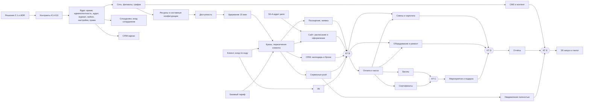

# План разработки yu-club

Версия 2 от 01.11.2026 (внесены решения владельца от 01.11). Автор – техлид проекта. Источник: `tz/01…20`, разборы `docs/razbor/*.md`.
Ссылки «18 §5.2» – файл ТЗ и пункт. «R-xx» – риск из реестра 20 §6. «N-xx» – новый блокер, которого в реестре 20 нет.
Сводный список вопросов – `docs/voprosy-zakazchiku.md` (Q-xx).

Статус плана: **разработка запущена 01.11.2026, этап 0 в работе.** Хостинг решён (N-01, частично), доступ к репо заказчика не подтверждён (N-03); остальные блокеры раздела 2 открыты – идём по умолчаниям с записью в реестр «принято по умолчанию». Пути в коде сайта и оценка Э1 по-прежнему зависят от аудита репозитория (раздел 3.6).

### Решения владельца от 01.11.2026

| ID | Решение | Что остаётся открытым |
|---|---|---|
| N-01 / Q-90 | Решено 01.11: пока размещаем на нашем VPS Beget (45.12.72.227, адрес стенда yu-club.45.12.72.227.nip.io), потом переносим на сервер клиента. Сервер Beget в РФ | тексты согласия и политики ПДн, оператор ПДн – от юриста заказчика |
| N-03 / Q-89 | Владелец говорит, доступ выдан; на 01.11 аккаунт tema-mail репозиторий не видит (404, приглашения нет) – проверить, на какой логин отправлено | вопрос о «дополнениях» 19 §6 |
| остальные | открыты; работаем по умолчаниям плана, решения пишем в реестр со статусом «принято по умолчанию» | ответы заказчика |

---

## 1. Что строим и границы

Одна система для сети компьютерных клубов «Ю-Клуб» (мультигород, несколько филиалов в городе):
- **публичный сайт** – филиалы, зоны ПК/VR/PS, комнаты, каталог игр, новости/акции/розыгрыши, страница дня рождения, онлайн-запись (12, 19);
- **личный кабинет клиента** – вход по коду, записи, посещения, баллы, сертификаты, настройки уведомлений (03);
- **CRM/админка** – Владелец, Директор, Администратор: расписание и брони, клиенты, касса, лояльность, сертификаты, смены и зарплата, оборудование и ремонт, мероприятия, уведомления, контент, отчёты, настройки (13, 04–15);
- **фоновые процессы** – истечение удержаний, напоминания, сгорание сертификатов, бэкапы.

**Не делаем** (по ТЗ):
- эквайринг, онлайн-оплату, банковские интеграции, ККТ/ОФД, бухгалтерию – деньги вносятся вручную (06 §9, 20 §4.11, 13 §2.6); система «не заменяет фискализацию» (06 §2.7);
- SMS/email/мессенджеры как каналы уведомлений – только push (09 §2, §15); SMS допускается только как канал кода входа, если его выберут (03 §5.1);
- интеграцию с ПО управления ПК в клубе, внешние календари (01 §18), кадровый документооборот, налоги, СКУД (05 §2);
- QR/штрихкоды, склад запчастей, ТО по календарю (10 §16), онлайн-заказ праздников с оплатой (11 §12);
- мобильное приложение – в ТЗ его нет, клиент работает через веб (вывод по 09, 12, 19);
- приём заявок на розыгрыши и выбор победителя (12 §8.4).

**Делаем, хотя в ТЗ не до конца:** вход клиента и ЛК в MVP (03 §18, в 18 их нет), сервисные уведомления в MVP (01 §18 п.13), бэкапы с этапа 0 (17 §21, в 18 – только этап 5).

---

## 2. Блокеры до старта

Правило 20 §6: открытый вопрос блокирует только свою ветку, но спорную логику по догадке не делаем. Ниже – что не даёт начать конкретный этап. Если заказчик молчит 5 рабочих дней, работаем по умолчанию и пишем решение в реестр 20 §11 со статусом «принято по умолчанию».

### 2.1. Блокируют этап 0

| ID | Решение | Что блокирует | Моё предложение по умолчанию | Статус |
|---|---|---|---|---|
| N-01 | Хостинг и 152-ФЗ: где живут ПДн, кто оператор, согласие, уведомление РКН. **Вывод плана, не пункт ТЗ:** закон в ТЗ не назван ни разу (grep «152» – пусто); в ТЗ есть только открытые вопросы 17 §21 п.1 (площадка) и п.15 (юридические требования к ПДн) | выбор площадки, состав форм, тест-стенд с реальными данными | VPS в РФ (Beget/Selectel), БД и бэкапы в РФ; согласие на обработку – отдельная галочка, по умолчанию пустая; тексты политики и согласия даёт юрист заказчика до Э5 | **решено 01.11** (хостинг Beget); тексты ПДн – открыто |
| N-02 | Кто утверждает стек и архитектуру (20 §13: «готовит команда разработки») | ADR и каркас | утверждаю я как техлид по разделу 3.5; заказчику – на чтение | открыт, работаем по умолчанию |
| N-03 | Доступ к репозиторию `AndreikinRoman/yu-club` и фиксированный commit (R-22) | аудит фронта, шаги сайта в Э1 | дают доступ на чтение; базой считаем `main` на дату доступа | **в работе**: доступ не подтверждён (404) |
| N-04 | Единый план этапов вместо локальных нумераций 01–17 и 18 (Q-01) | планирование, приёмка этапов | принять этот документ главным; профильные «Этап N» в 01–17 читать через таблицу 4.2 | открыт, работаем по умолчанию |
| N-05 | Вход сотрудников и 2FA (04 §3.1, 17 §21 п.11) | S0-09 | почта + пароль (argon2id), TOTP по желанию для Владельца и Директоров, не обязателен | открыт, работаем по умолчанию |
| R-21 | Пилотный филиал и состав первой очереди | тестовые данные, объём MVP | один филиал, в первой очереди этапы 0–2; этапы 3–4 включаются вторым релизом | открыт, работаем по умолчанию |
| R-14 | Права по финансам, блокировкам, ставкам, штрафам, объединению клиентов (20 §6, «до выдачи рабочих доступов») | S0-10 (набор действий в матрице прав); часть по ставкам и штрафам – Э3 | финансы: Администратор – оплаты сеансов и расходы своего филиала, корректировки и возвраты – Директор и Владелец; блокировка ресурса – Администратор по праву; ставки – Владелец, штрафы – Директор с причиной; объединение клиентов – Владелец | открыт, работаем по умолчанию |
| N-06 | Делегирование прав (04 §9) в 04 отнесено к этапам 3–5, а матрица 04 §5 полна оговорок «если разрешено» (Директор: филиалы, Администраторы, ресурсы, смены; Администратор: блокировки). По правилу «неуказанное = запрещено» без делегирования эти права нечем выдать | S0-10 | до Э3 – фиксированный набор: Директор в своей зоне может всё по матрице 04 §5, кроме: назначать директоров, менять свою зону, финкорректировок, экспорта ПДн; назначать Администраторов – да. Делегирование с датами – Э3.4 | открыт, работаем по умолчанию |

### 2.2. Блокируют этап 1

| ID | Решение | Что блокирует | Предложение по умолчанию | Статус |
|---|---|---|---|---|
| R-01 | Модель VR1/VR2/комната целиком/PS4 | S1-02 и всё бронирование VR | атомарные единицы VR1, VR2, PS4; бронь VR-места занимает свою единицу; аренда комнаты занимает все три; PS4 отдельно не продаётся; конфликт проверяет БД (раздел 3.3) | открыт, работаем по умолчанию |
| R-02 | 15/30 мин – шаг сетки, минимум или оба | S1-05, S1-14 | оба: длительность кратна шагу и не меньше одного шага; максимум не ограничен до решения (01 §17) | открыт, работаем по умолчанию |
| R-18 | Канал входа клиента | S1-12, ЛК | телефон + одноразовый код по SMS через адаптер провайдера; соцвход (Яндекс/VK/MAX) – после запуска | открыт, работаем по умолчанию |
| Q-07 | Статусы брони целиком (документа «Посещения, неявки и штрафы» нет) | S1-07, S1-10 | Подтверждена → Пришёл → Завершена; Неявка; Отменена клиентом; Отменена клубом; Перенесена (старая версия) | открыт, работаем по умолчанию |
| R-08, R-16 | Момент неявки и автозакрытие сеанса | автоматика S1-10 | только ручная отметка; запись без отметки висит в списке «требует решения» | открыт, работаем по умолчанию |
| R-12 | Отмена/перенос клиентом | клиентская отмена в ЛК | в MVP отмена клиентом без возврата денег (денег при брони нет – 18 §2), перенос – только админом | открыт, работаем по умолчанию |
| R-17 | Напоминание при записи после 21:00 накануне | S1-15 | не отправлять «накануне», отправить только «за 15 мин» (как 09 §6.1) | открыт, работаем по умолчанию |
| Q-30 | Push – web push или приложение | S1-15, S1-16 | web push (VAPID) из браузера; без разрешения – только запись в ЛК | открыт, работаем по умолчанию |
| Q-06 | Кто рисует дизайн CRM (в макете CRM нет, 19 §5) | экраны CRM | мы, на дизайн-системе макета, без отдельного дизайнера | открыт, работаем по умолчанию |

### 2.3. Блокируют этап 2 и дальше (не мешают старту)

R-03 (остаток сертификата меньше цены), R-04 (что такое «один сеанс»), R-05, R-06, R-07, R-13, момент оплаты (Q-20), касса одна или по способам (Q-22) – этап 2. R-09, R-10, R-11, R-14 (часть по ставкам и штрафам), R-15 – этап 3. R-19, R-20 – этап 5. Предложения по умолчанию – в `voprosy-zakazchiku.md`.

---

## 3. Архитектура

### 3.1. Принципы (из ТЗ, обязательны для всех модулей)

1. Источник истины – сервер. Экран не считает остатки, статусы, доступность и роли (20 §3, D-21).
2. Первичные факты не дублируются: бронь, посещение, финоперация, операция баллов, операция сертификата – отдельные записи (16 §1).
3. Ничего значимого не удаляется: архив вместо удаления, сторно вместо правки (02 §12, 06 §4.4, 16 §2.7).
4. Каждая операция привязана к филиалу и проверяет право на сервере (04 §2.9, 17 §7.2, запрет IDOR).
5. Повтор команды не создаёт дубль (16 §2.2, §15.2).
6. Основная операция не откатывается из-за сбоя вторичной (уведомления, отчёты) – 16 §2.6, §15.3.
7. Время – по часовому поясу филиала, хранение в UTC (01 §4, 09 §13).

### 3.2. Модули (контексты) – модульный монолит

| Контекст | ТЗ | Владеет данными | Наружу отдаёт |
|---|---|---|---|
| **core** – ядро | 04, 15, 16, 17 | журнал операций, аудит, настройки, права, идемпотентность, outbox, время филиала | библиотечные функции, не API |
| network – сеть | 02, 15 §5 | города, филиалы, график, исключения | справочник филиалов |
| resources – ресурсы | 02, 15 §8 | помещения, комнаты, ресурсы, составные конфигурации, единицы занятости | множество конфликтов ресурса |
| staff – сотрудники | 04, 05 | сотрудники, назначения, вход сотрудников | субъект прав |
| booking – брони | 01, 16 §3–6, §9 | удержания, брони и версии, занятость, блокировки, посещения, неявки | события брони, API доступности |
| clients – клиенты | 03 | карточка, контакты, вход клиента, согласия, слияния | клиент, сессия ЛК |
| pricing – тарифы | 15 §9 | тарифы, акции | цена на момент брони |
| notifications | 09 | подписки push, плановые и отправленные уведомления, категории | – |
| finance – касса | 06 | кассы, финоперации, категории | поступления и расходы |
| loyalty – баллы | 07 | счёт, партии, резервы, товары за баллы | баланс, право записи |
| certificates | 08 | сертификаты, погашения, сгорание | остаток |
| shifts – смены и зарплата | 05 | смены, ставки, штрафы, расчёты | – |
| equipment – оборудование | 10 | единицы, перемещения, ремонты, исполнители, гарантии | статус для доступности |
| events – мероприятия | 11 | мероприятия, состав, подарки имениннику | – |
| content – CMS | 12 | игры, публикации, медиа, блоки главной | публичный контент |
| reports – отчёты | 14 | только чтение и задачи экспорта | – |

Модули общаются вызовами функций внутри процесса и событиями через outbox. Чужие таблицы напрямую не пишут.

### 3.3. Общее ядро

**Журнал операций со сторно (ledger).** Один механизм для денег, баллов, остатков сертификатов, штрафов сотрудников (вывод разбора 05–08). Запись: счёт (касса филиала / бонусный счёт клиента / сертификат / расчёт сотрудника), единица (копейки / баллы с точностью 0,01), сумма со знаком, тип, основание, ссылки (бронь, сеанс, мероприятие, ремонт), филиал, автор, `reversal_of`, ключ идемпотентности. Таблица только на вставку; баланс = сумма записей (или проверяемый снимок); сторно – новая запись со ссылкой, двойное сторно запрещено ограничением. Партии баллов (07 §3.2) – отдельная таблица поверх журнала.

**Аудит.** Одно определение – 04 §11.2 (время, пользователь или системный процесс, роль и зона на момент действия, действие, объект, филиал, до/после, результат, причина, источник). Права БД: роль приложения без UPDATE/DELETE. Секреты маскируются до записи (04 §11.2). Хронология объекта (16 §16) – выборка из аудита в пределах прав.

**Настройки с наследованием и датами действия (15 §3).** Значение: ключ, уровень (система/сеть/город/филиал), объект уровня, значение, `valid_from`, `valid_to`, автор, причина. Чтение `resolve(key, branchId, at)`: филиал → город → сеть → система, с учётом даты. Изменение не трогает созданные операции: операции хранят **снимок** нужных значений (цена, срок, состав конфигурации) – 15 §3.4, 02 §8.4. Просмотр истории настроек на дату – этап 3 (15 §21), снимки – с этапа 1.

**Права роль × зона × действие (04, 17 §7).** Роль (Владелец/Директор/Администратор) + назначения (сеть / город / группа городов / филиал / несколько филиалов, с датами) + явные права на действие. Функции: `can(actor, action, branchId)` – на каждую команду; `scopeFilter(actor, action)` – условие для каждого списка и поиска (поиск не раскрывает факт существования чужих объектов, 13 §7.1). Неуказанное право – запрещено. Делегирование с датами – этап 3; до него – фиксированный набор по N-06.

**Время филиала.** Хранение `timestamptz` в UTC, у филиала IANA-зона. Функции: локальная дата → интервал UTC, «21:00 накануне по филиалу», границы суток для отчётов. Интервалы полуоткрытые `[начало, конец)` (01 §3). Смена зоны филиала не сдвигает прошлые события (02 §6.4). Ночные смены через полночь не поддерживаем (01 §4.1).

**Идемпотентность и outbox.** Каждая критичная команда (удержание, подтверждение, отмена, оплата, погашение, баллы, отправка) принимает ключ; повтор с тем же ключом отдаёт прежний результат, с другим телом – конфликт. События пишутся в outbox в той же транзакции, обработчики (напоминания, начисления, внутренние события CRM) – идемпотентны по ключу события, с повтором.

**Защита от двойной брони – на уровне БД.** Таблица занятости: (единица ресурса, интервал `tstzrange`, источник: удержание/бронь/мероприятие, активность). Ограничение `EXCLUDE USING gist (unit_id WITH =, period WITH &&) WHERE (active)`. Аренда комнаты пишет строки на все единицы комнаты, место VR – на свою; поэтому TC-01…TC-03 гарантирует база, а не код. Второе ограничение – пересечения броней одного клиента по всей сети (01 §9, 15 §7.4): `EXCLUDE (client_id WITH =, period WITH &&)` по активным броням и удержаниям клиента. Блокировки ресурсов – отдельная таблица (могут ложиться поверх существующих броней и формировать список затронутых, 01 §13).

### 3.4. Модель данных верхнего уровня

```
Сеть → Город(tz по умолчанию) → Филиал(tz, статус, график, исключения)
  Филиал → Помещение → Комната → Ресурс(тип, шаг) → Единица занятости
  Составная конфигурация(основной ресурс, входящие единицы, период) → снимок в брони
  Единица оборудования ↔ Ресурс (N:M), перемещения, ремонтные события, гарантии
Клиент(один на сеть) → контакты, согласия, сессии, слияния
  Удержание(15 мин, общий таймер) → Бронь(версии) → Занятость
  Бронь → Посещение | Неявка ; Бронь → Сеанс оплаты(R-04) → ровно один Платёж
Журнал операций: касса филиала | бонусный счёт(+партии, резервы) | сертификат | расчёт сотрудника
Сотрудник → роль, назначения(с датами), права, смены, ставки(с датами), штрафы, расчёты
Мероприятие → строки состава, поступления/расходы (ссылки в журнал), подарок имениннику
Уведомление(категория, плановое время, статус) ← подписка push клиента
Контент: игра(направление, доступность по филиалам), публикация(охват сеть/город/филиал), медиа
Аудит, настройки, системные статусы и причины (15 §16), outbox, ключи идемпотентности
```

Деньги – целые копейки. Баллы – `numeric(12,2)` (2,5 балла за 15 мин, 07 §3.3; правило округления – R-06/Q-41).

### 3.5. Рекомендация стека (не факт ТЗ, решение техлида; записать ADR в S0-00)

| Слой | Выбор | Причина |
|---|---|---|
| БД | **PostgreSQL 16** | `EXCLUDE` по интервалам закрывает гонку за слот и составные ресурсы в самой базе (17 §10); транзакции для журнала; `timestamptz` и зоны; одна база вместо БД + Redis |
| Бэкенд | **TypeScript на Node 26 (встроенный Temporal), Fastify, SQL через Kysely, миграции чистым SQL** | один язык с фронтом, общие схемы контрактов (Zod → OpenAPI); Kysely не прячет SQL – нужен для `EXCLUDE`, блокировок, сложных отчётов; один разработчик с ИИ держит один язык |
| Фоновые задачи | **pg-boss** (очередь в той же Postgres) | истечение удержаний, напоминания по времени, outbox, повторы; без отдельного брокера |
| Публичный сайт и ЛК | **Astro** (SSR для страниц с данными) + острова **Preact** (`@astrojs/preact`, `preact/compat` для переноса TSX макета) | правило владельца; SSR даёт индексируемые страницы филиалов и игр (12 §13) без SPA; расписание, удержание с таймером и ЛК – острова |
| CRM | **Astro + Preact**, отдельное приложение за входом целиком | стандарт админок владельца (admin-builder); отдельный деплой и отдельная поверхность атаки; экраны CRM – крупные острова |
| Уведомления | **Web Push (VAPID)** через service worker сайта | канал – только push (09 §2), приложения нет; без стороннего провайдера и его хранения ПДн |
| SMS кода входа | адаптер с двумя реализациями: тестовая (в лог стенда) и боевой провайдер РФ по выбору заказчика | канал не утверждён (R-18) – меняется без правки модулей |
| Хостинг | VPS в РФ, Docker Compose, Caddy (http→https кодом 301, не 308); решено 01.11: стенд на нашем VPS Beget (45.12.72.227, yu-club.45.12.72.227.nip.io), затем перенос на сервер клиента | 152-ФЗ (N-01); сервер Beget в РФ |
| Тесты | Vitest + настоящая Postgres в Docker; Playwright для e2e; k6 для нагрузки на гонку | гонки и `EXCLUDE` моками не проверить |

Отклонённые варианты: Supabase/Firebase (ПДн за рубежом, сложно с `EXCLUDE`-логикой и аудитом только на вставку), Next.js (против правила владельца «фронт – Astro»), отдельный Redis для блокировок (лишняя часть: база уже гарантирует).

### 3.6. Развилка по репозиторию заказчика

Факт на 01.11: репозиторий приватный; владелец говорит, доступ выдан, но аккаунт tema-mail его не видит (404, приглашения нет) – проверить логин (N-03). По 19 §2 в нём `src/App.tsx`, `src/components/Schedule.tsx`, `GameCarousel.tsx`, `src/types.ts`, `styles.css`, `docs/*.md`, `AGENTS.md` – похоже на TSX-прототип на React (вывод, не проверено). 19 §3.2 запрещает переносить его модель данных, хранение состояния, маршрутизацию и библиотеки; переиспользуем дизайн, вёрстку, компоненты, состояния и сценарии.

Шаг **S0-A (аудит репозитория заказчика)** – когда дадут доступ: только чтение, отчёт `docs/audit-repo-zakazchika.md` – фреймворк и сборка, список страниц и компонентов, что зависит от React-специфики (контекст, хуки сторонних библиотек), доля демо-данных, дизайн-токены, `AGENTS.md` и `docs/requirements.md` (могут содержать требования, которых нет в ТЗ), лицензии шрифтов и картинок, проверка «дополнений» 19 §6 против файлов (R-22).

| Итог аудита | Что делаем | Влияние на план |
|---|---|---|
| **A. React/Vite-прототип без бэкенда** (ожидаемо) | новое приложение Astro; компоненты переносим в острова Preact через `preact/compat`, `styles.css` и токены – как есть; демо-данные выбрасываем | шаги S1-18…S1-21 по разделу 6; +3–6 дней к Э1 на перенос |
| **A2. То же, но заказчик требует оставить его React-приложение** | его SPA + наш API; маршрутизатор и клиент API добавляем к нему | −2–4 дня сейчас; SEO страниц филиалов и игр хуже (SPA); расхождение с правилом владельца – записать причину в ADR |
| **B. Есть свой фреймворк с SSR (Next.js и т.п.) или бэкенд** | бэкенд остаётся нашим API; фронт – решение владельца: перенос в Astro или работа в их фреймворке | вопрос владельцу одним сообщением; до ответа делаем API и CRM, сайт ждёт |
| **C. В `docs/` или `AGENTS.md` есть требования вне ТЗ** | вносим в профильные разделы через реестр 20 §11 до реализации (20 §7.3) | возможное расширение объёма – отдельной оценкой |
| **D. Доступа нет к началу Э1** | API и CRM идут дальше; сайт – по разделу 12 и 19 без макета, только каркас и острова расписания без дизайна | дизайн-перенос уходит в Э4, риск переделки |

---

## 4. Единый план этапов

### 4.1. Этапы

| Этап | Название | Состав | Контрольная точка |
|---|---|---|---|
| **Э0** | Фундамент | решения раздела 2.1, аудит репо, ADR; каркас, CI, стенд; ядро (время, идемпотентность, аудит, журнал, outbox, настройки, права); вход сотрудников; города и филиалы, график; справочники, статусы и причины; CRM-каркас с контекстом филиала; **бэкап и проверка восстановления**; тестовые данные | КТ A по 18 §4.4 + восстановление из бэкапа проверено |
| **Э1** | Операционный MVP | помещения, комнаты, ресурсы, составные конфигурации; исключения календаря; блокировки; доступность; удержание 15 мин; бронь, запрет пересечений; отмена и перенос админом; посещение и неявка вручную; **клиент, вход по коду, ЛК (записи, посещения, настройки)**; бронь админом и без профиля; **базовый тариф и снимок цены**; **сервисные push: подтверждение, отмена, напоминания 21:00 и −15 мин**; сайт: выбор города/филиала, зоны и комнаты из данных, расписание и оформление; CRM: календарь филиала, карточка брони, справочники ресурсов, блокировки; нагрузочный тест гонки; 6 тестов VR+PS4 | КТ B по 18 §5.5 + запись с сайта видна в ЛК и CRM + напоминание приходит по времени филиала |
| **Э2** | Коммерческий контур | оплата сеанса одним способом (нал/безнал/перевод); касса филиала: начальный остаток, поступления, расходы в 2 уровня, изъятия, сторно; бонусный счёт: начисление после посещения, штраф −5, предел −50, блок записи, списание на время, товары за баллы, возвраты в исходную партию; сертификаты: продажа, частичное погашение, 6 мес, сгорание, ЛК; возвраты и корректировки; права на финансы; финсводка филиала | КТ C по 18 §6.5 + 10 сценариев 18 §6.3 |
| **Э3** | Управление клубом | 3 параллельные ветки: **смены и зарплата** (05); **оборудование и ремонт** (10, базовая карточка из 02); **мероприятия, платный праздник, подарок имениннику** (11, 20 §4.10); делегирование прав с датами (04 §9) | КТ D по 18 §7.4 + TC-13, TC-14, TC-15, TC-19 |
| **Э4** | Коммуникации, контент, отчёты | уведомления полностью: реклама с согласием, ручные и массовые с предпросмотром, центр уведомлений в ЛК, повторы; CMS: игры, комнаты, публикации, медиатека, черновик/публикация, гео-охват; SEO-поля и карта сайта; отчёты 14 §5–14 с детализацией и экспортом; рабочие столы Директора и Владельца; глобальный поиск | КТ E по 18 §8.4 + TC-20 |
| **Э5** | Подготовка к запуску и пилот | полное и сквозное тестирование TC-01…TC-20; нагрузка; безопасность (скиллы `безопасность`, `защита-сайта`), юр-проверка 152-ФЗ; мониторинг и оповещения; регламенты; наполнение данных; учётки; инструкции и обучение; план отката; пилот на одном филиале | КТ F по 18 §9.4, подпись владельца |
| **Э6** | Стабилизация | по 18 §10 | – |

Внутренние показы заказчику – после каждого этапа на тест-стенде. Боевой запуск – только после Э5 (18 §9). Вариант раньше: пилот после Э2 на одном филиале параллельно со старой записью (18 §17 п.10) – если владелец захочет получить пользу раньше; тогда части Э5 (мониторинг, регламент сбоя, юр-проверка) переезжают перед этим пилотом.

### 4.2. Соответствие локальных нумераций (как читать «Этап N» в профильных разделах)

| Блок | Где в профильном ТЗ | Где в 18 | Наш этап |
|---|---|---|---|
| Роли, зоны, аудит базовые | 04: Э0 | Э0 | Э0 |
| Смены, пересечения, самопланирование | 04: Э1; 05: Э1 | Э3 | Э3 |
| Базовая карточка оборудования | 02: Э0 | Э3 | Э3 |
| Ремонт, перемещения | 02: Э4; 10: Э2–3 | Э3 | Э3 |
| Вход клиента, ЛК | 03: Э1 | нет | **Э1** |
| Баллы и сертификаты в ЛК | 03: Э1 | Э2 | Э2 |
| Баллы: счёт и начисление | 07: Э1 | Э2 | Э2 |
| Сертификаты: продажа | 08: Э1 | Э2 | Э2 (продажа вместе с погашением) |
| Напоминания | 01: MVP; 09: Э2 | Э4 | **Э1** |
| Категории и настройки уведомлений | 09: Э1 | Э4 | Э1 (две настройки), остальное Э4 |
| Статусы и причины | 15: Э2 | Э0 | Э0 |
| Базовые тарифы | 15: Э1 | Э2 | **Э1** (простой тариф) / Э2 (дни недели, акции) |
| Касса, оплата сеанса | 06: Э2–3; 13: Э2; 16: Э1 | Э2 | Э2 |
| Мероприятия | 11: Э1–2; 16: Э2 | Э3 | Э3 |
| Подарок имениннику | 11: Э2 | **Э2** | **Э3** (вместе с мероприятиями) |
| Отчёты базовые | 14: Э1 | Э4 | Э4; в Э1–Э2 – списки дня и сводка кассы |
| Сайт: данные и выбор филиала | 12: Э1 | Э1 | Э1 |
| CMS | 12: Э2 | Э4 | Э4 |
| SEO | 12: Э3 | нет (в 18 слова SEO нет; публикация контента – Э4, 18 §8.2 п.9–10) | ЧПУ и маршруты – **Э1**; мета, карта сайта – Э4 |
| Бэкапы и восстановление | 17: Э2 | Э5 | **Э0** |
| Нагрузочный тест брони | 17: Э1 | Э5 | **Э1** + повтор в Э5 |

### 4.3. Где отступили от 18 и почему

| № | Что | В 18 | У нас | Почему |
|---|---|---|---|---|
| 1 | Регистрация, вход клиента, ЛК | отсутствуют | Э1 | 03 §18 ставит их в MVP; 18 §5.5 требует «полный цикл от сайта до CRM», а запись без клиента не проверить на пересечения (01 §9) |
| 2 | Сервисные уведомления и напоминания | Э4 | Э1 | 01 §18 п.13, 16 §17 Э1 п.8, TC-11 требует уведомление при отмене клубом; без них MVP не проходит свои же критерии |
| 3 | Базовый тариф и снимок цены | Э2 | Э1 | 16 §3.1 «тариф настроен» – предпроверка брони; 15 §21 Э1; 01 §10.1 показывает стоимость в сводке |
| 4 | Бэкапы и тест восстановления | Э5 | Э0 | 17 §21 требует бэкап до утверждения открытых вопросов; на стенде уже будут данные заказчика |
| 5 | Нагрузочный тест гонки за слот | Э5 | Э1 и Э5 | главный риск проекта (01 §8, R-01); ловить в Э1, а не за неделю до запуска |
| 6 | Подарок имениннику | Э2 | Э3 | основание подарка – мероприятие (11 §9.2), а мероприятия в 18 – Э3 (разбор 09–12, п.9.2) |
| 7 | Статусы и причины | Э0 | Э0 (совпало) | против 15 §21 (Э2) – брони Э1 без причин отмены невозможны |
| 8 | Маршруты и ЧПУ сайта | SEO не упомянуто; управление контентом – Э4 (18 §8.2 п.9–10) | ЧПУ в Э1, мета и карта сайта – Э4 | адреса фиксируются при первой вёрстке; смена позже – переезд с 301 (разбор 09–12, 12 п.9.4) |
| 9 | Сертификаты: продажа и погашение | Э2 | Э2 вместе | 08 §16 продаёт в Э1 без погашения – нельзя продавать то, что нельзя погасить |
| 10 | Счёт баллов для штрафа −5 | Э2 | Э2 | 16 §17 ставит штраф в Э1; оставили по 18: до боевого запуска Э2 всё равно будет готов, а штраф без начислений путает клиента; неявку в Э1 фиксируем, штраф применяется с Э2 только к новым неявкам |
| 11 | Справочник оборудования | Э3 | Э3 | 02 §16 просит базовую карточку в Э0, но брони Э1 зависят от единиц занятости ресурса, а не от карточки оборудования; блокировки ресурса на ремонт – в Э1 как в 18 |
| 12 | Делегирование прав | – | Э3 | N-06: до него – фиксированный набор прав Директора |

---

## 5. Граф зависимостей и параллельные потоки

### 5.1. Граф



### 5.2. Потоки и кто их может вести одновременно

Исполнители: я (техлид, интеграция и ревью) + агенты-исполнители в отдельных git worktree, каждый на свой поток. Одновременно разумно держать **не больше 3 потоков кода**: ревью и интеграция – узкое место одного человека.

| Поток | Состав | Старт после | Можно параллельно с |
|---|---|---|---|
| П1 Ядро и платформа | S0-01…S0-08, S0-12, S0-17, S0-19 | ADR | – (первым) |
| П2 Сеть и доступ | S0-09…S0-11, S0-13 | S0-04, S0-06 | П1 (после S0-06) |
| П3 CRM-оболочка | S0-14, S0-15, затем экраны CRM каждого этапа | S0-10 (права) | П2, П4 |
| П4 Бронирование | S1-01…S1-10, S1-13, S1-14 | КТ A | П5, П6 |
| П5 Клиент и ЛК | S1-11, S1-12, S1-17 | КТ A | П4 (сходятся в S1-07: `client_id` в брони) |
| П6 Сайт | S0-A, S1-18…S1-21 | аудит репо + контракт K5 (на моках) | П4, П5 |
| П7 Уведомления | S1-15, S1-16, затем Э4 | контракт K4 | П4 после S1-07 |
| П8 Деньги | Э2: касса, оплата → баллы ‖ сертификаты | КТ B | П9a/b/c (Э3 частично) |
| П9a Смены и зарплата | Э3 | КТ B + S0-10 | П9b, П9c, П8 |
| П9b Оборудование и ремонт | Э3 | КТ B (блокировки S1-04 и список затронутых броней); расход ремонта в кассу – после Э2.1 | П9a, П9c |
| П9c Мероприятия | Э3 | КТ C (касса, журнал) | П9a, П9b |
| П10 CMS и отчёты | Э4 | CMS – после КТ A; отчёты – после КТ D | П7 (Э4) |
| ПТ Тесты и эксплуатация | гонки, сквозные TC, бэкап, мониторинг | весь проект | всеми |

**Точки схода и что проверяем в каждой**

| Сход | Потоки | Проверка схода |
|---|---|---|
| С1 – S1-07 подтверждение брони | П4 + П5 | бронь клиента с входом и без профиля; пересечение клиента ловит БД |
| С2 – S1-18…S1-20 сайт на живом API | П6 + П4 | контракт-тест K5 зелёный и для API, и для клиента сайта |
| С3 – S1-15 напоминания на событиях брони | П7 + П4 | TC-18 перенос и отмена |
| С4 – КТ B | все Э1 | e2e Playwright сайт → ЛК → CRM + 6 тестов VR+PS4 + нагрузка |
| С5 – оплата сеанса | П8 + П4 | один сеанс – один платёж; TC-07 |
| С6 – мероприятие занимает комнату | П9c + П4 | занятость мероприятия в той же таблице; TC-13 |
| С7 – ремонт → блокировка → затронутые брони | П9b + П4 + П7 | TC-12 |
| С8 – отчёты = первичка | П10 + все | TC-20, контрольные соотношения 16 §14 |

### 5.3. Контракты, которые фиксируем до старта потоков (в `docs/kontrakty/`, шаг S0-00)

| ID | Контракт | Нужен потокам |
|---|---|---|
| K1 | `can(actor, action, branchId)` и `scopeFilter(actor, action)`; список действий – по матрице 04 §5 и 17 §7.3 | все |
| K2 | Событие аудита: поля по 04 §11.2, список типов по 04 §11.3 | все |
| K3 | Запись журнала операций: счёт, единица, сумма, тип, основание, ссылки, `reversal_of`, ключ | П8, П9a, П9c |
| K4 | События outbox: `HoldCreated/Expired`, `BookingConfirmed/Cancelled/Rescheduled`, `VisitConfirmed`, `NoShowMarked`, `ResourceBlocked` – поля, ключ события, версия | П4, П7, П8 |
| K5 | Публичный API записи (OpenAPI из Zod): филиалы, доступность, удержание, добавить слот, подтвердить, отменить; коды ошибок с причиной (01 §8.2) | П4, П6, П5 |
| K6 | Модель занятости: единицы ресурса, составная конфигурация → множество единиц, снимок в брони (R-01) | П4, П9b, П9c |
| K7 | `resolveSetting(key, branchId, at)` и список ключей этапов 0–1 | все |
| K8 | Время филиала: функции перевода, сутки, «21:00 накануне» | П4, П7, П10 |
| K9 | Клиент и сессия ЛК; бронь без профиля (телефон + имя) | П4, П5, П6 |
| K10 | «Сеанс оплаты» (R-04): по умолчанию одна бронь = один сеанс; составной визит – несколько броней, у каждой свой платёж | П8 |

---

## 6. Детальная разбивка этапов 0 и 1

Правила шага: ≤3 файлов кода (включая тесты, миграции, конфигурацию запуска), каждый файл ≤800 строк, рабочий результат, проверка, отдельный коммит с описанием на русском. Файлы, созданные официальным генератором без правки (`npm create astro`), в счёт не идут – сам генератор и его версию пишем в коммит. Пути – по стеку 3.5; если аудит репо (3.6) или ADR изменит структуру, меняются пути, но не границы шагов.

Структура репозитория (предложение):
```
apps/api/      Fastify, src/core/*, src/modules/<контекст>/*
apps/site/     Astro: публичный сайт + ЛК, острова Preact
apps/crm/      Astro: CRM за входом
packages/contracts/  схемы Zod, генерация OpenAPI и типов
db/migrations/ SQL-миграции вверх/вниз
tests/         интеграционные, e2e, нагрузка
deploy/        compose, Caddy, бэкап
```

### 6.1. Этап 0 – фундамент

Документы (не код, без лимита файлов):

| ID | Что делаем | Результат | Проверка | Зависит |
|---|---|---|---|---|
| S0-D | Решения 2.1 у заказчика | реестр решений `docs/reshenia.md` по шаблону 20 §11 | каждое решение с датой и автором | – |
| S0-A | Аудит репо заказчика | `docs/audit-repo-zakazchika.md` + выбор ветки 3.6 | сверка с 19 §2 по списку файлов; R-22 – что из 19 §6 есть в коде | доступ (N-03) |
| S0-00 | ADR стека, модель данных, контракты K1–K10 | `docs/adr/0001-stek.md`, `docs/model-dannyh.md`, `docs/kontrakty/*.md` | прогон `architecture-reviewer`, затем `verify-plan` по шагам Э0 | S0-D (N-01, N-02) |

Код:

| ID | Что делаем | Файлы / зона | Проверка | Зависит |
|---|---|---|---|---|
| S0-01 | Каркас API: сервер, `/health`, конфиг из окружения | `apps/api/package.json`, `apps/api/src/server.ts`, `tests/api/health.test.ts` | `pnpm test` зелёный; `curl /health` → 200 и версия | S0-00 |
| S0-02 | БД и миграции: Postgres в Compose, раннер, первая миграция (`btree_gist`, схемы, роль приложения без UPDATE/DELETE на журнальные таблицы) | `deploy/compose.dev.yml`, `db/migrate.ts`, `db/migrations/0001_init.sql` | миграция вверх и вниз на чистой базе; повтор вверх – без изменений | S0-01 |
| S0-03 | CI: типы, линт, тесты с Postgres-сервисом | `.github/workflows/ci.yml` | зелёный прогон на ветке; падающий тест роняет CI (проверить нарочно) | S0-02 |
| S0-04 | Время филиала (K8) | `apps/api/src/core/time.ts`, `tests/core/time.test.ts` | тесты: Москва, Новосибирск, Калининград, зона с переходом на летнее время; полуоткрытые интервалы; «21:00 накануне»; прогон с `TZ=America/New_York` на машине | S0-01 |
| S0-05 | Идемпотентность команд | `db/migrations/0002_idempotency.sql`, `apps/api/src/core/idempotency.ts`, `tests/core/idempotency.test.ts` | повтор с ключом → тот же ответ; другой запрос с тем же ключом → 409; 20 параллельных одинаковых → одна запись | S0-02 |
| S0-06 | Аудит (K2), только вставка | `db/migrations/0003_audit.sql`, `apps/api/src/core/audit.ts`, `tests/core/audit.test.ts` | UPDATE/DELETE от роли приложения падают; пароль/код в «до/после» замаскирован | S0-02 |
| S0-07 | Журнал операций со сторно (K3) | `db/migrations/0004_ledger.sql`, `apps/api/src/core/ledger.ts`, `tests/core/ledger.test.ts` | баланс = сумма записей; сторно создаёт запись, не удаляет; второе сторно той же записи – ошибка; повтор с ключом – без дубля | S0-05 |
| S0-08 | Outbox и фоновые задачи (pg-boss) | `db/migrations/0005_outbox.sql`, `apps/api/src/core/outbox.ts`, `tests/core/outbox.test.ts` | событие пишется только при фиксации транзакции; обработчик с ошибкой повторяется; повтор не дублирует результат | S0-05 |
| S0-09 | Сотрудники и вход сотрудников (N-05): пароль argon2id, сессии, выход, тайм-аут, блокировка завершает сессии, защита от перебора | `db/migrations/0006_staff.sql`, `apps/api/src/modules/staff/auth.ts`, `tests/staff/auth.test.ts` | вход/выход; 10 неверных паролей → задержка; заблокированный теряет сессию; в аудите вход и отказ без пароля | S0-06 |
| S0-10 | Права роль × зона × действие (K1), фиксированный набор по N-06 и R-14 | `db/migrations/0007_access.sql`, `apps/api/src/core/permissions.ts`, `tests/core/permissions.test.ts` | таблица тестов по матрице 04 §5: Директор не назначает директоров, никто не меняет себе роль, город не открывает филиалы автоматически, неуказанное – запрещено | S0-09 |
| S0-11 | Сеть: города, филиалы, статусы, часовой пояс, базовый график 10:00–22:00 | `db/migrations/0008_network.sql`, `apps/api/src/modules/network/routes.ts`, `tests/network/network.test.ts` | Владелец создаёт город и филиал; Администратор чужого филиала получает отказ и по прямому ID (IDOR); архив вместо удаления; смена зоны не сдвигает прошлые события; аудит изменения | S0-10, S0-04 |
| S0-12 | Настройки с наследованием и датами (K7): окно 7/30, шаг, удержание 15 мин, время напоминаний | `db/migrations/0009_settings.sql`, `apps/api/src/core/settings.ts`, `tests/core/settings.test.ts` | приоритет филиал → город → сеть → система; значение на дату; возврат к наследованию хранит старое в истории; цикл и пересечение дат ловятся до сохранения | S0-11 |
| S0-13 | Справочники: типы ресурсов, типы помещений, системные статусы и причины (коды неизменны), причины отмены | `db/migrations/0010_dictionaries.sql`, `apps/api/src/modules/dictionaries/routes.ts`, `tests/dictionaries/dictionaries.test.ts` | системный код нельзя удалить и переименовать; пользовательская причина – архив; права только Владельцу | S0-10 |
| S0-14 | CRM-каркас: вход, меню по правам, переключатель контекста сеть/город/филиал | `apps/crm/src/layouts/Crm.astro`, `apps/crm/src/islands/ContextSwitcher.tsx`, `apps/crm/src/pages/login.astro` (остальное – генератор Astro) | Playwright: Администратор видит только свои филиалы; прямая ссылка на чужой – отказ с сервера; несохранённая форма при смене контекста – предупреждение | S0-09, S0-10 |
| S0-15 | CRM: общие список и карточка (поиск, фильтры, порции, архив, история), экраны городов, филиалов, справочников | `apps/crm/src/islands/EntityList.tsx`, `apps/crm/src/islands/EntityCard.tsx`, `apps/crm/src/pages/network/[...path].astro` | Владелец создаёт филиал из CRM и видит запись аудита; список грузится порциями; пустое и ошибочное состояния | S0-14, S0-11, S0-13 |
| S0-16 | Сопоставление макета с данными (12 Э0) | `docs/karta-sayta.md`: страницы с ЧПУ (`/`, `/{city}/{branch}/`, `/{city}/{branch}/vr/`, `/games/pc/`, `/birthday/`, `/account/`…), откуда каждое поле | показать владельцу до вёрстки (правило «ЧПУ и карта сайта сразу»), агент `site-map` | S0-A |
| S0-17 | Бэкап и проверка восстановления (перенос из 18 Э5) | `deploy/backup.sh`, `deploy/restore-check.sh`, `deploy/backup.timer` | бэкап → восстановление в чистую базу → совпадают число записей и суммы журнала; неуспешный бэкап шлёт оповещение | S0-02 |
| S0-18 | Тестовые данные Э0: 2 города, 3 филиала (разные зоны), справочники, сотрудники трёх ролей (ресурсы – в S1-28) | `db/seed/dev.ts`, `tests/seed.test.ts` | повторный запуск не плодит дубли; демо-данные помечены и не попадают на прод (19 §10.1) | S0-11, S0-13 |
| S0-19 | Тест-стенд: Compose, Caddy (301), выкладка из CI по тегу | `deploy/compose.yml`, `deploy/Caddyfile`, `.github/workflows/deploy-test.yml` | открыть адрес стенда: CRM-вход отвечает, `/health` – версия коммита; http → https кодом 301 | S0-03, S0-14, S0-17 |

**КТ A:** критерии 18 §4.4 + восстановление из бэкапа проверено + скилл `deploy-check` на стенд.

### 6.2. Этап 1 – операционный MVP

Номер миграции = порядок применения: 0101 ресурсы → 0102 занятость → 0103 календарь → 0104 блокировки → 0105 клиенты → 0106 вход клиента → 0107 тарифы → 0108 удержания → 0109 брони → 0110 посещения → 0111 уведомления. Таблицы ниже сгруппированы по потокам, а не по порядку.

**Ресурсы и расписание (П4)**

| ID | Что делаем | Файлы / зона | Проверка | Зависит |
|---|---|---|---|---|
| S1-01 | Помещения, комнаты, ресурсы (тип, шаг, «самостоятельная бронь», статус), закрытие комнаты закрывает её ресурсы | `db/migrations/0101_resources.sql`, `apps/api/src/modules/resources/routes.ts`, `tests/resources/resources.test.ts` | число ПК/VR – данные, не код (01 §5.1); архив вместо удаления; права Директора своей зоны | КТ A |
| S1-02 | Единицы занятости и составные конфигурации (K6, R-01), снимок состава | `db/migrations/0102_occupancy.sql`, `apps/api/src/modules/resources/composite.ts`, `tests/resources/composite.test.ts` | комната целиком → {VR1, VR2, PS4}; VR-место → {VRi}; PS4 самостоятельно не бронируется; смена состава не меняет снимок старых броней | S1-01 |
| S1-03 | График и исключения календаря (сокращённый день, закрытие, спецграфик; приоритет ресурс → комната → филиал → регулярный) | `db/migrations/0103_calendar.sql`, `apps/api/src/modules/network/calendar.ts`, `tests/network/calendar.test.ts` | открытые интервалы на дату по приоритету; смена графика не трогает брони, отдаёт список затронутых (TC-17 частично) | S1-01 |
| S1-04 | Блокировки ресурсов (ремонт, ТО, закрытие) и список затронутых броней | `db/migrations/0104_blocks.sql`, `apps/api/src/modules/booking/blocks.ts`, `tests/booking/blocks.test.ts` | блокировка поверх будущей брони не удаляет её, а возвращает в список; блокировка без права Администратора – отказ | S1-02 |
| S1-05 | Доступность: сетка по шагу ресурса, 6 состояний слота, окно 7/30 из настроек | `apps/api/src/modules/booking/availability.ts`, `tests/booking/availability.test.ts` | состояния «свободен / мой / удерживается другим / занят / заблокирован / вне графика»; шаг VR 15, ПК/PS 30; граница суток по зоне филиала; расписание филиала за период ≤3 с, проверка доступности ≤2 с (17 §4.1) | S1-03, S1-04 |
| S1-06 | Удержание 15 мин: создать, добавить слот с перезапуском общего таймера, истечение задачей | `db/migrations/0108_holds.sql`, `apps/api/src/modules/booking/hold.ts`, `tests/booking/hold.test.ts` | TC-05, TC-06; неудачное добавление не трогает уже удержанные; истёкшее удержание не занимает слот (чистка в той же транзакции); событие в outbox | S1-05, S0-08, S1-11 |
| S1-07 | Подтверждение брони: 8 повторных проверок (01 §8.2), идемпотентность, запрет пересечений клиента по сети, версии брони | `db/migrations/0109_bookings.sql`, `apps/api/src/modules/booking/confirm.ts`, `tests/booking/confirm.test.ts` | TC-01…TC-04; 50 параллельных подтверждений одного слота → ровно одна бронь; повторное нажатие – та же бронь; отказ с конкретной причиной; запись аудита и события; снимок цены и отказ без тарифа | S1-06, S1-11 (С1), S1-14 |
| S1-08 | Публичный API записи (K5) и схемы контрактов | `packages/contracts/src/booking.ts`, `apps/api/src/modules/booking/routes.public.ts`, `tests/contracts/booking.contract.test.ts` | OpenAPI генерируется; контракт-тест на живом сервере; ошибки не раскрывают чужие данные | S1-07 |
| S1-09 | Отмена и перенос (админом; клиентом – отмена по R-12) | `apps/api/src/modules/booking/change.ts`, `tests/booking/change.test.ts` | перенос: старая не меняется, пока новая не подтверждена; отмена комнаты освобождает только свои единицы, чужую бронь VR не трогает (18 §5.3 п.5–6); комментарий Администратора обязателен | S1-07 |
| S1-10 | Посещение, завершение сеанса, неявка вручную, исправление с причиной | `db/migrations/0110_visits.sql`, `apps/api/src/modules/booking/visit.ts`, `tests/booking/visit.test.ts` | повторная отметка прихода не создаёт второе посещение; неявка не создаёт посещение; ошибочная неявка – обратная запись; событие `VisitConfirmed` для Э2 | S1-07 |
| S1-13 | Бронь администратором: с клиентом, без профиля (телефон + имя), проверки не обходятся | `apps/api/src/modules/booking/routes.crm.ts`, `tests/booking/crm-booking.test.ts` | обычным созданием запрет пересечений не обходится, исключение – только отдельный сценарий (01 §9 п.6, вне MVP); Администратор чужого филиала – отказ; бронь без профиля проверяется на пересечения по телефону (Q-09 по умолчанию) | S1-07, S1-11 |
| S1-14 | Базовый тариф (филиал × тип ресурса × длительность) и снимок цены в брони | `db/migrations/0107_tariffs.sql`, `apps/api/src/modules/pricing/tariff.ts`, `tests/pricing/tariff.test.ts` | нет тарифа → ошибка конфигурации, не 0 ₽; два тарифа одного приоритета – ошибка до сохранения; смена тарифа не меняет цену созданной брони | S0-12, S1-01 |
| S1-28 | Тестовые данные Э1: VR-комната (VR1, VR2, PS4), 5 ПК, 3 комнаты PS5, базовые тарифы, исключения графика | `db/seed/resources.ts`, `tests/seed-resources.test.ts` | повторный запуск не плодит дубли; на засеянных данных проходят S1-26 и S1-27 | S0-18, S1-02, S1-03, S1-14 |

**Клиент и ЛК (П5)**

| ID | Что делаем | Файлы / зона | Проверка | Зависит |
|---|---|---|---|---|
| S1-11 | Карточка клиента: нормализация телефона, статусы, поиск в CRM по телефону/ФИО/ID с маской | `db/migrations/0105_clients.sql`, `apps/api/src/modules/clients/routes.ts`, `tests/clients/clients.test.ts` | одна карточка на телефон; поиск ≤2 с; Администратор видит минимум сетевой истории (04 §8.3) | КТ A |
| S1-12 | Вход клиента по коду (R-18), адаптер SMS (тестовый + боевой), согласие на ПДн | `db/migrations/0106_client_auth.sql`, `apps/api/src/modules/clients/otp.ts`, `tests/clients/otp.test.ts` | ответ не раскрывает, есть ли аккаунт; перевыпуск аннулирует старый код; лимит попыток; повторная регистрация = вход; код не попадает в аудит и логи | S1-11 |
| S1-17 | ЛК: профиль, мои записи (будущие/прошлые/отменённые), история посещений, переключатели «Напоминания» и «Реклама», выход | `apps/site/src/pages/account/index.astro`, `apps/site/src/islands/Account.tsx`, `tests/e2e/account.spec.ts` | клиент видит только свои записи; блоки баллов и сертификатов – пустое состояние «появится позже»; служебные комментарии не видны (03 §8.3) | S1-12, S1-08 |

**Уведомления (П7)**

| ID | Что делаем | Файлы / зона | Проверка | Зависит |
|---|---|---|---|---|
| S1-15 | Подписка web push и планировщик: подтверждение, отмена клубом, напоминания 21:00 накануне и −15 мин по зоне филиала, отмена старых при переносе | `db/migrations/0111_notifications.sql`, `apps/api/src/modules/notifications/reminders.ts`, `tests/notifications/reminders.test.ts` | TC-18; бронь после 21:00 накануне – «накануне» не шлём (R-17); выключенные напоминания не глушат отмену (09 §3.1); проверка 7 условий перед отправкой (09 §6.4) | S1-09, S0-08 |
| S1-16 | Отправка push и журнал статусов («отправлено провайдеру», «нет канала», «пропущено», «ошибка») | `apps/api/src/modules/notifications/sender.ts`, `apps/site/public/sw.js`, `tests/notifications/sender.test.ts` | реальная доставка на тестовый браузер со стенда; без подписки – статус «нет доступного канала», бронь не страдает (16 §15.5); «доставлено» не показываем без подтверждения | S1-15 |

**Сайт (П6) – ветка A из 3.6; при ветке A2/B шаги переписываются после S0-A**

| ID | Что делаем | Файлы / зона | Проверка | Зависит |
|---|---|---|---|---|
| S1-18 | Каркас сайта Astro: стили и токены макета, шапка/подвал, выбор города и филиала, маршруты по карте S0-16 | `apps/site/src/layouts/Site.astro`, `apps/site/src/islands/BranchPicker.tsx`, `apps/site/src/pages/[city]/[branch]/index.astro` | Playwright 390 и 1440 px; адреса и часы из API, не из статики (12 приёмка 23); закрытый филиал – без слотов (12 §4.3) | S0-16, S1-08 |
| S1-19 | Остров расписания: сетка, фильтр зоны и игры, выбор слотов, таймер удержания (перенос `Schedule.tsx` через `preact/compat`) | `apps/site/src/islands/Schedule.tsx`, `apps/site/src/islands/HoldTimer.tsx`, `tests/e2e/schedule.spec.ts` | таймер идёт от серверного `expires_at`, закрытие вкладки не продлевает (01 §7.4); состояния не только цветом; без горизонтальной прокрутки страницы на 390 px | S1-18, S1-06 |
| S1-20 | Оформление: вход по коду в потоке записи, сводка с ценой, подтверждение, экран успеха, переход в ЛК; 12 состояний ошибок (01 §15.1) | `apps/site/src/islands/Checkout.tsx`, `apps/site/src/pages/booking/success.astro`, `tests/e2e/checkout.spec.ts` | успех – только после ответа сервера (D-07); ошибка не сбрасывает ввод; бронь появляется в ЛК и CRM (С2) | S1-19, S1-12 |
| S1-21 | Страницы зон ПК/VR/PS и комнат из данных, пустые состояния, 404 | `apps/site/src/pages/[city]/[branch]/[zone].astro`, `apps/site/src/components/ZoneCard.astro`, `apps/site/src/pages/404.astro` | вместимость не из числа устройств (12 §7.1); кнопка комнаты ведёт в выбор ресурса; игры – из файла импорта до CMS Э4, без демо-игр макета | S1-18 |

**CRM (П3)**

| ID | Что делаем | Файлы / зона | Проверка | Зависит |
|---|---|---|---|---|
| S1-22 | Календарь филиала по ресурсам (день/неделя) и рабочий стол Администратора: записи дня, неотмеченные, блокировки | `apps/crm/src/islands/BranchCalendar.tsx`, `apps/crm/src/pages/schedule/index.astro`, `tests/e2e/crm-calendar.spec.ts` | данные сайта и CRM совпадают (18 §5.5); загрузка ≤3 с; время в зоне филиала, а не браузера | S1-07, S0-15 |
| S1-23 | Карточка брони и действия: создать (в т.ч. без профиля), отменить с причиной, перенести, отметить приход/неявку, хронология | `apps/crm/src/islands/BookingCard.tsx`, `apps/crm/src/islands/BookingForm.tsx`, `tests/e2e/crm-booking.spec.ts` | подтверждение «было/стало» при отмене и переносе (13 §10); двойной клик – одна операция | S1-22, S1-09, S1-10, S1-13 |
| S1-24 | Справочники ресурсов, комнат, составных конфигураций; график и исключения; блокировки со списком затронутых | `apps/crm/src/pages/resources/[...path].astro`, `apps/crm/src/islands/CalendarExceptions.tsx`, `apps/crm/src/islands/BlockForm.tsx` | перед сокращением часов – список затронутых броней, автоотмены нет (15 §6.5); Playwright по сценарию TC-17 | S0-15, S1-03, S1-04 |
| S1-25 | Карточка клиента в CRM: поиск, контакты, записи, посещения | `apps/crm/src/islands/ClientCard.tsx`, `apps/crm/src/pages/clients/[...path].astro`, `tests/e2e/crm-client.spec.ts` | телефон маскирован в списке; экспорта нет у Администратора | S1-11, S0-15 |

**Проверки этапа (ПТ)**

| ID | Что делаем | Файлы / зона | Проверка | Зависит |
|---|---|---|---|---|
| S1-26 | Нагрузочный тест гонки: 200 клиентов на 3 слота VR-комнаты одновременно, аренда комнаты против мест | `tests/load/booking-race.ts` (`npm run load:race`) | ноль двойных броней (запрос к базе после прогона); p95 удержания ≤2 с | S1-08, S1-28 |
| S1-27 | Сквозной e2e и набор VR+PS4: сайт → вход → удержание → бронь → ЛК → CRM → приход → завершение; 6 сценариев 18 §5.3 | `tests/e2e/full-cycle.spec.ts`, `tests/e2e/vr-ps4.spec.ts` | все зелёные на стенде; отчёт Playwright в артефактах CI | S1-20, S1-23, S1-28 |

**КТ B:** 18 §5.5 + S1-26 и S1-27 зелёные + напоминание реально пришло на тестовый телефон в 21:00 по времени филиала + `deploy-check` GO + `change-reviewer` на итоговый diff этапа.

### 6.3. Этапы 2–6 – эпики

| Эпик | Состав | Ключевые проверки |
|---|---|---|
| Э2.1 Касса филиала | начальный остаток (без удвоения), поступления, расходы 2 уровня с обязательным комментарием, изъятия, сторно, вложения, отрицательная касса по настройке, сводка кассы | остаток конец = начало + доходы − расходы ± корректировки; правка – только сторно |
| Э2.2 Оплата сеанса | один способ на сеанс (нал/безнал/перевод), статус оплаты брони, возврат отдельной операцией с решением сотрудника | TC-07; повтор не создаёт второй платёж; поиск исходной операции при потере ответа (16 §15.3) |
| Э2.3 Баллы | счёт, партии, начисление по `VisitConfirmed` (÷6 мин), штраф −5 с обрезкой до −50, блок записи на −50 (в S1-07 добавляется проверка), списание на время только целиком, резерв на время удержания, товары за баллы, возврат в исходную партию, ручная корректировка по праву | TC-09, TC-10; баланс воспроизводится из операций; одно начисление и один штраф на бронь |
| Э2.4 Сертификаты | продажа за деньги (поступление в филиале продажи), номер системы, 6 мес (31-е → последний день), частичное погашение, сгорание задачей, сторно погашения, ЛК «Мои сертификаты» | TC-08; погашение сверх остатка и истёкшего – отказ; два параллельных погашения не уводят в минус |
| Э2.5 Права на деньги и финсводка | действия 17 §7.3, финсводка филиала, ЛК: баллы и сертификаты | 18 §6.5 |
| Э3.1 Смены и зарплата | назначения, самопланирование, правка владельцем с уведомлением, пересечения между филиалами, пустые смены, факт, ставки с датой действия, начисления, штрафы, расчётный период, выплата | TC-15, TC-19 |
| Э3.2 Оборудование и ремонт | единый список статусов (Q-50), карточка, перемещения с проверкой будущих броней, учётки PS/VR без паролей, ремонтные события, исполнители, гарантии, документы, расход ремонта в кассу, блокировка по подтверждению | TC-12; поломка одного VR блокирует только его |
| Э3.3 Мероприятия | карточка без обязательной брони, состав, пакеты, чек-лист, поступления и расходы через журнал, план/факт, платный праздник VR+PS4 (≥120 мин, до 10 гостей), подарок имениннику (60 дней, Пн–Пт, праздники) | TC-13, TC-14; занятость мероприятия в общей таблице |
| Э3.4 Делегирование прав | права с датами, временная замена, отзыв | 04 §9 |
| Э4.1 Уведомления полностью | реклама с подтверждённым согласием, ручные и массовые с предпросмотром аудитории, центр уведомлений в ЛК, повторы без дублей, шаблоны | 18 §8.4 |
| Э4.2 CMS | игры с доступностью по филиалам, комнаты, новости/акции/розыгрыши, медиатека, черновик/предпросмотр/публикация, охват сеть/город/филиал, базовые версии и аудит | черновик не виден по ссылке; контент не меняет доступность |
| Э4.3 SEO | title/description, H1, alt, `sitemap.xml`, `robots.txt`, canonical, разметка филиалов, 301 при смене адреса (скиллы `site-seo`, `site-tech`) | проверка `site-tech` в режиме «тест» |
| Э4.4 Отчёты | 11 отчётов 14 §4–14, детализация = итог, экспорт XLSX/CSV в фоне с правом и аудитом, дашборды Директора и Владельца, глобальный поиск | TC-20; контрольные соотношения 16 §14 |
| Э5 | TC-01…TC-20 целиком, нагрузка, `безопасность`, `защита-сайта`, `юр-проверка-сайта`, мониторинг и оповещения, тест восстановления, регламенты 17 §18, наполнение, учётки, инструкции, обучение, план отката, пилот | 18 §9.4 |

---

## 7. Критический путь и сроки

### 7.1. Критический путь

Решения N-01, R-01, R-02, R-18 → S0-00 (ADR, контракты) → S0-01 → S0-02 → S0-06 → S0-09 → S0-10 → S0-11 → S0-12 / S0-15 → КТ A → S1-01 → S1-02 → S1-04 → S1-05 → S1-06 → S1-07 → S1-08 → S1-18 → S1-19 → S1-20 → S1-27 → **КТ B** → Э2.1 → Э2.2 → Э2.3 → **КТ C** → Э3.3 (мероприятия зависят от кассы) → **КТ D** → Э4.4 (отчёты читают всё) → **КТ E** → Э5 → пилот → **КТ F**. До КТ B путь собран по колонке «Зависит» таблиц 6.1–6.2; после КТ B – на уровне эпиков (5.2).

Вне критического пути (идут параллельно): клиент и ЛК (П5) до схода С1; уведомления (П7); экраны CRM (П3); CMS (Э4.2 можно начать после КТ A); смены и оборудование Э3.1–Э3.2 после КТ B; аудит репо, если доступ дадут до S1-18.

Если аудит репо задерживается дольше КТ A – сайт становится критическим путём (ветка D в 3.6).

### 7.2. Оценка в днях работы одного разработчика с ИИ

| Этап | Оптимистично | Реалистично | Пессимистично | Что двигает вилку |
|---|---:|---:|---:|---|
| Э0 (с решениями, аудитом, ADR) | 12 | 16 | 22 | скорость решений N-01…N-05; объём репо заказчика |
| Э1 | 22 | 30 | 40 | ветка 3.6 (A2 −3, A +5, D +8); канал SMS; доработки по 6 тестам VR+PS4 |
| Э2 | 16 | 22 | 30 | R-03, R-04, R-06; модель кассы (одна или по способам) |
| Э3 | 22 | 30 | 40 | платный праздник и подарок (R-09…R-11); правила зарплаты (Q-60…Q-64) |
| Э4 | 20 | 28 | 38 | число отчётов на старте (Q-80); глубина CMS и SEO |
| Э5 (без календарного времени пилота) | 10 | 14 | 20 | найденные дефекты P0/P1; юр-тексты; обучение |
| **Итого** | **102** | **140** | **190** | |

Допущения оценки:
1. Решения блоков 2.1 и 2.2 приходят в течение 5 рабочих дней от запроса; иначе работаем по умолчанию, но переделки при смене решения – сверх вилки.
2. Репо заказчика – TSX-прототип без бэкенда (ветка A), компоненты переносятся с правками, а не с нуля.
3. Один пилотный филиал, перенос исторических данных не нужен (18 §17 п.9), параллельная работа со старой записью – без интеграции с ней.
4. Дизайн CRM делаем сами на токенах макета, без отдельного дизайнера и согласования каждого экрана.
5. Объём в ТЗ не растёт; дополнения 19 §6 (праздник, турниры, отзывы) входят в Э3–Э4 в объёме 19/20.
6. ИИ-исполнители пишут код, но ревью, интеграция и приёмка – один человек; параллельные потоки сокращают календарь, а не дни работы.
7. Календарное время пилота (рекомендую 2–4 недели) не входит в дни разработки.

Календарь при 2–3 параллельных потоках: Э0 и Э1 последовательны по ядру, дальше выигрыш 25–35%: реалистично 140 дней работы ≈ 91–105 календарных рабочих дней (140 × 0,65–0,75) + пилот. Точную дату не называю до решений раздела 2 (18 §17 последний абзац).

Журнал «прогноз / факт» по этапам веду в этом файле в разделе 11 после каждой КТ.

---

## 8. Тестовая стратегия

**Уровни.** Модульные (ядро, расчёты), интеграционные на настоящей Postgres (все модули, гонки), контрактные (K5 и API CRM по OpenAPI), e2e Playwright (сайт, ЛК, CRM на 390 и 1440 px), нагрузка k6, тест восстановления из бэкапа. CI гонит всё, кроме нагрузки (нагрузка – по тегу и перед каждой КТ).

**Гонки за слот.**
- Гарантию даёт база (`EXCLUDE`), тесты проверяют именно базу: N параллельных соединений, а не последовательные вызовы.
- Сценарии: одно место VR (TC-01), два разных VR (TC-02), комната против места (TC-03), клиент против самого себя на разных ресурсах (TC-04), удержание против подтверждения, истечение удержания в момент подтверждения, добавление слота против чужого удержания.
- Каждый тест гонки – 100 повторов в CI ночью; после прогона – SQL-проверка «ни одной пары пересечений по активным единицам».

**Идемпотентность.** Для каждой команды из 16 §15.2: повтор с тем же ключом → тот же результат; тот же ключ с другим телом → 409; обрыв ответа после фиксации → повтор находит исходную операцию (16 §15.3). Обработчики outbox: повторная доставка события не создаёт второе начисление/уведомление. Двойной клик в e2e.

**Деньги и баллы.**
- Деньги – целые копейки, никаких float; баллы – `numeric`.
- Инварианты как свойства (property-based, fast-check): баланс = сумма операций; сторно ровно одно; остаток сертификата = номинал − погашения − сгорание ± корректировки; касса конец = начало + приход − расход ± корректировки (14 §7).
- Граничные: TC-10 (−48 → штраф −2 → −50, следующий штраф – событие без изменения), 2,5 балла за 15 мин без округления, возврат в истёкшую партию – «не возвращено», сертификат 31-го числа → последний день месяца, продажа и погашение не дают двух поступлений (TC-08).
- Контрольные соотношения 16 §14 – отдельный тест-набор, гоняется и на стенде с реальными данными.

**Часовые пояса.**
- Сервер и БД в UTC; тесты запускаются с чужим `TZ` машины, чтобы поймать утечку локального времени.
- Филиалы в Москве, Новосибирске (+4 к Москве), Калининграде; одна тестовая зона с переходом на летнее время (09 §13).
- Проверки: окно 7/30 дней по суткам филиала; «21:00 накануне» для брони в 10:00 и в 23:45 предыдущего дня; запись после 21:00 (R-17); напоминание −15 мин для брони, созданной за 10 мин; смена зоны филиала не сдвигает прошлое; сетевой отчёт по правилу Q-83.

**VR + PS4 – 6 обязательных тестов (18 §5.3), каждый – интеграционный и e2e:**

| № | Сценарий | Ожидание | TC в 20 |
|---|---|---|---|
| 1 | Два клиента одновременно бронируют VR1 и VR2 | обе брони есть | TC-02 |
| 2 | Аренда комнаты целиком | VR1, VR2 и PS4 заняты, места VR на интервал не предлагаются | TC-03 |
| 3 | Попытка брони PS4 отдельно | ресурс не предлагается в выборе, прямой запрос API – отказ | – |
| 4 | Место VR на 14:00–14:30 и аренда комнаты 14:15–15:15 в любом порядке и параллельно | вторая отклоняется | TC-03 |
| 5 | Отмена аренды комнаты | освобождены все три единицы этой брони | – |
| 6 | Есть бронь VR1 клиента A, отменяется бронь VR2 клиента B | бронь A не тронута | – |

Плюс подарок имениннику в Э3 (2 VR одному клиенту одной бронью составной конфигурации – см. Q-72) и праздник ≥120 мин (TC-13).

**Права и изоляция.** Табличный тест матрицы 04 §5 на каждое действие API; генерируемые тесты IDOR: каждый маршрут вызывается с ID чужого филиала → отказ без раскрытия существования. Поиск не находит чужое.

**Матрица TC → этап:** TC-01…06, 11, 17, 18 – Э1; TC-07…10 – Э2; TC-12…16, 19 – Э3; TC-20 – Э4; все – повтор в Э5.

---

## 9. Риски

| № | Риск | Вероятность / влияние | Что делаем |
|---|---|---|---|
| 1 | Решения R-01, R-02, R-18, N-01 не приходят | высокая / блок Э1 | работаем по умолчанию 2.2 с записью в реестр; модель занятости допускает другую схему VR-комнаты без смены таблиц |
| 2 | Репо заказчика не дают или он сильно расходится с ТЗ (R-22) | средняя / сайт и сроки Э1 | развилка 3.6; API и CRM не зависят от фронта |
| 3 | «Дополнения» 19 §6 не внесены в 01, 03, 11, 12, 17 | факт / объём Э3–Э4 | заносим черновики дополнений в реестр, утверждает заказчик до реализации (20 §7.3) |
| 4 | 152-ФЗ не учтён в ТЗ (вывод плана, закон в ТЗ не назван) | высокая / штрафы, перенос хостинга | хостинг в РФ с Э0, галочка согласия, `юр-проверка-сайта` до боевого домена |
| 5 | 54-ФЗ: деньги принимаются без ККТ в системе (вывод плана; в ТЗ только «не заменяет фискализацию», 06 §2.7) | средняя / риск клуба | не наш объём, но вопрос заказчику Q-23 до Э2; в кассе поле «чек пробит» по решению |
| 6 | Остаток сертификата меньше цены сгорает (R-03) | высокая / жалобы клиентов | выносим владельцу с цифрами; по умолчанию строго по ТЗ, но с предупреждением при продаже |
| 7 | Тупик −50: клиент не может записаться и не может поднять баланс | средняя / потеря клиента | по умолчанию Администратор может записать по спецправу (R-13) |
| 8 | Разные статусы оборудования в 02 и 10, ручная или авто-блокировка | факт / путаница в Э3 | единый список Q-50, блокировка только по подтверждению сотрудника |
| 9 | CRM без дизайна | факт / переделки | один общий список/карточка на токенах макета, показ экранов этапами |
| 10 | Один человек на ревью при нескольких агентах | высокая / качество | не больше 3 потоков; `change-reviewer` до коммита на каждый заметный шаг; гонки и деньги – только с тестами на базе |
| 11 | Push не доходит (iOS без установки на экран, отказ в разрешении) | высокая / клиенты без напоминаний | запись в ЛК всегда; вопрос заказчику про SMS для напоминаний (Q-31) |
| 12 | Нет подтверждённых НФТ (SLA, RPO/RTO, нагрузка) | факт / приёмка Э5 | берём ориентиры 17 §4.1 и §12.1 как цели тестов, утверждение до Э5 (R-20) |
| 13 | Нет документов «Посещения, неявки и штрафы», «Тарифы и ценообразование», «VR + PS4» | факт / правила висят | по умолчанию из 2.2; документы просим или пишем черновики на утверждение |
| 14 | Подарок (2 VR одному клиенту) против запрета пересечений | факт | одна бронь на составную конфигурацию «2 VR без PS4», не две брони |
| 15 | Объём растёт после показов | высокая / сроки | каждое изменение – через реестр 20 §11 с оценкой; вилка 7.2 не включает новые функции |

---

## 10. Вопросы к заказчику

Полный список без дублей из пяти разборов – `docs/voprosy-zakazchiku.md`: 10 групп (А–К), блокирующие помечены, у каждого предложение по умолчанию. Топ блокирующих – раздел 2.

## 11. Журнал «прогноз / факт»

| Этап | Прогноз (дни) | Факт | Причина расхождения |
|---|---|---|---|
| Э0 | 12–22 | – | – |
| Э1 | 22–40 | – | – |
